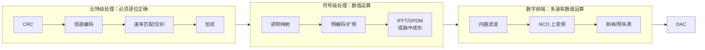

# 数据集与实验清单（讨论稿）

> 2026-10-11。动手做实验之前先定范围：通信链路里有哪些算子、哪些适合本课题、选哪几条链做数据集、要做哪些实验。
> 算子的详细规格见 `thesis/CATALOG.md`，本文只做筛选和安排。

---

## 1. 各代通信系统的基带链路

### 1.1 所有标准共用的结构

不管是 3G、4G、5G、Wi-Fi 还是软件无线电，基带硬件都可以分成三段：



接收端是反过来的：ADC → 数字前端（DDC、抽取、AGC）→ 同步 → FFT 或 Rake → 信道估计与均衡 → 软解调 → 译码。

### 1.2 各标准的差别

| 系统 | 波形 | 数字前端 | 同步 | 核心变换 | 均衡/检测 | 软解调 | 信道译码 |
|---|---|---|---|---|---|---|---|
| **3G WCDMA** | CDMA，码片速率 3.84 Mcps | DDC + RRC 匹配滤波（滚降 0.22） | 路径搜索（相关器） | Rake：解扰 + OVSF 解扩 + 积分 | MRC 合并 | QPSK/16QAM | Turbo / 卷积码 |
| **4G LTE** | OFDM（下行）/ SC-FDMA（上行） | DDC + 抽取 | PSS/SSS 相关 | FFT（128–2048 点） | LS 信道估计 + 插值，MMSE MIMO 检测 | 至 64/256QAM | Turbo |
| **5G NR** | CP-OFDM / DFT-s-OFDM | DDC + 抽取，多种子载波间隔 | PSS/SSS，DMRS | FFT（至 4096 点） | DMRS 信道估计，MMSE/球形检测 | 至 256/1024QAM | LDPC / Polar |
| **Wi-Fi 802.11a/g/n** | OFDM，64 点 | DDC | 短/长训练序列相关，CFO 估计（atan2） | FFT 64 点 | 长训练序列平均 + 导频相位校正 | 至 64QAM | 卷积码（Viterbi） |
| **SDR 单载波** | PSK/QAM | DDC：NCO + CIC + 半带 + FIR | Gardner 定时 + Farrow 插值，Costas 载波环 | 匹配滤波 | 判决反馈均衡 | PSK/QAM | 视应用 |

资料来源见第 6 节。

---

## 2. 算子清单与筛选

### 2.1 筛选原则

本课题的方法只对满足下面三条的算子有意义：

1. **数值质量可以换面积**：存在近似实现，精度降一点，面积就小一点。
2. **有多种真正不同的结构**：不只是同一结构调参数。
3. **在链路中与前后级耦合**：前级的误差能被后级吸收或放大。这是"单算子最优 ≠ 整链最优"能成立的前提。

比特级处理（CRC、加扰、交织、速率匹配、OVSF 码生成）必须逐位正确，没有精度取舍，**不在本课题范围内**。信道译码（LDPC、Turbo、Viterbi）有近似空间（如 min-sum、量化位宽），但规模大、评价要跑 BER，先不做。

### 2.2 算子清单

"仓库"一列：✅ 已有单算子任务和评价；🔶 已在 DDC 链里用原语搭过；⬜ 还没做。

| 类别 | 算子 | 用在哪里 | 可选结构（变换空间） | 质量指标 | 仓库 |
|---|---|---|---|---|---|
| 数字前端 | NCO / 正余弦 | 全部 | 整表、1/4 波表、粗表 + 插值、CORDIC、多项式 | SFDR、SQNR | ✅ 🔶 |
| | 复数混频 / 复乘 | 全部 | 直接 4 乘、3 乘（Karatsuba）、截位方式 | SQNR | ✅ 🔶 |
| | 抽取 / 内插 FIR | 全部 | 直接型、对称折叠、多相、多级、半带、分时复用 | 混叠抑制、纹波 | ✅ 🔶 |
| | CIC + 补偿 | SDR、3G–5G | 级数、差分延迟、Hogenauer 截位 | 混叠、通带下垂 | 🔶（专家模板） |
| | RRC 成形 / 匹配滤波 | 3G、SDR | 对称、多相、系数量化、CSD 移位加 | EVM、ACLR | ⬜（mfilt 族相近） |
| | AGC（幅度、log、环路） | 全部 | α·max+β·min、CORDIC、查表 | 建立时间、稳态误差 | ⬜ |
| 同步 | 相关器（训练序列、PSS） | 4G、5G、Wi-Fi、3G | 符号位相关、滑动累加、分时复用 | 检测概率 | ⬜ |
| | atan2（CFO 估计） | Wi-Fi、OFDM | CORDIC 向量模式、查表、多项式 | 角度误差 | ✅ |
| | 相位旋转（CFO 校正） | OFDM | NCO + 复乘，或 CORDIC 旋转 | EVM | 🔶 |
| | Farrow 插值 / Gardner | SDR | 多项式阶数、多相表 | 定时 EVM | ⬜ |
| 核心变换 | FFT / IFFT | 4G、5G、Wi-Fi | radix-2/4/2²、流水/迭代、旋转因子用表或 CORDIC、缩放方式 | SQNR、EVM | ⬜（有 fft64 草稿） |
| | 解扩 + 积分（Rake） | 3G | ±1 乘退化为加减、分时复用 | SNR | ⬜ |
| 均衡 | LS 信道估计 + 插值 | 4G、5G、Wi-Fi | 平均、线性插值、滤波插值 | NMSE | ⬜ |
| | 倒数 / 除法（均衡） | OFDM | 查表、Newton 迭代、CORDIC、乘共轭后推迟除法 | EVM | ⬜ |
| | MMSE MIMO 检测（2×2） | 4G、5G | 直接求逆、QR、近似求逆 | BER、EVM | ⬜ |
| 软解调 | LLR 计算（至 64/256QAM） | 4G、5G、Wi-Fi | max-log、分段线性、查表校正 | LLR 误差、BER | ✅ |

### 2.3 与现有 LLM 硬件基准的关系

现有基准里的 DSP 题很少，而且只考功能正确：

- RTLBench 有 11 个 DSP 题，如 4 抽头 FIR、8 点 FFT、8/16 位 CORDIC；
- ArchXBench 有 FFT、FIR/IIR 流水线设计；
- VerilogEval、RTLLM、CVDP 以通用逻辑为主。

这些基准的规格是"自然语言描述 + 测试平台"，评价标准是逐位通过。我们的数据集有三点不同，这本身可以作为一项贡献：

- **规格是三元组**：数学公式 + 允许空间 + 指标（见 3.1）；
- **评价看 PPA 的 Pareto 前沿**，而不是通过率（见 3.2）；
- **对象是整条链**，不是孤立的小模块。

---

## 3. 数据集设计

### 3.1 规格：公式 + 允许空间 + 指标

每个任务（单算子或整条链）都用同一种三元组来描述：

| 组成 | 含义 | DDC 链的例子 |
|---|---|---|
| **公式 F** | 理想的数学行为，用实数或复数定义，不含任何实现信息 | `y[m] = (h * (x[n]·e^{-j2πf·n}))[mR]`，h 是任意满足指标的低通 |
| **指标 M** | 怎么度量实现与理想行为的差距。每类任务用它自己领域里通行的指标 | 强阻塞下的带内 SNR；通带纹波 |
| **允许空间 T** | 指标必须落在的范围，也就是允许偏离理想行为多少。再加上接口约束（输入输出位宽、速率、时延上限） | SNR ≥ 理想接收机 − 2 dB；纹波 ≤ 0.3 dB；输入 14 位、输出 16 位 |

再配上**测试场景**：干扰覆盖全部相关频带，搜索场景与留出场景分开。

这样做有三个好处：
- 不同任务可以用不同的指标（见下表），但格式统一，裁判可以做成通用的：算指标、判断是否落在允许空间内。
- "允许空间"明确划出了近似变换的合法范围。只要落在里面，任何实现都算正确。
- 同一个公式配上不同松紧的允许空间，就得到难度不同的一组规格。

**各类任务使用的指标**

| 任务类型 | 指标 M | 允许空间 T 的典型写法 |
|---|---|---|
| NCO / 正余弦 | SFDR、SQNR | SFDR ≥ 80 dBc |
| 抽取 / 接收滤波链 | 带内 SNR（含混叠）、纹波 | SNR ≥ 理想 − Δ dB |
| 成形 / 发射链 | EVM、邻道泄漏比 ACLR | EVM ≤ 2%，ACLR ≥ 45 dB |
| FFT | 输出 SQNR | SQNR ≥ 60 dB |
| 信道估计 | 归一化均方误差 NMSE | NMSE ≤ 理想 + Δ dB |
| 均衡 + 软解调 | LLR 误差，或未编码 BER 的 SNR 损失 | 在目标 BER 处损失 ≤ 0.2 dB |
| 同步（检测、CFO 估计） | 检测概率、频偏估计误差 | 误差 ≤ 给定门限 |

### 3.2 评价：在允许空间内比较 PPA 的 Pareto 前沿

质量和代价分开处理：

- **质量是约束。** 设计必须在搜索场景和留出场景上都落在允许空间内，否则不计入。
- **代价是多目标。** 对达标的设计，报告硬件的三项指标：

| 指标 | 含义 | 怎么得到 | 现状 |
|---|---|---|---|
| **面积 A** | 标准单元面积 | Yosys + ABC，Nangate45 | 已有 |
| **性能 P** | 最高时钟频率（关键路径）、每个输出样点需要的周期数 | ABC 的时序报告；后续用 OpenSTA / OpenROAD | 待补，工作量小 |
| **功耗 P** | 动态 + 静态功耗 | 仿真得到翻转率，再用 OpenSTA 估算 | 待补，工作量中等 |

- **用 Pareto 前沿比较方法。** 每种方法在每个规格上产生一组达标设计，取其 PPA 上的非支配集。比较时使用三个量：
  1. **超体积（hypervolume）**：前沿覆盖的体积，越大越好，是多目标优化里的标准指标；
  2. **支配关系**：方法 A 的前沿上有多少个点支配方法 B 的点；
  3. **固定约束下的单项指标**：例如"满足 200 MHz 时钟时的最小面积"，方便读者直观理解。
- **质量–代价曲线。** 对同一公式放宽或收紧允许空间（例如允许损失 0.5、1、2、3 dB），得到"质量换代价"的曲线，用来展示近似变换的价值。

注意：目前所有结果只有面积一项。引入时序后，搜索目标要从"最小面积"改为多目标，OpenEvolve 本身的 MAP-Elites 网格支持这一点，但已有实验需要重跑。

### 3.3 三层结构

**第 1 层：单算子（已有）。** 7 个算子族，106 个实例：复乘、正余弦、NCO、FIR、atan2、LLR、匹配滤波。用途是给"逐级最优"提供来源（实验 E2.1），以及验证表示的通用性。

**第 2 层：链路（主实验）。** 从 3 条扩到 8 条，覆盖 3G、4G、5G、Wi-Fi 和软件无线电的主要数值模块。

| 编号 | 链路 | 组成 | 指标 | 来源系统 | 难度 | 状态 |
|---|---|---|---|---|---|---|
| **A** | 接收 DDC | NCO → 混频 → 多级抽取滤波 | 带内 SNR、纹波 | 全部 | — | **已完成**（6 开发 + 6 留出规格） |
| **B** | 发射 DUC | RRC 成形 → 多级内插 → NCO 上变频 | EVM、ACLR | 3G、SDR | 低：与 A 对称，加一个内插原语 | 待做 |
| **C** | OFDM 发射 | QAM 映射 → IFFT → 加循环前缀 → 加窗/滤波 | EVM、带外泄漏 | 4G、5G、Wi-Fi | 中：需要 FFT 和按帧处理 | 待做 |
| **D** | OFDM 接收内环 | CFO 校正 → FFT → 信道估计 → 均衡 → LLR | EVM、BER 损失 | 4G、5G、Wi-Fi | 高：级数多，含除法 | 待做 |
| **E** | 突发同步前端 | 延迟自相关 → 包检测 → CFO 估计（atan2）→ 相位旋转 | 检测概率、频偏误差 | Wi-Fi、5G | 中：全是前馈结构 | 待做 |
| **F** | 多相信道化器 | 原型滤波器多相分解 → FFT → 多路子带 | 子带泄漏、EVM | SDR、多载波基站 | 中 | 待做 |
| **G** | WCDMA Rake 支路 | RRC 匹配滤波 → 解扰解扩 → 积分 → MRC 合并 | 合并后 SNR | 3G | 中 | 待做 |
| **H** | 分数倍重采样 | 抗混叠滤波 → Farrow 插值（开环） | EVM、镜像抑制 | SDR、多标准 | 中 | 待做 |

选择依据：
- A、B、F、H 是多速率滤波类，结构变换最丰富；
- C、D 是变换域类，级间共用误差预算，耦合最强；
- E、G 是相关与合并类，有大量"乘法退化为加减"的机会；
- 8 条链全部是前馈结构，现有编译器不需要支持反馈环。

每条链配 3 个开发规格 + 3 个留出规格（链 A 保持 6 + 6），总计 54 个规格。每条链另配一份教科书结构的专家模板作参考上限。

**第 3 层：扩展。** 含反馈环的同步（Gardner 定时环、Costas 载波环、AGC 环）、2×2 MMSE 检测。需要编译器支持反馈，放在论文之后。

### 3.4 通用框架：新增一条链只写一份规格文件

原则：**不为每条链单独改系统。** 新增算子或链路时，只写一份约 30 行的规格文件，其余自动生成。

**同一段原语程序有两种解释**：浮点解释是公式，定点解释是硬件。LLM 的工作是在浮点语义落在允许空间内的前提下，改写定点实现。

| 环节 | 现在（绑定 DDC） | 通用做法 |
|---|---|---|
| 公式 F | 写在裁判代码里 | 用原语写一遍理想版（浮点、不限位宽），它既是参考答案也是规格 |
| 直写起点 | 手写 `naive.py` | 自动生成：理想版的每个运算换成足够宽的定点运算，位宽由区间分析推出 |
| 测试信号 | 每条链单独写 | 信号库，按名字选用：多音 + 全频带阻塞、QAM/OFDM 调制帧、噪声、信道 |
| 指标 M | 每条链单独写 | 指标库，按名字选用：SNR、EVM、ACLR、SFDR、NMSE、纹波、BER 损失；统一处理时延、增益、相位对齐 |
| 允许空间 T | 手填门槛 | 自动计算：理想版在同一批信号上的成绩 − 允许损失 |
| 提示词 | 手写 | 由规格文件自动拼出 |
| 专家参考 | 手写模板 | 可选：任何现成 Verilog（如开源 USRP DDC、OpenOFDM）接到同一裁判上打分 |
| 逐级拆分 | 无 | 理想版用 `scope` 标出各级，系统自动在边界切开得到每级的子规格 |

**规格文件示意**

```python
task = Task(
    name="ddc_r16_wide",
    ideal=lambda g, p: g.decimate(g.lowpass(g.input() * g.exp(-2j*pi*p.f_if*g.n()), p.passband), p.R),
    params=dict(R=16, f_if=0.1937, passband=0.80),
    interface=dict(in_bits=14, out_bits=16),
    stimulus="tones_with_dense_blockers",
    metric=["inband_snr", "passband_ripple"],
    tolerance=dict(inband_snr="ideal - 2.0 dB", passband_ripple="<= 0.3 dB"),
)
```

**需要一次性补齐的通用能力**（与具体链路无关）：
- 原语：内插（上采样）、按帧处理（串并转换）；
- 数学级运算：`exp`、`sqrt`、`atan2`、`1/x` 等。在理想版里直接使用；在直写起点里自动展开成大查找表，交给 LLM 优化；
- 信号库和指标库。

**由此得到的新实验：**
- 接入成本：每条链的规格行数和人工时间；
- 跨链迁移：把 LLM 在链 A 上发现的子结构存成库，看能否让链 B 更快收敛。

### 3.5 可行性评估后的两处修正

实验会话对照现有代码评估后，方案有两处调整。

**修正 1：参考答案 = 理想版程序作用在"干净输入"上。**
如果直接拿理想版的输出当参考，候选只要群时延或通带形状不同，就会被算成误差；而且理想版和自己比误差为零，定不出门槛。所以信号库要同时提供两路输入：

| 量 | 定义 |
|---|---|
| 参考 | 理想版（浮点）作用在**干净输入**上 |
| 上限 | 理想版（浮点）作用在**带损伤输入**（阻塞、量化、噪声）上的得分 |
| 门槛 | 上限 − 允许损失 |
| 候选得分 | 候选输出与参考比较，对齐由指标库统一处理 |

这和链 A 现在的做法等价，所以链 A 可以原样回归。

**修正 2：理想版要用"数学级运算库"来写。**
`lowpass`、`exp(−jωn)`、`sqrt`、`atan2`、`1/x` 是数学级运算，不是现有的硬件原语。每个数学级运算带两样东西：
- 浮点语义，用于理想版；
- 默认的直写定点展开，用于自动生成起点。例如 `exp` 展开成计数器加大查找表，`lowpass` 展开成按指标设计的长 FIR。位宽由区间分析给出。

### 3.6 现有代码的通用程度

| 部分 | 状态 |
|---|---|
| 原语、时序对齐、Verilog 生成、逐位整数语义、代价统计、诊断 | 已通用 |
| 进化驱动、Verilog 评价通路、综合、面积校准、曲线与祖先链导出 | 已通用 |
| 裁判（场景、参考、打分、上限） | 绑定 DDC，要拆成信号库、参考生成、指标库 |
| 规格数据结构、提示词 | 绑定 DDC，要换成通用的任务规格 |
| 编译器的输入输出接口 | 有三处硬编码（单路实数输入、固定 I/Q 输出、输出速率），要改成由接口声明决定 |
| 专家模板、手写起点 | 链 A 专用，保留作为回归锚点 |

### 3.7 分步计划（约 6–8 个工作日）

| 步骤 | 内容 | 工作量 |
|---|---|---|
| 1 | 拆裁判为信号库、参考、指标库；引入任务规格；提示词自动拼出；**链 A 回归** | 2 天 |
| 2 | 浮点解释、数学级运算库、区间分析、自动生成直写起点 | 1.5–2 天 |
| 3 | 内插原语、**链 B（DUC）**、EVM 与 ACLR 指标 | 1–1.5 天 |
| 4 | 按帧处理、FFT 类链路 | 2–3 天，不确定性最大 |

**链 A 的回归断言**（防止重构时悄悄改了语义）：
- 新框架算出的上限和门槛与现有数值逐位相同；
- 自动生成的直写起点与手写起点逐位一致，或至少裕量差 < 0.1 dB、面积差 < 5%；
- 已有的 6 个 LLM 最优程序和 6 个专家最优设计重新打分，裕量和面积与主表完全一致。

**接入顺序**：链 A 回归 → 链 B（DUC）→ 一个带数学级运算的单算子（atan2，验证"大表展开 + LLM 优化"）→ 突发同步 → FFT 类链路。

### 3.8 风险

1. **直写 FFT 的规模。** 64 点的直写 DFT 约 1.6 万个常数乘法，Verilog 会到几百 MB，真实综合基本不可行。对策：起点只报校准面积，优化后的设计再做真实综合；或先用 16 点。
2. **指标的通用对齐。** 帧类输出要做帧同步；BER 类指标需要解调器；检测类指标输出的是判决而不是波形。指标库每加一类都要单独验证。
3. **LLM 成功率可能随链路复杂度下降。** 链 A 上种群达标率约 50%–70%，更复杂的链可能更低，费用也会上升。
4. **评价器漏洞会重演。** 每条新链的信号库都要有全覆盖的干扰和留出场景，这部分没法完全自动化，需要人工把关。
5. 含反馈环的链路暂不支持。

---

## 4. 实验清单

按主线的三个挑战组织。"费用"指 DeepSeek API。

### 挑战 1：LLM 应该在什么表示上做变换

| 编号 | 实验 | 要回答的问题 | 状态 | 费用 |
|---|---|---|---|---|
| E1.1 | 原语程序 vs 直接写 Verilog（B1），同模型、同预算、同反馈 | 原语表示是否让 LLM 更容易做出结构变换 | 流程已搭好，未跑 | 约 ¥20 |
| E1.2 | 一次性生成 vs 进化式修改 | 小步修改是否必要 | 已有（v1 裁判下 9/80、1/80），建议在 v2 下重跑一小组 | 约 ¥5 |
| E1.3 | 演化路径分析 | LLM 实际做了哪些变换，面积降在哪一步 | **已完成**（2 个规格） | 0 |
| E1.4 | 编译正确性：RTL 与整数模型逐位对拍 | 表示到硬件是否可信 | **已完成** | 0 |

### 挑战 2：单算子最优不等于整链最优

| 编号 | 实验 | 要回答的问题 | 状态 | 费用 |
|---|---|---|---|---|
| E2.1 | **逐级最优再拼接 vs 整链优化**。把系统误差预算平均分给各级，每级在局部指标下做到面积最小，再拼成整链；与整链联合优化比较 | 同样的系统 SNR 下，整链优化能省多少面积 | **待做，最关键** | 0（用模板搜索） |
| E2.2 | 误差预算分配分析：整链最优解中各级实际占用的误差份额 | 最优分配是否明显偏离平均分配 | 待做，随 E2.1 | 0 |
| E2.3 | 裁判的完整性：稀疏测试 vs 全频带覆盖 | 系统指标定义不完整时会发生什么 | **已完成**（v1/v2，74 个设计） | 0 |
| E2.4 | LLM 的跨级变换案例 | LLM 是否做出了跨级的改动（如前级放宽、后级补偿） | 待做，从已有程序中分析 | 0 |

### 挑战 3：怎么让 LLM 更高效地发现变换

| 编号 | 实验 | 要回答的问题 | 状态 | 费用 |
|---|---|---|---|---|
| E3.1 | LLM vs 非 LLM 程序搜索（B3 两种变异） | LLM 本身是否有价值 | **已完成**（0.131 vs 0.87） | 0 |
| E3.2 | 反馈档位：分数 / 指标 / 经验证的诊断 | 什么反馈最有效 | 已有 6 对（−48%，p≈0.11），需补种子 | 约 ¥15 |
| E3.3 | 联合 vs 按角色分阶段 | 决策应如何分工 | **已完成**（开发集和留出集均 p<0.001） | 0 |
| E3.4 | **分工混合：LLM 定结构 + 确定性工具定位宽和复用** | 能否缩小与专家的差距 | 待做 | 约 ¥15 |
| E3.5 | 领域知识增强 | 补充多速率知识是否有用 | 单种子，未见收益；需改进方式后重做 | 约 ¥7 |

### 总体结果与泛化

| 编号 | 实验 | 状态 | 费用 |
|---|---|---|---|
| E4.1 | 主表：直写起点 / B1 / B3 / 本方法 / 专家，6 个开发规格，真实面积 + 留出场景 | 除 B1 外已完成（单种子） | 含在 E1.1 |
| E4.2 | 补到 3 个种子 | 待做 | 约 ¥25 |
| E4.3 | 6 个留出规格上复验本方法 | 待做 | 约 ¥10 |
| E4.4 | 在链 B–H 上重复主表（每条约 ¥20–30） | 待做 | 约 ¥150–200 |
| E4.6 | 加入时序后改为 PPA 多目标搜索，报告 Pareto 前沿与超体积 | 待做，需先补时序工具 | 链 A 约 ¥20 |
| E4.5 | HLS 基线（B2） | 暂缓，需 x86 Linux 环境 | 0 |

### 建议的顺序

1. **不花钱，马上做**：E2.1、E2.2、E2.4；给评价流程补上时序（关键路径）一项。
2. **充值后第一批（约 ¥50）**：E1.1（B1）、E3.4（分工混合）、E3.2 补种子。
3. **第二批（约 ¥65）**：E4.2 补种子、E4.3 留出规格、链 B 和链 E。
4. **中期之后**：其余链路、PPA 多目标（E4.6）、HLS 基线。

中期报告用第 1、2 步的结果就够了；第 3 步的结果用于论文。

---

## 5. 需要你确认的问题

1. 8 条链的选择是否合适？有没有你特别想加或想去掉的？
2. E2.1 里"逐级最优"的做法是：把误差预算平均分给各级。是否还要加一种"按经验比例分"的对照？
3. PPA 三项里，功耗估算工作量较大。是否先做面积 + 时序两项，功耗放到论文阶段？
4. 预算：链 A 上的第 1 批约 ¥50；8 条链全部做完约 ¥200–300。

---

## 6. 资料来源

- 5G NR 处理链：[ShareTechNote PDSCH](https://www.sharetechnote.com/html/5G/5G_PDSCH.html)、[PUSCH](https://www.sharetechnote.com/html/5G/5G_PUSCH.html)；[TS 38.212 LDPC/Polar 指南](https://www.cafetele.com/articles/article-ldpc-polar-coding-3gpp.html)；[5G NR 软件收发机原型（arXiv 1908.04376）](https://arxiv.org/pdf/1908.04376)
- LTE：[LTE-A 下行物理层 FPGA 实现](https://www.academia.edu/116690036/FPGA_Implementation_of_LTE_Advanced_Downlink_Physical_Layer_Transceiver)；[PSS/SSS 同步器 FPGA 实现](https://www.researchgate.net/publication/286359711_Architecture_and_FPGA_implementation_of_LTE_PSS_and_SSS_synchronizer)；[MathWorks LTE 下行空间复用示例](https://lost-contact.mit.edu/afs/inf.ed.ac.uk/group/teaching/matlab-help/R2013b/comm/examples/lte-phy-downlink-with-spatial-multiplexing.html)
- WCDMA：[Rake 接收机 ASIC 实现（学位论文）](https://www.diva-portal.org/smash/get/diva2:1023795/FULLTEXT01.pdf)；[NXP AN2253 Rake 信道估计](https://www.nxp.jp/docs/en/application-note/AN2253.pdf)；[RRC 滤波器的分布式算法实现](https://ieeexplore.ieee.org/document/1439108/)
- SDR：[SDR FPGA 核与领域专用语言（Tsoeunyane 2017）](https://onlinelibrary.wiley.com/doi/10.1155/2017/3925961)；[软件无线电中的载波与定时恢复](https://academia.edu/8155378/Synchronization_in_Software_Radios-Carrier_and_Timing_Recovery_Using_FPGAs)；[FPGA 上的 AGC](https://www.researchgate.net/publication/261263692_Automatic_Gain_Control_on_FPGA_for_Software-Defined_Radios)；Ettus USRP `ddc_chain.v`（见 [arXiv 1803.01438](https://arxiv.org/pdf/1803.01438) 的引用）
- Wi-Fi 开源实现：[OpenOFDM](https://github.com/jhshi/openofdm)（[文档](https://openofdm.readthedocs.io/en/latest/eq.html)）；[openwifi-hw](https://github.com/open-sdr/openwifi-hw)；[无授权 IP 的分支](https://github.com/Tobias-DG3YEV/openofdm)
- LLM 硬件基准：[RTLBench](https://www.researchgate.net/publication/399211061_RTLBench_A_Multi-Dimensional_Benchmark_Suite_for_Evaluating_LLM-Generated_RTL_Code)；[ArchXBench](https://arxiv.org/pdf/2508.06047)；[RTLLM](https://arxiv.org/pdf/2308.05345)；[OpenLLM-RTL](https://arxiv.org/abs/2503.15112)

说明：第 1.2 节表中各标准的参数（如 WCDMA 码片速率、FFT 点数范围、调制阶数）部分来自上述资料，部分来自通用教材知识，正式写进论文前需对照 3GPP 规范原文核实。
