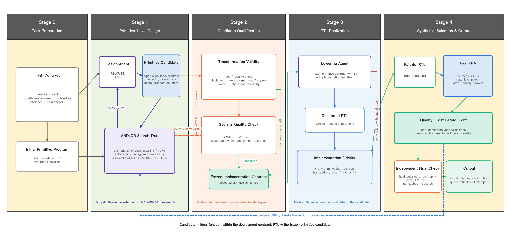

# VeriEvolve 整体架构 v5（设计稿）

> 2026-10-16。本文件定义问题、三个贡献、整体架构、疑点回应与实验设计。实验数字一律不在此处出现。
> 框架图：`figures/v5/fig_framework_v5.png`（脚本 `figures/make_flow_v5.py`）；可视化编辑源为 `figures/v5/fig_framework_v5.drawio`，可用 diagrams.net / draw.io 打开后逐项修改。

---

## 0. 一句话

**问题**：给定数学公式 F、系统质量指标 Q（含信号环境与容差 p）、接口 I，由 LLM 自动设计满足系统容差、在目标时钟下时序收敛、且面积与功耗尽可能小的 Verilog。

**方法**：LLM 先在一种可执行的原语表示上设计“算什么、承诺怎样造”，**误差在这一阶段就被显式声明并按系统容差允许**；通过的候选冻结为契约，再由 LLM 写成 RTL，此时不再允许任何误差，系统判定 RTL 是否逐位忠实于契约，并以真实 PPA 反馈驱动下一轮设计。

**核心思想**：误差只在设计阶段被允许，实现阶段零容忍。

---

## 1. 为什么难：三个挑战，对应三个贡献

### 挑战一（表示）：LLM 应该在什么对象上做设计？

- **直接写 RTL**：算法结构、定点精度、微结构和 Verilog 编码混在一次生成里，出了问题无法定位；HINT 的实验也说明直接生成的 QoR 不稳定。
- **写 HLS C++**：调度、绑定、存储组织都由工具决定，设计决策不可见；多速率需要手写 dataflow。
- **自研编译器把原语直接编译成 RTL**：我们自己试过。每一种状态、速率、微结构都要补 lowering 规则，覆盖面有限；而且一个原语只有一种固定实现，编译器的实现偏好会被固化进所有候选。

→ **贡献一：可执行的通信 DSP 原语契约。**

### 挑战二（判定）：在“允许近似”的前提下，怎样判定一个设计是对的？

- 通信 DSP 的正确性不是“与公式逐位相等”，而是“系统指标在容差内”。没有逐位的标准答案，测试通过/不通过的判定方式用不上。
- 更关键的是：**有意的近似和无意的错误，从输出上看可能一模一样。** 一个 LLM 写错的符号位、只在大幅值输入时触发的溢出、帧边界上差一拍，都可能在搜索场景上仍然满足 SNR 门槛，却在部署中失效。只看系统指标，无法把二者分开。

→ **贡献二：双关系分段判定。**

### 挑战三（搜索）：设计空间同时跨越四个层次，而评价很贵。

- 设计空间 = 算法结构 × 定点精度 × 微结构 × RTL 编码。
- 评价代价相差三个数量级：原语执行与容差判定是秒级，LLM 写 RTL 要数分钟和大量 token，真实综合与门级功耗也是分钟级。
- agent 需要知道：该改结构还是调精度？是设计本身不够好，还是 RTL 写得不好？

→ **贡献三：自适应粒度 AND/OR 设计树与设计—实现双环智能体搜索。**

### 三者的因果链

```
贡献一：能表示 ──> 贡献二：能判定 ──> 贡献三：能搜索
（候选可执行，        （区分有意近似与         （按判定结果把失败
 近似点显式）          无意错误，分段把关）      送到正确的环）
```

每个贡献都依赖前一个：没有显式的近似点，就无法区分近似与错误；没有分段判定，双环搜索就不知道失败该回哪个环。

---

## 2. 整体架构



这张图是**唯一的总架构图**，只按执行顺序展示任务输入、原语级设计、候选判定、RTL 实现和
综合输出。AND/OR 树、G0--G5 的具体分支以及逐位等价继承规则属于方法细节，分别在方法三和
方法二的细节图中展开，不在总图中前置。

### 2.1 一次迭代的数据流

1. **设计 Agent** 从 AND/OR 设计树的可行或近可行前沿选择一个待展开节点：REWRITE 改结构或区域分解，TUNE 改精度或微结构承诺，并声明变换类别。
2. 原语程序**双重执行**：理想解释得到“无量化的同一结构”，定点解释得到逐位整数模型。
3. **候选级判定**（秒级，不写 RTL）：
   - G0 静态检查：类型、速率、区间；
   - G1 变换核实：T1 / T2 / T3；
   - G2 容差门：系统指标的松弛量是否不低于裕量。
4. 通过的候选**冻结为实现契约**：整数模型参考序列、接口与时序要求、微结构承诺、分段标识。
5. **Lowering Agent** 按契约写 RTL，可以产生多个实现，作为同一冻结契约下的 OR 实现子节点。
6. **实现级判定**：
   - G3 一致性门：RTL 与整数模型逐位一致，并满足契约；
   - G4 真实综合 PPA。
7. 报告按门分流：候选级失败与 PPA 回到设计 Agent；G3 失败回到 Lowering Agent 做局部修复，修不好再退回设计 Agent。
8. 预算用完后，从可行前沿中选点做 **G5 终验**（隐藏场景、统计复核、门级对拍、目标时钟）。

### 2.2 输入与输出

| | 内容 |
|---|---|
| 输入（用户写） | 公式 F；质量指标 Q（系统指标、信号环境、容差 p）；接口 I（位宽、速率、目标时钟） |
| 系统派生 | 任务参考模型、门槛、裕量、搜索/留出/统计复核场景、直写起点、预算 |
| 输出 | Verilog；PPA 报告；质量证据（各场景松弛、失败概率上界）；一致性证据（对拍记录、契约核对）；设计谱系 |

---

## 3. 贡献一：可执行的通信 DSP 原语契约

### 3.1 一句话

> **原语让误差在写 RTL 之前就被声明、被允许。** 误差只能经由显式的近似点（量化、系数、查表）进入；同一程序按理想与定点两种方式执行，于是每一处误差在设计阶段就能被枚举、测量，并按系统容差判定是否允许。一旦允许，候选就冻结为契约，RTL 阶段不再允许任何误差，必须逐位忠实。

展开说，原语把**数值语义**（定点类型、显式近似点、速率与状态）与**微结构承诺**（折叠、流水、存储、资源）分为两层：前者决定“允许哪些误差”，后者决定“怎样造”。

“提前允许误差”包含三层意思，缺一不可：

| | 含义 | 没有它会怎样 |
|---|---|---|
| 提前 | 在写 RTL 之前判定误差能否接受 | 只能在 RTL 上判定：慢，而且分不清误差来自设计还是实现 |
| 显式 | 误差只能从声明的近似点进入，可以枚举 | 有意近似与无意错误无法区分（见挑战二） |
| 系统级 | 能否接受由链路输出的系统指标决定 | 退化为逐算子误差指标（近似计算类工作的做法），层层留裕量，错过跨算子的误差折算 |

这也是与 HINT 的根本区别：HINT 的中间表示在写 RTL 之前就要求与 oracle 精确一致，不允许任何误差；我们的原语在这一阶段**主动允许**误差，并把允许的范围交给系统容差来定。

### 3.2 三个设计决定，以及每个决定换来什么

| 设计决定 | 内容 | 换来什么（供贡献二、三使用） |
|---|---|---|
| **近似点显式化** | 两种解释只在三类原语上不同：量化 `q(格式, 舍入, 溢出)`、系数 `const(值, 格式)`、查表 `lut(f, 地址位, 输出格式)`。其余运算（加减乘、移位、延迟、抽取等）在两种解释下精确一致 | 全部误差来源可以枚举；区间分析能证明“对契约输入类不饱和、不回绕”；有意近似必须经过声明，未声明的偏差就是错误 |
| **双重解释** | 同一程序：理想解释（量化取恒等、系数取精确值、查表取 f(x)）与定点解释（逐位整数） | 结构误差与精度误差分开测量（见 4.3），用来指导 REWRITE 或 TUNE；T2 判定有了严格定义 |
| **数值层 / 承诺层分离** | A 层决定逐位结果；B 层只决定周期、资源与面积，不改变整数模型 | 只改 B 层的修改构造上逐位等价，免检并继承质量结论；A 层由候选级判定把关，B 层由实现级判定把关 |

### 3.3 A 层：数值语义层

| 类别 | 原语 |
|---|---|
| 类型 | 定点 `s<W>.<F>` / `u<W>.<F>`；复数用 (re, im) 二元组（构造函数库），帧由 `reframe` / `interleave` 表达 |
| 精确运算 | `add` `sub` `neg` `mul` `shift` `cmp` `abs` `min` `max` `select`；位逻辑；带进位加减 |
| 近似点 | `q` `const` `lut` |
| 时间与状态 | `delay(n)`；`state` / 反馈（`integrate`、`counter` 为语法糖） |
| 速率 | `decimate(R, phase)`、`interpolate(R)`、`repeat(R)`；速率是相对输入样点率的有理数，同速率信号按样点序号配对（与相位无关，时延对齐交给 lowering） |
| 块 | `reframe(x, n_in, picks)`（串并、帧内重排、去 / 加循环前缀）、`interleave([s0, s1, …])`（并串） |
| 接口 | `input`、`output`（携带速率与 valid 协议） |

### 3.4 B 层：微结构承诺层

承诺挂在分段（`scope`）上，可以留空；留空的部分由 Lowering Agent 自由选择。

| 承诺 | 含义 |
|---|---|
| `fold(scope, k)` | 时分复用因子（I/Q 交织即 `fold=2`） |
| `resource(scope, mul≤m, …)` | 运算单元数量上限 |
| `pipeline(scope, latency≤L)` | 该段的延迟上限 |
| `storage(scope, reg / srl / ram)` | 延迟线与帧缓存的存储方式 |
| `reset(scope, none / sync, warmup=n)` | 数据寄存器是否复位，以及暖机样点数 |
| `interface(II, latency≤L)` | 顶层吞吐与总延迟上限（必填） |

划分原则：会显著影响 PPA、且应由 PPA 反馈来决定的微结构（例如折叠、资源上限），作为承诺交给设计 Agent；局部编码选择（CSD 还是乘法器、寄存器写法）留给 Lowering Agent。

### 3.5 实现契约

候选通过 G2 后冻结为契约，内容包括：

- 各场景上整数模型的样点级参考序列；
- 接口：位宽、速率、valid 协议、II、延迟上限；
- 已填写的 B 层承诺；
- 分段标识：RTL 中必须保留对应标注，用于把综合后的面积与关键路径回映到分段；
- 暖机规则。

Lowering Agent 只能改变编码方式，不能改变契约。需要改契约时，只能退回设计环，生成新的候选。

### 3.6 与最近工作的区别

| | HINT（2608.07625） | 直接 RTL 进化（EvolVE、COEVO 等） | HLS / A2HCoder | 本课题 |
|---|---|---|---|---|
| 设计对象 | 受限 C 的硬件意图 | Verilog | HLS C++ | 两层 DSP 原语 |
| 数值语义 | 定宽整数 | 无 | `ap_fixed` | 定点类型 + 显式近似点 |
| 多速率 | 无 | 无 | 需手写 dataflow | 一等速率域 |
| 正确性 | 与 oracle 精确一致 | 测试通过 / 通过率 | 执行结果核对 | 候选 ≈ 公式（容差）；RTL ≡ 候选（逐位） |
| 搜索 | 无（接受即冻结） | 有（只在 RTL 上） | 位宽 DSE | 双环：契约 × 实现 |

一句话区分 HINT：HINT 固定“精确功能下的硬件组织”；我们的原语表达“允许近似的数值计算及其硬件承诺”，并在容差内搜索。

### 3.7 查新结论：哪些不能说是新的，新意落在哪里

依据 2026-10-16 的 arXiv 查新（DAC/ICCAD 2026 正式论文列表与付费全文未逐篇核对）：

| 说法 | 结论 | 依据 |
|---|---|---|
| “首个面向 LLM 的可执行硬件中间表示 / 首个分离架构与 lowering 的流程” | **不能说** | HINT 已提出可执行硬件意图、承诺层、RTL 前验收与按契约的 agentic lowering |
| “双重解释是新的” | **不能单独说** | MATLAB `fi` + DataTypeOverride、SystemC `sc_fixed` 早有“同一代码切换浮点 / 定点运行”。双重解释只是机制 |
| “以输出质量为约束最小化代价是新的” | **不能说** | 这是经典字长优化（WLO）的标准表述（Constantinides、ID.Fix、MATLAB Fixed-Point Designer） |
| “首个 LLM 位宽优化 / 首个 LLM 质量—代价 Pareto” | **不能说** | HLSRewriter（逐变量精度损失下的 LLM 位宽调整）；2606.13089（LLM 协同进化近似乘法器，误差—面积 Pareto） |
| 通信 DSP 的 LLM 硬件设计 | 部分覆盖 | A2H-MAS 做了 5G SSB 与 WLAN 同步，但在功能等价约束下做位宽 DSE，验收无系统指标门 |
| **以通信系统指标为验收门、近似只能经显式近似点进入、写 RTL 前按 T1/T2/T3 判定候选** | **未发现覆盖** | — |
| **以质量松弛作为 DSP 系统级搜索的反馈与 Pareto 维度，并与 LLM 按逐位契约写 RTL 结合** | **未发现覆盖** | — |

**可辩护的总表述**：据我们所知，这是第一个这样的 LLM 智能体硬件设计流程：候选的接受准则是通信系统级指标的容差（SNR / EVM / 混叠抑制），所有近似都被约束在类型化程序中的显式近似点上，因此候选能在写 RTL 之前被判定为逐位等价、数学等价或近似；RTL 再由 Lowering Agent 按冻结的逐位契约实现。各子部件都有先例，新意在“近似显式化 + 写 RTL 前按系统容差允许误差”这一组合。

**与三篇最危险近邻的表述**：

- **HINT**：作为直接基础引用——“在 HINT 式可执行承诺层之上，引入数值语义层”。HINT 的接受准则是与 oracle 精确等价，类型只是定宽整数，首次综合即冻结、不做 QoR 搜索。
- **A2H-MAS**：它在功能等价约束下做位宽 DSE，验收为参考数据比对加按类别的阈值，没有系统指标门，lowering 交给 HLS。最好在同类基带模块上做直接对比。
- **HLSRewriter**：精度是逐变量的百分比损失，方法是逐变量 profiling 加单调增位，不做结构改写。我们以系统指标为约束，结构改写与精度联合搜索。

---

## 4. 贡献二：双关系分段判定

### 4.1 一句话

> 把正确性拆成两个关系，分在两段判定：**候选对公式**只要求系统可接受（容差内，统计判定，不写 RTL）；**RTL 对候选**要求实现忠实（逐位一致，并满足契约）。二者分开，系统才能区分有意近似与无意错误，并把每一种失败送回能修复它的那个环。

### 4.2 各门

**候选级（只在整数模型上做，秒级）**

| 门 | 检查 | 结果 |
|---|---|---|
| G0 静态检查 | 类型与速率推导；区间分析；B 层承诺是否合法（例如 1/32 速率的段最多 `fold=32`） | 失败为 BROKEN，返回错误位置 |
| G1 变换核实 | 按实际行为分类（agent 的声明只作对照）：**T1 逐位等价**——定点解释输出逐位相同（只改 B 层时构造上成立，免检）；**T2 理想等价**——理想解释相同、定点不同，即只改了精度（位宽、截位、系数位数、查表大小）或做了数学等价的重排；**T3 结构近似**——理想解释改变，即结构本身变了（换滤波器、FIR 换 CIC 等） | T1 继承父节点全部质量结论；T2 继承结构余量（理想解释的质量），只重测定点质量；T3 两种解释都重测。声明与实际不符时按实际类别判定并注明 |
| G2 容差门 | 搜索场景上，每条约束的松弛量 ≥ 安全裕量 | 达标为 FEASIBLE；差一点为 OPEN（保留，作为后续修改起点） |

**实现级**

| 门 | 检查 | 结果 |
|---|---|---|
| G3 一致性门 | ① 可综合、lint 通过；② RTL 输出的样点序列与整数模型逐位一致（允许固定的整体延迟，不超过上限；暖机样点按契约排除）；③ valid 模式满足 II；④ 资源承诺核对（综合前统计运算单元数）；⑤ 分段标注齐全。激励包括搜索场景、受约束随机输入，以及由区间分析导出的极值输入 | 失败返回 Lowering Agent：首个失配样点、所在分段、违约项 |
| G4 PPA | 真实综合、STA、门级仿真功耗 | 返回设计 Agent：面积、时序、功耗、相对父节点的变化量、关键路径所在分段 |
| G5 终验 | 留出场景 + 统计复核场景（给出失败概率的 95% 置信上界）；额外的独立随机一致性测试；门级网表对拍；目标时钟 wns ≥ 0 | 只返回通过或未通过 |

**T2 / T3 的划分为什么有原则**：双重解释把“改精度”与“改结构”在语义上分开了——精度原语（`q`、`const` 的位数、`lut` 的大小）在理想解释下都是恒等或精确值，所以只改精度不会改变理想解释；只有结构改变才会。这也对应两种修改粒度：T2 ≈ TUNE，T3 ≈ REWRITE。注意：交换律、结合律在全精度整数运算中逐位成立，所以“多相分解”这类不插入新量化点的重排是 T1；只有在重排中改变了量化点的位置，才会变成 T2。

### 4.3 双重解释带来的诊断：结构余量与精度余量

对每个候选，同时报告两个 SNR：

- **理想解释 SNR**：同一结构、不做量化时能达到的质量，即结构本身的上限；
- **定点解释 SNR**：实际实现的质量。

| 情况 | 含义 | 建议的修改粒度 |
|---|---|---|
| 理想解释也接近门槛 | 结构本身是瓶颈 | REWRITE（换结构） |
| 理想解释余量大，定点解释不达标 | 精度是瓶颈 | TUNE（加位宽、调截位） |
| 两者都有余量 | 还可以省 | TUNE（收窄精度）或修改 B 层（折叠、去流水） |

注意：存在有意的误差相消（例如用常数补偿截位偏置）时，两者之差不是严格可加的误差分解，只作为诊断，不作为归因。

### 4.4 失败分流

| 失败 | 去向 | 原因 |
|---|---|---|
| G0 / G1 / G2 | 设计 Agent | 设计本身的问题 |
| G3 | Lowering Agent（局部修复，最多 k 次） | 实现问题，契约是对的 |
| G3 反复失败，或承诺不可实现 | 设计 Agent | 契约本身无法实现（例如折叠因子太大，时序不收敛） |
| G4 | 设计 Agent；也可要求对同一契约重新实现 | PPA 由设计和实现共同决定 |

### 4.5 备选方案（公认方法）

| 环节 | 主方法 | 备选 |
|---|---|---|
| RTL 实现 | Lowering Agent | 确定性编译器（现有 `dspgen`，覆盖已支持的子集）；HLS（Vitis HLS、Bambu） |
| G3 | 样点级逐位对拍 | 小模块且延迟一致时，用形式等价（Yosys eqy）与确定性编译器的 RTL 比对 |

---

## 5. 贡献三：自适应粒度 AND/OR 设计树与设计—实现双环智能体搜索

### 5.1 一句话

> 外环用自适应粒度 AND/OR 树组织原语设计：OR 节点保留同一问题的不同实现选择，AND 节点表示一次分解后必须共同成立的子区域；内环在冻结契约下继续保留多个 RTL 实现分支。两环由贡献二的判定结果连接，所有调用与综合都计入同一预算。

### 5.2 AND/OR 树的严格含义

- **OR 节点：待实现的区域问题。** 节点携带区域边界、输入输出类型、速率/状态/延迟契约及它所在的完整根程序。对它做不同的 `REWRITE`、`TUNE` 或采用不同结构，得到的是互斥的备选分支，最终可选其中之一。
- **AND 节点：一次具体分解或组合。** 例如把一个抽取滤波区域分解成 CIC、半带与补偿 FIR 后，三个子区域及其接口约束必须同时得到实现，才能组成该分支的完整候选。`FUSE` 会重新划定这一组子问题，而不是简单增加一个同层候选。
- **实现 OR 子节点。** 一个通过 G2 的冻结契约可以由 Lowering Agent 生成多个逐位忠实但 PPA 不同的 RTL；这些实现彼此是 OR 关系，不改变上层候选语义。
- **根级裁判。** 局部节点的质量和面积只用于选择展开位置、给界和诊断；每个组合分支都必须装配成完整原语程序，并在链路根重新经过 G0--G2。系统质量存在跨区域耦合，因此不能把局部 SQNR 或局部 Pareto 前沿直接相加后向上回传。

因此，**候选谱系树不自动等于 AND/OR 树**：只有“一个选择产生多个必须共同完成的子问题”时才是 AND；同一父节点下的多个完整候选只是 OR。本文不会把普通的父子档案换名成 AND/OR 搜索。

### 5.3 外环（设计）

- **搜索状态**：AND/OR 结构、每个物化出的完整原语程序、父子谱系、判定报告、动作、变换类别及实现子节点。根程序和所有已评价分支只追加、不覆盖。
- **动作**：REWRITE 可替换区域、分解为一组 AND 子区域或融合多个区域；TUNE 在当前区域边界不变时调整 A 层精度或 B 层承诺。
- **前沿**：可行前沿按（面积，质量松弛）排序，功耗作为第三维；近可行前沿按（缺口，面积）排序。
- **选择与回传**：优先展开非支配的 FEASIBLE 分支和缺口最小的 OPEN 分支；只把完整根候选实测得到的状态与质量--PPA 向上回传。BROKEN 分支剪枝，父节点及其他兄弟分支保留。
- **自适应粒度**：按 4.3 的结构/精度余量选择区域；连续若干次 TUNE 没有改进时扩大区域做 REWRITE，局部瓶颈清晰时缩小到单个参数或子区域。

### 5.4 内环（实现）

- 一个契约可以有多个实现子节点，每个子节点都单独过 G3、G4。
- 内环的动作：局部修复（G3 失败时）；对同一契约重新实现以改善 PPA（可选，计入预算）。
- 实现子节点必须保留谱系与全部调用记录。报告时可以取最好的一个，但成本按全部次数计。

### 5.5 预算与归因

- 统一预算：设计调用、lowering 调用、候选级评价、真实综合、终验，分别设上限并在工具层强制执行。
- 归因：同一批契约分别交给确定性编译器与 Lowering Agent，可以把 PPA 收益拆成“设计环的贡献”与“实现环的贡献”（见 7.3）。

### 5.6 当前实现与证据边界

- 现有 `dspgen/archive.py` 已实现追加式完整候选谱系、OR 分支、OPEN/FEASIBLE 双前沿和父节点保留；`dspgen/hier_agent/` 已能识别类型化区域，并把 REWRITE/TUNE 后的完整程序送回根级评价。
- 现有原型尚未实现“分别求解多个子区域前沿，再自动枚举和组合它们”的严格 AND 回传；目前的 AND 组合由 agent 在完整程序中物化后统一评价。因此它是 **AND/OR 搜索协议的原型**，不是已经验证优于平坦搜索的论文结果。
- 贡献三是否成立必须由同模型、同信息、同总预算下的 `best-of-N / 平坦 agent / OR-only 完整候选树 / 自适应 AND/OR 树` 对照决定；没有稳定收益时，论文退回“反馈驱动的候选树搜索”，不强行保留 AND/OR 名称。

---

## 6. 疑点清单与回应

| # | 可能的质疑 | 回应 | 证据（实验） |
|---|---|---|---|
| D1 | 既然 RTL 最终由 LLM 写，为什么不让它直接写 RTL，再用同样的容差判定？ | ① 容差判定在写 RTL 之前完成，同预算下能评价的候选多一个数量级；② 失败可以定位；③ **根本原因**：没有声明的候选语义，就无法区分有意近似与无意错误。在搜索场景上满足 SNR 的 RTL 错误，会在部署中暴露 | 路线对照（7.2）；统计 G3 拦下的 RTL 错误中，有多少在搜索场景上满足容差（7.3） |
| D2 | 原语会不会又限制表达能力？ | 原语只描述数值与承诺，周期级实现交给 LLM；A 层是通用定点算术，覆盖面由算术原语决定，而不是由编译器模板决定 | 链路覆盖：连续流、块处理、递归、数据相关四类形态 |
| D3 | 收益来自设计环还是实现环？ | 同一批契约，确定性编译器与 LLM lowering 分别实现 | 归因实验 |
| D4 | LLM 写的 RTL 可信吗？ | G3 逐位对拍（场景、随机、极值输入）；G5 独立随机测试与门级对拍；小模块可做形式等价 | 统计 G5 中是否出现 G3 漏检 |
| D5 | 容差判定会不会过拟合搜索场景？ | 隐藏的留出场景与统计复核场景；给出失败概率的置信上界；搜索阶段留安全裕量 | 终验余量表 |
| D6 | 容差 p 是拍脑袋定的吗？ | 门槛由标准与 p 推出；同时报告不同 p 下的质量—成本前沿，而不只给一个点 | 多档 p 的前沿曲线 |
| D7 | AND/OR 树是否必要？简单基线也许就够 | 同预算下与独立采样取最好（best-of-N）、平坦 agent、仅保留完整候选的 OR-only 树对比 | 消融 |
| D8 | 和公认方法比怎样？ | 开源 IP；教科书结构 + 经典字长优化；LLM + HLS（`ap_fixed`） | 主对比 |
| D9 | LLM 是不是背出了已知结构？ | 报告找到的结构；在留出规格上测试；原语文档不含结构提示 | 结构清单 + 留出规格 |
| D10 | 成本多高？ | 报告 token、墙钟时间、各类调用次数 | 成本表 |
| D11 | 结论是否稳健？ | 每个设置至少 3 次独立运行，报告中位数与离散度 | 全部实验 |
| D12 | 只比面积不公平？ | PPA 三项全报：面积、功耗与每样点能耗、目标时钟下 wns 与 fmax | 全部实验 |
| D13 | 收益只是来自放宽精度，与 LLM 和原语无关？ | ① **零误差对照**：同一 agent、同一预算，禁止在 A 层引入新的近似，只允许改 B 层与 lowering（即等价优化，HINT / COEVO 的设定）——直接检验“提前允许误差”是否是收益来源；② 同一容差下的非 LLM 字长优化基线，证明 REWRITE 带来纯调位宽得不到的收益 | 7.3 的 E1、7.2 的 B2 |
| D14 | 原语文档与构造函数库里装的是人的知识，算谁的贡献？ | 契约库与任务无关、事先冻结、不含结构提示；所有 LLM 基线拿到同样的领域知识与文档；“契约”与“搜索”分开消融 | 7.3 |
| D15 | 测试是否被改过、被 agent 看到？ | 测试与场景在生成前冻结，agent 不能修改；隐藏场景只回通过与否；所有对任务的改动公开，并对所有方法统一使用 | 实验协议 7.6 |
| D17 | 契约是否足以无歧义地约束 lowering？ | 契约由程序、展开后的原语图（整数码）、协议、承诺、饱和提示与验收规则组成；Lowering Agent 发现的歧义作为契约缺陷修复，而不是让 agent 猜。本地分析工具（自建测试、综合估计）对所有变体同样开放、不计预算 | 冒烟测试中一致性检查零失配；统计各次运行中契约相关的失败类型 |
| D16 | 失败、不适用、超约束的结果怎么算？ | 仿照 HINT：不适用记 NA，预算内无合规结果记 NC，未满足时序或延迟记 ⋆ 并排除在严格 PPA 结论之外；逐设计 Win/Tie/Lose 中失败计为 Lose | 全部实验 |

---

## 7. 实验设计

> 依据近邻工作的实验做法整理（HINT、COEVO、EvolVE、RTLScout、AI as a Compiler、A2H-MAS、Simple Baselines、HALS、2606.13089）。原则：基线与本方法拿到同样的模型、领域知识、搜索空间与预算；测试事先冻结；成本单独报告。

### 7.1 研究问题

| RQ | 问题 | 对应贡献 | 关键证据 |
|---|---|---|---|
| RQ1 | 在系统容差内，PPA 是否优于公认方法与 LLM 基线？ | 全部 | 主对比（7.2） |
| RQ2 | “提前允许误差”是否是收益来源？原语契约是否必要？ | 贡献一 | 零误差对照 E1；路线对照 E2 |
| RQ3 | 双关系判定是否必要？ | 贡献二 | 去掉 G3 的漏检统计 E3；只在 RTL 上判定 E4；反馈消融 E5 |
| RQ4 | AND/OR 设计树与双环搜索是否必要？ | 贡献三 | 同预算的 IID / SCS / 平坦 agent / OR-only 树 E6；实现环归因 E7 |
| RQ5 | 质量—成本折中与跨链路通用性 | 全部 | 紧 / 松两档容差与多时钟点下的前沿；四类计算形态 |

### 7.2 主对比的基线（RQ1）

**公认的非 LLM 方法**

| # | 基线 | 适用链路 | 说明 |
|---|---|---|---|
| B1 | 开源 IP（USRP DDC、ZipCPU FFT） | DDC、OFDM | 已有；声明为同流程参照，不是最优上界 |
| B2 | 教科书结构 + 经典字长优化（max−1 / min+b 贪心） | 全部 | 已有 DDC 版；必须有，用来证明结构改写的收益超出纯调位宽 |
| B3 | FloPoCo（FixFIR、FixSOPC，末位精确） | FIR、抽取滤波 | 开源；VHDL 经 GHDL + ghdl-yosys-plugin 进入同一流程 |
| B4 | Bambu + `ac_fixed`（开源 HLS） | 全部 | 开源；同一 Yosys + Nangate45 流程，代表“HLS 直接下沉” |
| B5 | SPIRAL FFT 生成器 | OFDM | 许可证待确认；不可用时注明 |
| B6 | MATLAB Fixed-Point Designer + HDL Coder | 全部 | 工业公认流程；取决于有无许可证，没有则注明 |

**LLM 基线（同模型、同文档、同预算）**

| # | 基线 | 代表的路线 |
|---|---|---|
| L1 | 直接写 RTL，配我们的容差判定与 PPA 反馈 | EvolVE / COEVO 式 |
| L2 | HINT 式路线：受限 C 的硬件意图，要求与参考精确一致，再 lowering | HINT |
| L3 | LLM 写 HLS C++（`ac_fixed`），Bambu 下沉 | A2H-MAS 式 |
| L4 | 同预算的独立采样取最好（IID）与顺序条件采样（SCS） | Simple Baselines |

### 7.3 消融（RQ2–RQ4）

| # | 消融 | 去掉什么 | 回答什么 |
|---|---|---|---|
| E1 | **零误差对照** | 禁止 A 层引入新的近似（只能改 B 层与 lowering），即等价优化 | “提前允许误差”带来多少收益（贡献一的核心证据） |
| E2 | 路线对照 | 设计对象换成 RTL（L1）/ HLS（L3）/ 精确硬件意图（L2）；以及原语 + 确定性编译器 | 原语契约是否必要（以路线为消融单位，仿照 HINT） |
| E3 | 去掉 G3 | 只用系统容差判定 LLM 写的 RTL | 有多少 RTL 错误在搜索场景上满足容差、却在留出场景或契约核对中失败（挑战二的直接证据） |
| E4 | 去掉候选级判定 | 每个候选都先写 RTL 再判定 | 同预算下可评价的候选数与最终 PPA |
| E5 | 反馈消融 | 只给标量分数，不给约束表、结构 / 精度余量 | 判定报告的信息量是否重要 |
| E6 | 搜索消融 | IID、SCS、平坦 agent、OR-only 完整候选树 vs 自适应 AND/OR 树 | 贡献三是否成立；没有稳定收益则如实退回“反馈驱动的候选树搜索” |
| E7 | 实现环归因 | 同一批契约交给确定性编译器 vs Lowering Agent | PPA 收益中设计环与实现环各占多少 |

### 7.4 任务集

| 形态 | 链路 | 规格 |
|---|---|---|
| 连续流、多速率 | DDC、DUC | 多组抽取率与带宽；含留出规格 |
| 块处理 | OFDM 发射（IFFT + 循环前缀）、OFDM 接收（FFT） | 多种点数与调制 |
| 递归、反馈 | NCO、积分梳状、AGC 或 IIR | — |
| 数据相关 | 信道估计与均衡、软解调（LLR） | — |

通过参数扫描（点数、位宽、抽取率）扩大任务数量；所有对任务的修改公开，并对所有方法统一使用。

### 7.5 指标

| 类别 | 指标 |
|---|---|
| 质量 | 搜索 / 留出 / 统计复核场景上的最小松弛；失败概率的 95% 置信上界；容差分紧 / 松两档（参照 HALS），并给出随容差变化的前沿 |
| PPA | Yosys + ABC + OpenSTA，Nangate45；面积为主指标（固定时钟下，防止靠放松时钟换面积），同时报告单元数、wns、fmax、门级仿真功耗（任务激励的 VCD）、每样点能耗；**多个目标时钟点**（参照 EvolVE、RTLScout） |
| 正确性 | G3 通过率、修复次数；G5 一致性；验证强度分级：小位宽子模块穷举、随机 + 极值输入的大样本对拍、门级网表对拍 |
| 逐设计比较 | Win / Tie / Lose，失败计为 Lose；NA / NC / ⋆ 分开记 |
| 成本 | 单独成表：API 费用、token、墙钟时间、LLM 调用次数、真实综合次数、core-h（参照 RTLScout） |

### 7.6 实验协议

- **冻结**：任务、场景、契约库、提示词、模型版本、预算在运行前冻结；agent 不能修改测试。
- **公平**：所有 LLM 方法用同一模型、同一领域文档、同一预算，并在工具层强制执行；对己方保守（例如 HINT 式路线不提前停止）。
- **统计**：每格至少 3–5 次独立运行；报告中位数与范围（或 mean ± SD），用 bootstrap 95% 置信区间或 Mann–Whitney U 检验；不把 agent 的自适应修订当作 pass@k。
- **污染检测**：对规格做改名与误导性描述的变体（参照 AI as a Compiler），检查 agent 是否只是背出已知结构。
- **如实报告败例**：例如在某链路上不如基线，给出原因分析（参照 HALS）。

---

## 8. 实现现状（代码：`examples/comm_dsp_bench/dspc/`）

新包独立于旧代码；任务、场景、指标、扫频、PPA 流程复用 `dspgen` 中已验证的部分，判定口径与 v4 一致。

| 模块 | 内容 | 状态 |
|---|---|---|
| `prog.py` `fixtype.py` | A 层原语（类型推导、速率规则、近似点）、B 层承诺、分段、A/B 层哈希 | 完成 |
| `interp.py` | 双重解释（定点 / 理想）；反馈按强连通分量求值（累加器向量化）；活跃性释放；量化点噪声统计 | 完成 |
| `analysis.py` | G0：区间分析、精确性传播、近似点清单、回绕点、承诺合法性 | 完成 |
| `judge.py` | G1 变换核实（T1/T2/T3，按实际行为）、G2 容差门（含扫频）、结构 / 精度余量与粒度建议；G5 的隐藏场景部分 | 完成 |
| `lib.py` `direct.py` | 构造函数库（FIR、多相抽取 FIR、复数运算）；语义直写起点 | 完成（DDC / DUC / OFDM 发射） |
| `contract.py` | 冻结契约：程序、展开后的原语图（整数码）、接口与承诺、三类参考向量 | 完成 |
| `conform.py` | G3：逐位对拍、输出个数、分段标注、乘法器数量 | 完成；按分段的资源核对尚未实现 |
| `archive.py` | 设计节点 + 实现子节点、双前沿、调度提示、G5 终验（隐藏场景 + 新种子向量 + 门级对拍 + 时序） | 完成；AND 分解由 agent 在完整程序中物化 |
| `workspace.py` `tool.py` `launch.py` | 设计 / 实现工作区、agent 工具命令（预算强制、调用日志）、Lowering Agent 启动器；变体 full / exact（E1）/ score（E5） | 完成；启动器未做批量运行 |
| 测试 | `tests/test_dspc_prim.py`、`tests/test_dspc_judge.py` | 24 项通过 |

**已验证的行为**（2026-10-16）：

- 新解释器与旧实现数值对齐：直写起点两个搜索场景 SNR 相差 ≤ 0.004 dB。
- G1：多相改写判为 T1；收窄混频判为 T2；改坏 CIC 回绕模数判为 T3（agent 声明为 precision，被识破）。
- 结构 / 精度余量的建议在一次手工设计中依次给出 REWRITE → TUNE，最终候选 FEASIBLE。
- G3：一个只在满量程输入时出错的 RTL 在搜索场景上零失配，被随机与极值向量抓到。
- 零误差变体：T2 候选被工具层拒绝。

- OFDM 发射（帧任务）：直写起点定点 SNR 54.86 dB，与旧实现一致；理想解释为精确 IDFT（278 dB）。
- **实现环冒烟测试**：对一个 FEASIBLE 的 DDC 候选（NCO 查表 + 7 阶 CIC + 41 抽头补偿 FIR）冻结契约，由一个 Claude Lowering Agent 只凭契约写 RTL：一致性检查 4 次全部通过（四组向量零失配），4 次真实综合后得到 38,524 μm²、2 ns 下 wns +0.014 ns。这只是单个候选的一次实现，不作为 PPA 结论。
- 该 agent 报告了 8 处契约缺陷（输入协议、`integrate` 输出节点、`lut` 地址公式、验收规则、饱和提示、系数对称性、注释可信度、分段标注规则），已全部写入契约与原语文档；验收改为“输出不能少、多余忽略”，新增 `probe` 命令给出任意节点的参考序列。

**尚未完成**：OFDM 接收等其余帧任务的直写起点；G4 反馈按分段回映面积与关键路径（冒烟测试中 Lowering Agent 只能用本地工具自行分析）；功耗进入前沿；实验所需的 LLM 基线路线（直接 RTL、HINT 式、HLS）与公认工具基线（FloPoCo、Bambu）。

**已知的测量口径**：任务的理想上限用已知延迟的 SNR，候选打分在延迟范围内搜索最佳对齐，因此理想解释的得分可略高于理想上限（直写起点约 0.45 dB）。定点与理想两种解释用同一打分，二者之间可比。

---

## 9. 与 v4 的对应关系

| v4 | v5 | 变化 |
|---|---|---|
| 方法一：原语 + 编译器 | 贡献一：原语契约 | 去掉 Verilog 后端；新增双重解释、近似点显式化、承诺层、契约 |
| 方法二：系统级容差验证 | 贡献二：双关系分段判定 | 实现忠实性从“构造保证”变成真正的判定门 G3；新增失败分流、结构/精度余量 |
| 方法三：LLM 层次化搜索 | 贡献三：AND/OR 设计树 + 双环搜索 | 保留自适应粒度树；新增实现环（Lowering Agent）与实现 OR 子节点；预算统一计量 |
