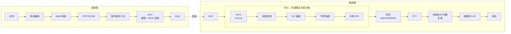
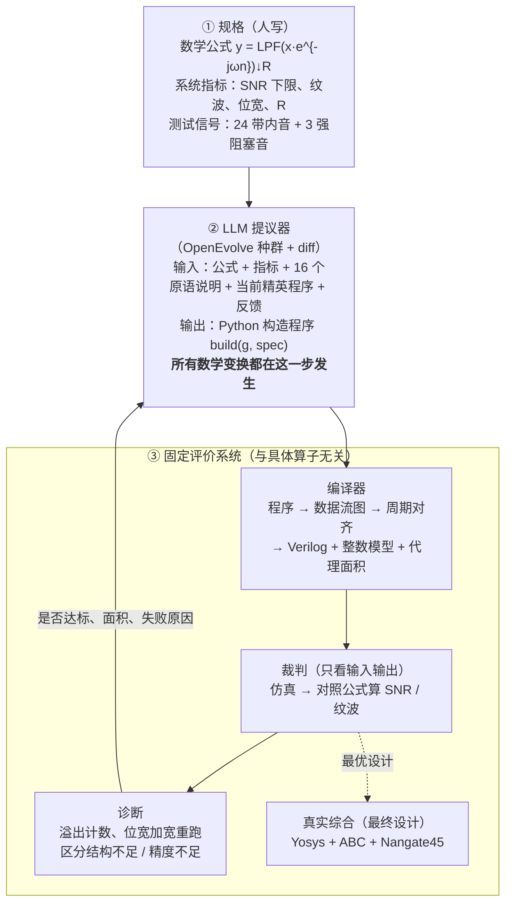

# 研究生学位论文中期报告（初稿 v0）

> 状态：2026-10-10 初稿，供讨论。
> 题目（暂定）：**面向通信 DSP 的大语言模型驱动公式到硬件设计方法研究**
> 标注约定：【图 N｜状态】中的状态取值为：**有数据**＝可用已有结果直接画；**待画**＝示意图，无需数据；**待实验**＝需要 `multistage-ddc-receiver-chain` 补跑实验。
> 文中数字的出处统一列在附录 A。

---

## 报告提纲

- 一 研究背景、领域进展和研究动机
  - 1.1 研究背景
  - 1.2 国内外研究现状
  - 1.3 研究动机
- 二 已取得阶段性成果
  - 2.1 系统核心设计：LLM 写什么、变换在哪里发生
  - 2.2 框架实现
  - 2.3 实验评估
- 三 学位论文进展情况和存在的问题
- 四 下一步工作计划和内容，预计答辩时间
- 五 已取得研究成果列表

---

# 一 研究背景、领域进展和研究动机

## 1.1 研究背景

### 通信基带中的数字信号处理

5G NR 等现代无线通信系统中，基带信号处理几乎全部由定点数字硬件完成。一条典型的收发链路如图 1 所示：

- 发射端依次完成信道编码、QAM 映射、IFFT（OFDM 调制）、脉冲成形和数字上变频（DUC）。
- 接收端在 ADC 之后依次完成数字下变频（DDC）、同步、FFT、信道估计与均衡、软解调和译码。

这些算子的数学定义在标准和教材中是确定的，比如 DDC 可以写成一行公式。但把公式变成面积小、精度够的定点电路，需要大量专家经验。



【图 1｜待画】通信收发链路与算子组成。红框是本课题的主实验对象 DDC；灰色标注是前期做过的单算子实验（sin/cos、atan2、复乘、64QAM LLR）。正式版每级旁边标注本课题实测的综合面积。

### 本课题选择 DDC 的原因

DDC 是接收机中第一个、也是工作速率最高的数字模块。在三个方面，它都是检验"从公式出发设计硬件"的合适对象：

1. **公式简单，实现空间很大。** 数学定义只有一行：

   $$y[m] = \Big(h * \big(x[n]\, e^{-j 2\pi f_{IF} n}\big)\Big)[mR]$$

   即把中频 $f_{IF}$ 处的信号搬到零频、低通滤波、抽取 $R$ 倍，其中低通 $h$ 只要求满足指标。实现上却可以有多种选择：sin/cos 用查表、CORDIC 还是两者混合；滤波器用单级长 FIR、多级抽取、CIC 加半带加补偿 FIR，还是多相结构；以及每一级的位宽和乘法器复用方式。
2. **大量变换是近似的。** CIC 替代低通、半带滤波器、截短位宽都会改变输出。这些改变能不能接受，只能由系统级指标来判断，不能靠逐位等价来判断。
3. **跨级耦合强。** 前一级的混叠抑制决定了后一级还需要多少阶，一级的位宽决定了下一级的噪声底。单独优化每个算子得不到全链最优。


【图 2｜待画（可用裁判代码生成）】DDC 在频域做了什么：(a) 输入频谱，包括中频期望信号和 3 个强阻塞音；(b) 混频后的频谱；(c) 低通滤波后的频谱；(d) 抽取后的频谱，标出混叠区。

## 1.2 国内外研究现状


【图 3｜待画】相关工作分类。横轴是"输入抽象层级"（自然语言或 RTL → 数学公式），纵轴是"优化范围"（单个算子 → 整条链），并区分"只允许等价变换"和"允许近似变换"。本课题位于"公式输入 + 整链 + 允许近似"这一格。

**（1）传统 DSP 硬件生成与字长优化。** 这类工作有三个方向：
- SPIRAL、FloPoCo [25] 用专家写好的规则或算子库生成特定算子；
- 字长优化方法 [23][24] 在结构给定的前提下搜索位宽；
- 多速率滤波器理论（Hogenauer CIC、多相分解、半带）提供了成熟的结构变换，但这些变换的选择和组合依赖设计者。

**（2）等价饱和（e-graph）与数据通路优化。** egg [32]、Coward 等 [33]、ROVER [34] 用 e-graph 表示等价程序空间，再按代价提取最优实现。ASPEN [35] 进一步让 LLM 提议 e-graph 重写规则。这类方法正确性有保证，但只能做**等价**变换，规则通常局限于单个表达式，难以表达多速率、跨级的结构改写。

**（3）LLM 生成 RTL。** 已有的数据集、微调模型和反馈式代理包括：
- 数据集与微调模型：VeriGen、RTLCoder、CraftRTL [1–4]；
- 反馈式代理：AutoChip、VerilogCoder [5][7]。

评测基准 VerilogEval、RTLLM、CVDP [9–11] 都以**功能正确率**为主要指标。文献中证据最强的改进来自多轮执行反馈：AutoChip 加入编译和仿真反馈后，通过率从约 65% 提高到约 89%。

**（4）LLM 驱动的进化式程序搜索。** AlphaEvolve [15]、OpenEvolve [16]、ShinkaEvolve [17] 让 LLM 在种群中以 diff 的形式改写程序，再由自动评价器选择。在 RTL 领域：
- REvolution [20] 用 DeepSeek-V3 在 RTLLM 上把通过率从 64% 提到 88%；
- EvoVerilog、COEVO [21][22] 进一步优化 PPA。

这些工作的规格仍然是自然语言或参考 RTL，评价标准是功能等价加 PPA。

**表 1｜相关工作对比**（只列已公开发表的工作）

| 类别 | 代表工作 | 输入 | 变换由谁做 | 允许近似 | 整链联合 | 质量判据 |
|---|---|---|---|---|---|---|
| 生成器/算子库 | SPIRAL, FloPoCo | 公式/算子 | 专家规则 | 部分 | 否 | 误差界 |
| 字长优化 | Lee'06, Sung'95 | 给定结构 | 搜索算法 | 只调位宽 | 部分 | SQNR |
| e-graph | egg, Coward'22, ROVER | 表达式/RTL | 重写规则 | 否 | 否 | 等价 |
| LLM 写规则 | ASPEN | RTL | LLM 提规则 + 验证 | 否 | 否 | 等价 |
| LLM 写 RTL | RTLCoder, AutoChip | 自然语言 | LLM | 否 | 否 | 功能通过率 |
| LLM 进化 | REvolution, COEVO | 自然语言/RTL | LLM + 进化 | 否 | 否 | 通过率 + PPA |
| **本课题** | — | **数学公式 + 系统指标** | **LLM + 进化** | **是** | **是** | **链级 SNR + 真实面积** |

## 1.3 研究动机

**动机一：同一公式的不同实现，面积相差一个数量级以上。** 照公式逐字实现的直写程序是单级几百抽头的全速率 FIR，而教科书结构（NCO → CIC → 半带 → 补偿 FIR）把绝大部分滤波放到低速率上完成。在 v2 裁判下的 5 个规格上，直写起点的真实面积为 0.43M–1.89M μm²，专家结构只有 0.03M–0.11M μm²，相差 8–46 倍（图 4）。可见真正决定面积的是**结构选择**，而不是位宽微调。


【图 4｜有数据】6 个开发规格上，直写程序与专家模板最好结果的代理面积对比（对数纵轴）。

**动机二：现有方法各自缺一块。**
- 规则驱动的方法（e-graph、生成器）只能做等价变换，或只能在专家预设的结构里选。CIC 替代 FIR、半带滤波器这类近似变换，以及抽取前移这类跨级变换，都需要人先想到并写成规则。
- LLM 生成 RTL 的工作以功能正确为目标。而在数值处理任务里，"功能正确"本身是不可识别的：输出和参考模型不逐位相等，并不代表实现错了，两个都通过测试的实现，SNR 也可能相差几十 dB。

**动机三：直接让 LLM 一次写出完整设计，成功率很低。** 我们的试点显示：每次让 LLM（DeepSeek）从头写一个完整程序，80 次调用中只有 9 次达到系统指标；加上编译修复和中间信号探针后反而只有 1/80，换用更大的模型也是 1/80。改成 OpenEvolve 式的"种群 + 小步 diff + 选择"后，最终种群中 52%–68% 的程序达标（图 5）。注意两者口径不同：前者是单次调用的达标率，后者是最终种群中的达标比例。所以关键在于**给 LLM 什么样的表示和反馈**，而不只是用更强的模型。


【图 5｜有数据】不同 harness 下的达标率：一次性生成（v1）、加修复与探针（v2 flash / v2 pro）、OpenEvolve diff 进化。

**本课题要回答的三个问题：**

- **问题 1（主问题）**：只给数学公式和系统指标，LLM 能否自己发现满足指标的结构变换（包括近似变换），并且优于现有的自动化路径？这里的自动化路径包括 LLM 直接写 Verilog、HLS 和非 LLM 程序搜索。甚至能超过专家手工设计。  并且 这个llm 做的是对什么的变换？是直接的数学公式还是对应的原语？
- **问题 2**：结构、精度、复用三类决策，应当联合搜索，还是按角色分阶段搜索？  不不不  这个应该是  某一个算子的最优 在整个通信链路里面 是不是最优的
<!-- todo 这个肯定是不对的  这个我没想好 -->
- **问题 3**：给 LLM 的反馈中，加入"经过验证的失败原因"（位宽不够还是结构不够、哪一级溢出），是否比只给分数更有效？ 或者怎么让llm 更好的发现？？  这

---

# 二 已取得阶段性成果

## 2.1 系统核心设计：LLM 写什么、变换在哪里发生

### 2.1.1 总体架构

整个系统由三部分组成，各自职责见图 6：

- **规格**：人写，每条链写一次；
- **LLM 提议器**：负责实现；
- **固定的评价系统**：负责打分。



【图 6｜待画】系统总体架构。正式版要突出两点：LLM 位于主路径中心；从诊断回到 LLM 的反馈环。

### 2.1.2 LLM 的输入与输出

**输入**（每次调用）：
1. 公式与指标（见 1.1）；
2. 16 个原语的使用说明（表 2）；
3. 当前种群中的精英程序；
4. 最近几次尝试的评价反馈。

**输出**：一段完整的 Python 程序 `build(g, spec)`，用原语搭出整条链。下面是最直白的写法，即照着公式逐字实现，也是进化的起点：

```python
def build(g, spec):
    x  = g.input()
    ph = g.counter(spec.fcw, 32)                       # 相位 = n·f_IF
    addr = g.bits(ph, 31, 22)                          # 取高 10 位查表
    cos = g.lut(addr, [cos(2πk/1024) for k in range(1024)], 16, 14)
    sin = g.lut(addr, [sin(2πk/1024) for k in range(1024)], 16, 14)
    i = g.q(x * cos, 18, 16); q = g.q(-(x * sin), 18, 16)   # 混频
    h = remez(511, ...)                                 # 一个大低通
    i = g.mac(zip(g.delay_line(i, 511), h))             # 511 抽头直接型
    q = g.mac(zip(g.delay_line(q, 511), h))
    g.output(g.q(g.decimate(i, R), 16, 15), g.q(g.decimate(q, R), 16, 15))
```

【图 7｜待画】LLM 一次调用的输入组成（提示词四个部分，左）与输出程序（右）；下方给一次真实 diff 的前后对比，例如把 `decimate` 移到 `mac` 之前。

**表 2｜原语集合（16 个，与算子无关）**

| 类别 | 原语 |
|---|---|
| 定点算术 | `add` `sub` `neg` `mul`（变量相乘）`scale`（乘常数，移位加实现）`shift` |
| 位宽控制 | `q`（舍入或截断、饱和或回绕） |
| 查表与选择 | `lut` `bits` `mux` `const` |
| 时序 | `reg` `delay_line` `integrate` `decimate` `counter` |
| 乘加 | `mac`（常系数乘加，可选分时复用） |

原语里**没有** FIR、CIC、NCO、CORDIC。这些算子都要由 LLM 用原语拼出来，再由 LLM 把算子组合成整条链。

### 2.1.3 数学变换在哪里发生

系统不内置任何变换规则。所有变换都体现为 LLM 对构造程序的改写（表 3）。其中，等价变换不改变输出；近似变换会改变输出，能否接受只由裁判按系统指标判定。

**表 3｜变换在程序中的体现**

| 变换 | 类型 | 程序中的体现 |
|---|---|---|
| 先抽取再滤波（多相恒等式） | 等价 | 把 `decimate` 移到 `mac` 前 |
| 系数对称，先加后乘 | 等价 | 先 `tap[k] + tap[N-1-k]` 再进 `mac` |
| 四分之一波查表 | 等价 | 表只存 1/4，用 `bits` + `mux` 镜像 |
| 单级长滤波器拆成多级 | 近似 | 多段 `delay_line` + `mac` + `decimate` |
| CIC 代替第一级滤波 | 近似 | `integrate` + `decimate` + 相减 |
| 半带滤波器 | 近似 | 系数隔一个为零，零系数不生成硬件 |
| 截短位宽、减少系数位 | 近似 | 改 `q()` 位宽、`mac` 的 `coef_bits` |
| 乘法器分时复用 | 微架构 | `mac(..., share=F)` |

### 2.1.4 裁判与诊断

**裁判**只看输入和输出：
- 把测试信号送进被测设计，得到输出；
- 与理想浮点参考对齐（自动搜索时延）；
- 计算带内 SNR（混叠、失真和量化噪声都算作误差）和通带纹波；
- SNR 门槛取理想接收机（ADC 量化上限）减去允许的实现损失（1.5–2.5 dB）；
- 阻塞音覆盖全部混叠频带（裁判 v2，见 2.3.3），另设搜索不可见的留出场景用于复核。

因为裁判不关心内部结构，专家设计、参数搜索结果和 LLM 程序都用同一把尺子衡量。

**诊断**在不达标时确定性地定位原因：
- 程序报错：返回错误类型和行号；
- 溢出：编译器在每个饱和点埋了计数器，报告哪一段溢出了多少次；
- SNR 不足：把全部量化点加宽 4 位后重跑。如果达标，说明是精度问题，再逐段加宽定位到具体哪一段；如果仍不达标，说明是结构问题（滤波不够），加位宽没用。

这些原因都是**重新运行得到的，而不是推测的**。问题 3 要检验的正是这种反馈的价值。


【图 8｜待画】裁判与诊断流程图。

### 2.1.5 路线演进：为什么让 LLM 写构造程序

本课题先后尝试过三种 LLM 的角色（图 9），由此得到了当前的设计：

1. **在预设设计中挑选或调参。** 空间可以穷举，LLM 不可能比枚举更好。
2. **typed IR 架构计划。** LLM 在 LUT、CORDIC 或两者混合的 sin/cos，以及对称 FIR、多相 FIR 等预定义结构中选择组合，由确定性编译器生成 RTL。这条路径完成了逐位对拍和综合检查，DeepSeek 提出的方案也得到了真实映射（41,426 μm²）。但变换仍然由人预先写进模块，LLM 只是在选参数。
3. **LLM 用通用原语写构造程序**（当前方案）。系统只保留与算子无关的原语、编译器和裁判，把实现完全交给 LLM。

【图 9｜待画】三代设计中 LLM 角色的对比示意。

## 2.2 框架实现


【图 10｜待画】实现流程：`build` 程序 → 同步数据流图 → 多速率周期对齐 → (a) Verilog、(b) 逐位整数模型、(c) 按 `g.scope` 分组的代理面积。右侧是与 OpenEvolve 的接口：`oe_eval.py` 把达标、面积和诊断转成适应度与文本反馈。

主要实现内容：
- **原语与编译器**（`dspgraph/sdf.py`）：每个原语同时给出 Verilog、逐位整数语义和面积估计。编译器自动处理多速率下的周期对齐，LLM 只需要写样点级的数学。位宽超过 62 位时自动切换到任意精度整数（上限 128 位），去掉了 int64 带来的人为约束。
- **规格与裁判**（`rx_spec.py`、`judge.py`）：6 个开发规格、6 个留出规格；留出场景的阻塞音位置不同，搜索过程不可见。
- **专家对照**（`template.py`）：教科书 NCO → CIC → 半带 → 补偿 FIR 的参数化程序，用于问题 1 和问题 2 的对照。
- **进化搜索**：复用仓库中的 OpenEvolve，起点是已达标的直写程序。
- **真实综合**（`synth_compare.py`）：Yosys + ABC，Nangate45 标准单元库。
- **正确性检查**：真实综合对比中的 9 个设计全部通过 RTL 与整数模型逐位对拍。每个设计输入 4000 个样点，r16 规格比较 250 个输出，r32 规格比较 125 个，失配均为 0。开发期还对多相、分时复用、CIC 回绕、75 位宽等设计做了检查，均为零失配。


【图 11｜有数据】RTL 与整数模型对拍：被测设计的输出频谱与理想参考叠加，并标注失配数为 0。

## 2.3 实验评估

### 2.3.1 实验设置

**表 4｜DDC 开发规格**（频率按输入采样率归一化）

| 规格 | 抽取 R | 通带占比 | 输入/输出位宽 | 纹波上限 (dB) | 混叠抑制 (dB) | 允许损失 (dB) | 阻塞功率 (dB) |
|---|---|---|---|---|---|---|---|
| r16 宽带 | 16 | 0.80 | 14/16 | 0.30 | 75 | 2.0 | 15 |
| r16 窄带 | 16 | 0.50 | 12/16 | 0.50 | 80 | 1.5 | 20 |
| r32 宽带 | 32 | 0.80 | 14/16 | 0.20 | 85 | 2.0 | 20 |
| r32 窄带 | 32 | 0.40 | 12/16 | 0.50 | 70 | 1.5 | 10 |
| r64 宽带 | 64 | 0.70 | 14/16 | 0.30 | 85 | 2.5 | 25 |
| r64 窄带 | 64 | — | — | — | — | — | — |

（r64 窄带的参数待补；6 个留出规格见 `rx_spec.py` 中的 `HELDOUT_SPECS`，字段与开发规格相同。）

其他设置：
- **LLM**：DeepSeek（`deepseek-flash`），关闭思考模式（开启后 2 万 token 都花在推理上，不输出代码）；
- **搜索**：OpenEvolve diff 进化；
- **对照**：专家模板（NCO → CIC → 半带 → 补偿 FIR），分别做分阶段和联合参数搜索；
- **评价**：每个最优设计**同时报告搜索场景和留出场景**的结果，面积以 Nangate45 真实综合为准。

### 2.3.2 评价系统的正确性

**逐位一致。** 真实综合对比中的 9 个设计全部通过 RTL 与整数模型的逐位对拍：每个设计输入 4000 个样点，r16 规格比较 250 个输出，r32 规格比较 125 个，失配均为 0。开发期还对多相、分时复用、CIC 回绕、75 位宽等设计做了检查，均为零失配。

这说明编译器生成的 Verilog 与 LLM 程序的数学语义严格一致，裁判看到的就是最终硬件的真实行为。

**代价模型校准。** 搜索时如果每个候选都做真实综合，代价太高，所以需要代理面积模型。我们取 52 个设计做 Nangate45 真实综合（快速 ABC），按奇偶分成训练集和留出集，拟合各原语的面积单价。之后在主实验的 17 个最终设计上复核：校准面积与真实面积的 Spearman 秩相关为 1.0，相对误差中位数为 4.8%。

| 指标（留出集） | 校准前 | 校准后 |
|---|---|---|
| Spearman 秩相关 | 0.57 | **0.987** |
| 相对误差中位数 | 13.6% | **2.3%** |
| 相对误差 p90 | — | 8.6% |

最大的修正是查找表：旧模型把查找表高估了约 12 倍（每位单价从 0.55 降到 0.044）。校准后代理面积的单位直接是 μm²，可以用来引导搜索。

【图 18｜有数据】代理面积与真实面积的散点图，校准前后各一张。

### 2.3.3 关键发现：稀疏测试场景会被搜索"钻空子"

这是开发期最重要的一项发现，直接决定了裁判的最终形式。

**现象。** 第一版裁判（v1）沿用了常见做法：每个测试场景放 3 个强阻塞音，2 个搜索场景合计只检验 6 个频点。在 v1 下，无论是专家模板的参数搜索还是 LLM 进化，都能找到面积很小、在搜索场景上达标的设计。

**留出复核暴露问题。** 我们把这些最优设计放到阻塞音位置不同的留出场景上重新打分（表 5）：绝大多数设计不达标，最差的比门槛低 30 多 dB。

**表 5｜v1 裁判下最优设计的留出复核**

| 设计来源 | 设计数 | 留出达标 | 留出裕量中位数 | 留出裕量最差 |
|---|---|---|---|---|
| 专家模板·分阶段搜索 | 30 | 7 | −0.8 dB | −34.5 dB |
| 专家模板·联合搜索 | 29 | 3 | −0.9 dB | −34.6 dB |
| LLM 从直写起点进化 | 6 | 1 | −0.7 dB | −11.3 dB |
| LLM 从专家起点、只接受结构改动 | 6 | 0 | −5.4 dB | — |

**原因。** 搜索学会了只在被检验的几个频点上形成抑制陷波，而不是在整个混叠频带上抑制。这是一种**评价器漏洞**，与具体搜索方法无关：参数搜索和 LLM 都会利用它。在 LLM 驱动的进化搜索中，这类现象也被称为 reward hacking。

**修订（裁判 v2）。** 阻塞音改为覆盖全部混叠频带：每个混叠带放 2 个随机频点，总共 12–57 个，总功率与原来 3 个单音相同。修订后，直写起点在 6 个开发规格上的搜索裕量与留出裕量基本一致（例如 1.78 vs 1.74 dB，1.60 vs 1.65 dB），泛化差距消失。


【图 12｜有数据】横轴为搜索场景裕量，纵轴为留出场景裕量，共 74 个设计。v1 下的点大量落在对角线下方（过拟合），v2 下的点贴近对角线。v2 下，直写起点在 6 个规格的留出场景上全部达标（裕量 1.7–2.3 dB）。

**意义。** 这说明在"公式 + 系统指标"类任务中，规格本身必须覆盖完整的干扰空间，并配合留出场景复核，否则任何自动搜索都会利用规格漏洞。这是本课题评价体系设计的一条重要经验，也是后续所有实验的基础。v1 下得到的面积数字因此不作为结论使用，三个问题全部在 v2 下重跑。

### 2.3.4 主实验：从公式出发的自动设计

**设置。**
- 所有结果都在 v2 裁判下得到。面积为 Nangate45 真实综合面积（快速 ABC 脚本，μm²）。
- 本方法：OpenEvolve diff 进化，带"经过验证的诊断"反馈，120 次迭代，种子 0。
- 非 LLM 基线 B3：从同一个直写起点出发，同为 120 次评价，两个种子。
- 专家模板 R：作为参考上限，取问题 2 中 10 次运行（每次 400 次评价）的最优设计。

**结论一：在 6 个规格上，LLM 自动把真实面积降低 71.5%–89.0%。**

**表 6｜本方法相对直写起点的真实面积（μm²）**

| 规格 | 直写起点 | 本方法 | 降幅 |
|---|---|---|---|
| r16 窄带 | 425,644 | 121,112 | 71.5% |
| r16 宽带 | 946,859 | 134,285 | **85.8%** |
| r32 窄带 | 709,042 | 92,264 | **87.0%** |
| r32 宽带 | 1,889,223 | 276,398 | **85.4%** |
| r64 窄带 | 1,622,343 | 178,227 | **89.0%** |
| r64 宽带 | 2,559,706 | 296,043 | **88.4%** |

6 个规格的降幅为 71.5%–89.0%，几何均值约 85%。所有设计的 RTL 与整数模型逐位零失配。

**结论二：同样的评价次数下，LLM 的结果约为非 LLM 搜索的 1/7。**

**表 7｜同预算（120 次评价）下的面积比（校准面积 / 直写起点，越小越好）**

| 规格 | 本方法 | B3 数值变异（2 种子） | B3 结构变异（2 种子） |
|---|---|---|---|
| r16 窄带 | **0.226** | 0.80 / 0.82 | 0.86 / 1.00 |
| r16 宽带 | **0.139** | 0.77 / 1.00 | 0.78 / 1.00 |
| r32 窄带 | **0.114** | 0.80 / 0.96 | 0.80 / 1.00 |
| r32 宽带 | **0.129** | 0.97 / 0.95 | 0.93 / 1.00 |
| r64 窄带 | **0.107** | 0.74 / 1.00 | 0.75 / 0.75 |
| r64 宽带 | **0.102** | 0.77 / 0.95 | 0.82 / 1.00 |
| **几何均值** | **0.131** | 0.871 | 0.884 |

两种随机搜索只能在现有结构上微调，几何均值仍在 0.87 左右。LLM 能改变结构，比如引入多级抽取、改写查表方式、分时复用乘法器，几何均值降到 0.131，约为随机搜索的 15%。这直接说明了 **LLM 提出结构变换的价值**。


【图 14｜有数据】各规格上直写起点、B3、本方法和专家模板的面积分组柱状图（对数轴）。


【图 15｜有数据】进化曲线：横轴为评价次数，纵轴为截至当前的最优达标面积比。本方法与两种 B3 随机搜索画在同一图中，每个规格一个子图。

**结论三：泛化能力与专家模板相当。** 在搜索不可见的留出场景上：
- 本方法 4/6 达标，专家模板同样是 4/6；
- 在 r32 宽带上，本方法留出裕量 +0.94 dB，专家模板为 −0.85 dB；
- 两者不达标的规格，裕量都只差 0.05–1.0 dB，属于把裕量压得过紧，可以通过在搜索中保留少量裕量来解决（见第四章）。

**与专家水平的距离。** 专家模板内置了 CIC、半带、补偿 FIR 等教科书结构，并经过 4000 次评价的参数搜索，是一个很强的参考上限。本方法只用 120 次 LLM 迭代：
- 在 r16 宽带上达到专家面积的 84%；
- 在其余规格上达到 19%–40%。

缩小这一差距是下一阶段的重点。

### 2.3.5 LLM 能发现哪些变换

LLM 只拿到公式、指标和原语，**没有任何内置规则**，就自主写出了以下变换。这些变换都经 RTL 逐位对拍验证：

- 等价变换：四分之一波查表镜像（表只存 1/4，用位选择和多路器镜像）、系数对称预加；
- 近似变换：多级抽取（如 4×4、8×2×2）、位宽缩短；
- 结构改写：查找表换成"粗表 + 移位加线性插值"，sin 与 cos 共用；
- 微架构：乘法器分时复用（share=8/16）。

在提示词中补充多速率结构知识后，LLM 还会主动采用多相分解。

**演化路径案例。** 我们用 checkpoint 中的父节点关系，回溯了两个最优设计的祖先链（表 10，数值为校准面积 / 直写起点）。

**表 10｜LLM 的演化路径**

| 规格 | 步骤 | 引入的变换 | 面积比 |
|---|---|---|---|
| r32 宽带 | 0 | 直写起点：65536 项整周期表 + 单级长低通 | 1.000 |
| | 1 | 多相分解 + 缩短滤波器（SNR 差 3.6 dB，未达标） | 4.056 |
| | 2 | 两级抽取 + 多相 | 0.243 |
| | 3 | 四分之一波查表镜像（表缩小 4 倍）+ 三级抽取 8×2×2 | 0.138 |
| | 4 | 缩短查表与混频字长（20→16 位） | **0.129** |
| r64 窄带 | 0 | 直写起点 | 1.000 |
| | 1 | 相位截短到 14 位（表 65536→16384）+ 两级级联抽取 | 0.184 |
| | 2 | 相位截短到 12 位（表 16384→4096） | 0.114 |
| | 3 | 缩短查表与混频字长（18→16 位） | **0.107** |

可以看到两点：
- **面积主要靠结构变换降下来。** 两条路径上，面积的大幅下降都发生在结构变换（多级抽取、查表结构改写）这一步，最后的位宽微调只再降了 5%–7%。
- **进化可以穿过不可行的中间设计。** r32 宽带的第 1 步本身不达标，但它的后代修正之后成为最优设计的祖先。这是一次性生成和贪心修改都做不到的。


【图 13｜有数据】演化路径：横轴为步骤，纵轴为面积比（对数轴），每个点标注引入的变换，不达标的中间体画成灰色。

### 2.3.6 反馈消融：经过验证的诊断让结果更好

**设置。** 3 个规格 × 2 个种子 × 120 次迭代，比较三档反馈。

**表 8｜反馈档位对比（面积 / 直写起点，几何均值）**

| 反馈档位 | 面积比 | 种群达标比例 |
|---|---|---|
| 只给分数 | 0.251 | 67% |
| 给全部指标数值 | 0.152 | 75% |
| 加经过验证的诊断 | **0.131** | 73% |

两两配对比较：
- 加诊断 vs 只给分数：面积再减小 **48%**（几何均值比 0.52），6 对中 5 对更好；
- 给全部指标 vs 只给分数：减小 40%，同样是 5/6 对更好。

收益最大的是 r32 宽带：只给分数时为 0.37/0.39，加诊断后为 0.13/0.13。目前只有 6 对，统计上还不显著（单侧符号检验 p≈0.11），正在补种子。


【图 17｜有数据】三档反馈的面积比，6 个配对用连线表示。

### 2.3.7 决策组织方式：联合搜索 vs 按角色分阶段搜索

**设置。** 在专家模板空间中，比较两种组织方式。
- 联合：结构、精度、复用三类决策同时进化；
- 分阶段：按角色依次确定结构、精度、复用。

每次 400 次评价，6 个规格 × 5 个种子，共 30 对。

**结论：按角色分阶段搜索显著更好。**
- 分阶段在 24/30 对中更优，联合的面积几何均值是分阶段的 1.22 倍（Wilcoxon p = 0.0004）；
- 6 个规格的中位数都是分阶段更小。

**留出规格复验。** 我们在 6 个从未使用过的留出规格上重复了同样的实验，设置完全相同（6 规格 × 5 种子 × 2 方法，每次 400 次评价）。结论复现：联合/分阶段的面积几何均值比为 1.26，分阶段在 23/30 对中更优（Wilcoxon p = 0.0006）。

**表 11｜问题 2 的开发集与留出集结果**

| 规格集 | 配对数 | 联合/分阶段几何均值 | 分阶段更优 | Wilcoxon p |
|---|---|---|---|---|
| 开发集 | 30 | 1.22 | 24/30 | 0.0004 |
| 留出集 | 30 | 1.26 | 23/30 | 0.0006 |

这说明在有限预算下，**先定结构、再定精度、最后定复用**的分工能显著提高搜索效率。这一发现为下一阶段的系统设计提供了依据：让 LLM 专注于结构，位宽和复用交给确定性优化（见第四章）。

注：这一结论限于本模板空间和简单进化算子，不推广到更强的联合优化器。v1 裁判下曾得到相反趋势，但那是在有漏洞的评价器上得到的，已作废。


【图 16｜有数据】每个规格上联合与分阶段的面积箱线图。

### 2.3.8 待完成的对照

| 实验 | 状态 |
|---|---|
| B1 LLM 直接写 Verilog（同模型、同预算） | 流程已搭好并验证，等 API 预算。起点是人写的直写 Verilog，与本方法起点逐位等价（每个场景 1376 个输出全部一致），SNR 相同；评价用 iverilog + v2 裁判 + Yosys 真实映射。约 ¥20、8–12 小时 |
| B2 HLS | 暂缓：开源 Bambu 只提供 x86_64 Linux 版本，本机为 arm64 |
| 补到 3 个种子、留出规格复验 | 等 API 预算 |

# 三 学位论文进展情况和存在的问题

## 3.1 学位论文进展情况

| 部分 | 状态 |
|---|---|
| 文献调研 | 完成，约 40 篇，覆盖 LLM-RTL、进化搜索、字长优化、e-graph |
| 评价系统：原语、编译器、裁判、诊断、综合 | 完成，RTL 与整数模型逐位零失配；裁判已修订为 v2（全混叠带阻塞 + 留出复核） |
| 通信 DSP 基准 | DDC 链 12 个规格完成；单算子任务（sin/cos、atan2、复乘、LLR）完成 |
| 问题 1 主实验 | v2 下完成 6 个规格（单种子）：真实面积降 71.5%–89.0%，约为随机搜索的 1/7；已回溯演化路径 |
| 问题 2 | v2 下开发集与留出集各 30 对：分阶段均显著更优（p = 0.0004 / 0.0006） |
| 问题 3 | v2 下完成 6 对：加诊断使面积减小 48%（5/6），正在补种子 |
| 代价模型 | 校准完成，留出 Spearman 0.987 |
| 论文章节 | 第一到第六章草稿已有，但基于早期"证书化适应度"方向，需按当前主线重组 |

## 3.2 存在的问题

1. **与专家水平仍有距离。** 在 r16 宽带上，本方法达到专家模板面积的 84%，其余规格为 19%–40%。主要原因是 LLM 还很少采用 CIC、半带这类"整体替换滤波结构"的大步变换。在提示词中补充多速率知识后，LLM 开始使用多相分解，但单种子下最终面积没有改善。
2. **统计强度。** 主实验和问题 3 目前为 1–2 个种子，需要补到 3 个种子，并在 6 个留出规格上复验。
3. **裕量过紧。** 本方法和专家模板都有 2/6 个设计在留出场景上以 0.05–1.0 dB 的差距不达标。原因是搜索会把裕量压到接近 0。
4. **对照尚不完整。** B1（LLM 直接写 Verilog）需要 API 预算；B2（HLS）受本机 arm64 环境限制。
5. **时序指标。** 当前以面积为成本，尚未考虑时序。

---

# 四 下一步工作计划和内容，预计答辩时间

**重点实验：**
- **补齐主对照**：B1 LLM 直接写 Verilog；在 x86 环境上完成 B2 HLS；所有方法补到 3 个种子，并在 6 个留出规格上复验。
- **"LLM 定结构 + 确定性工具定精度与复用"**：依据 2.3.7 的结论，让 LLM 专注于结构，位宽和复用交给按角色分阶段的确定性优化，目标是缩小与专家的差距。
- **大步结构变换**：引入跨结构的变异，以及更系统的领域知识检索，提升 CIC、半带等结构的发现率。
- **裕量约束**：在搜索中要求 0.3–0.5 dB 的安全裕量，解决留出场景的泛化问题。

**改进方向：**
- **区间算术自动推位宽**：从输入范围逐节点推出不会溢出的位宽，加强诊断信息。
- **等价变换的形式化检查**：对 LLM 声称的等价改写做 RTL 等价检查，把变换分成"已证等价"和"近似且由裁判接受"两类，并做统计。
- **时序**：引入 OpenROAD 布局布线和静态时序分析，指标改为"满足频率约束下的面积"。
- **扩展**：把同一套框架用于 DUC 发射链，或 OFDM 接收后端（FFT + 均衡 + LLR）。

**表 9｜研究计划进度表**（待确认）

| 时间 | 内容 |
|---|---|
| 2026.10–2026.11 | 补到 3 个种子并完成留出复验；B1 直接写 Verilog 基线；LLM 定结构 + 确定性优化；裕量约束 |
| 2026.12–2027.01 | B2 HLS 基线；等价检查与变换统计；OpenROAD 时序；冻结方法 |
| 2027.02–2027.03 | 扩展到第二条链；整理论文实验 |
| 2027.03–2027.04 | 撰写学位论文，投稿 |
| 2027.05（预计） | 学位论文答辩 |

---

# 五 已取得研究成果列表

（待补：已发表或在投论文、专利、开源代码。）

---

## 附录 A：文中数字出处

数据目录均位于 `da43/.../examples/comm_dsp_bench/experiments_dspgraph/`。

| 数字 | 文件 |
|---|---|
| v1 留出复核（表 5） | `holdout_check_v1_20261010.json` |
| 搜索与留出裕量对（图 12） | `margin_pairs_v1_v2_20261010.json` |
| 主实验（表 6、表 7、留出、R/M） | `main_table_v2_20261010.json`；专家最终评估在 `final_eval_R_v2_20261010.json` |
| 问题 2 | `analysis_p1_v2_judge2_20261010.json`；留出集 `analysis_p1_heldout_v2_20261010.json` |
| 问题 3（表 8） | `analysis_p3_v3_judge2_20261010.json` |
| 领域知识增强 | `k_knowledge_v1_judge2_20261010/` |
| 进化曲线（图 15） | `curves_M_B3_v2_20261010.csv` |
| 祖先链（表 10） | `ancestry_M_r32w_r64n_v2_20261010.json` |
| r64 宽带直写起点 | `final_eval_naive_r64w_v2_20261010.json`（并行批处理时内存不足，单独重跑） |
| 逐位对拍 | `synth_compare_v1_20261010.json` 中的 `rtl_crosscheck`；v2 下见主表 `*_rtl_ok` |
| 结构改写零失配 | `verify_structonly_r16n_v1_20261010.json` |
| 试点 9/80、1/80 | `harness_ab_v1_flash_20261009/`、`harness_ab_v2_flash_20261009/`、`harness_ab_v2_pro_20261009/` |
| typed IR 路线的 41,426 μm² | `Iknow.md` 2026-10-08 条目 |
| 代价校准 | `sdf_cost_calibration_v1_20261010/summary.json` |
| 本方法 v2 | `p3_oe_feedback_v2_20261010/`（r16n、r32w、r64n）、`p2_oe_naive_v3_judge2_20261010/`（r16w、r32n、r64w） |
| B3 随机数值变异 / 结构变异 | `random_prog_baseline_v1_judge2_20261010.json`、`random_struct_baseline_v1_judge2_20261010.json` |
| 文献数字 | `thesis/references.md`、`Iknow.md` 2026-10-09 条目 |

> v1 裁判下的面积数字（问题 1–3 首轮）只作为 2.3.3 的背景，不作为结论；原始记录保留在各 `p1_*`、`p2_*`、`p3_*` 目录。

## 附录 B：图表清单

共 18 张图、11 张表。

| 图 | 内容 | 状态 |
|---|---|---|
| 1 | 收发链路算子图 | 待画 |
| 2 | DDC 频谱示意 | 待画（代码生成） |
| 3 | 相关工作分类 | 待画 |
| 4 | 直写 vs 专家面积 | 有数据 |
| 5 | harness 达标率 | 有数据 |
| 6 | 系统架构 | 待画 |
| 7 | LLM 输入输出与 diff 示例 | 待画 |
| 8 | 裁判与诊断流程 | 待画 |
| 9 | 三代路线对比 | 待画 |
| 10 | 实现流程 | 待画 |
| 11 | 逐位对拍 | 有数据 |
| 12 | v1/v2 裁判的搜索–留出裕量散点 | 有数据 |
| 13 | 演化路径案例 | 有数据 |
| 14 | 各方法面积对比 | 有数据 |
| 15 | 进化曲线（叠加随机搜索） | 有数据 |
| 16 | 联合 vs 分阶段箱线图 | 有数据 |
| 17 | 反馈档位消融 | 有数据 |
| 18 | 代价模型校准前后 | 有数据 |
