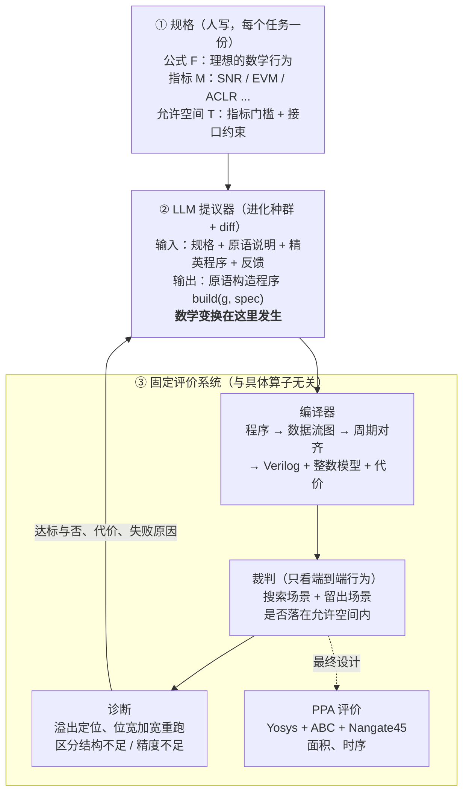

# 研究生学位论文中期报告（v1）

> 2026-10-11。按新主线重写：一个核心问题 → 三个挑战 → 三个设计 → 逐项实验。
> 题目（暂定）：**面向通信链路的大语言模型驱动公式到硬件设计方法研究**
> 图的状态标注：**有数据**＝可直接画；**待画**＝示意图；**待实验**＝结果尚未产生。
> 数字出处见附录 A。所有实验结果均在修订后的裁判（v2）下得到，面积为 Nangate45 真实综合面积（快速 ABC 脚本）。

---

## 报告提纲

- 一 研究背景、领域进展和研究动机
  - 1.1 研究背景
  - 1.2 国内外研究现状
  - 1.3 研究动机：一个核心问题与三个挑战
- 二 已取得阶段性成果
  - 2.1 总体思路与系统架构
  - 2.2 设计一：原语级构造表示
  - 2.3 设计二：整链规格与评价
  - 2.4 设计三：进化搜索、诊断反馈与分工
  - 2.5 数据集：通信算子与链路
  - 2.6 实验评估
- 三 学位论文进展情况和存在的问题
- 四 下一步工作计划和内容，预计答辩时间
- 五 已取得研究成果列表

---

# 一 研究背景、领域进展和研究动机

## 1.1 研究背景

### 通信基带硬件的组成

从 3G 到 5G，再到 Wi-Fi 和软件无线电，基带硬件都可以分成三段（图 1）：

- **比特级处理**：CRC、信道编码、速率匹配、加扰。必须逐位正确。
- **符号级处理**：调制映射、扩频或预编码、FFT/IFFT、信道估计与均衡、软解调。
- **数字前端**：上下变频、多速率滤波、增益控制。

后两段是数值运算，占据了基带芯片的大部分面积和功耗。它们有一个共同特点：**数学定义是确定的，但实现方式有很大的自由度**。

```mermaid
flowchart LR
  subgraph BIT[比特级：必须逐位正确]
    direction LR
    CRC[CRC] --> ENC[信道编码] --> RM[速率匹配] --> SCR[加扰]
  end
  subgraph SYM[符号级：数值运算]
    direction LR
    MAP[调制映射] --> PRE[预编码/扩频] --> OFDM[IFFT 或脉冲成形]
  end
  subgraph DFE[数字前端：多速率数值运算]
    direction LR
    INT[内插滤波] --> DUC[NCO 上变频]
  end
  BIT --> SYM --> DFE --> DAC[DAC]
  DAC -. 信道 .-> ADC[ADC]
  ADC --> DDC[DDC：NCO + 混频 + 抽取滤波] --> SYNC[同步] --> FFT[FFT 或 Rake] --> EQ[信道估计/均衡] --> LLR[软解调] --> DEC[译码]
```



【图 1｜待画】通信收发链路的通用结构。本课题的对象是其中的数值运算部分（符号级与数字前端）。正式版中标出 8 条数据集链路各自覆盖的范围。

**表 1｜各代通信系统的主要数值模块**

| 系统 | 数字前端 | 同步 | 核心变换 | 均衡/检测 | 软解调 |
|---|---|---|---|---|---|
| 3G WCDMA | DDC + RRC 匹配滤波 | 路径搜索（相关器） | Rake：解扩 + 积分 | MRC 合并 | QPSK/16QAM |
| 4G LTE | DDC + 抽取 | PSS/SSS 相关 | FFT | LS 估计 + MMSE 检测 | 至 256QAM |
| 5G NR | DDC + 抽取 | PSS/SSS、DMRS | FFT | DMRS 估计 + MMSE | 至 1024QAM |
| Wi-Fi | DDC | 训练序列相关、CFO 估计 | FFT 64 点 | 信道平均 + 导频校正 | 至 64QAM |
| 软件无线电 | NCO + CIC + 半带 + FIR | 定时与载波恢复 | 匹配滤波 | 均衡 | PSK/QAM |

### 从公式到硬件：一个例子

以接收机的数字下变频（DDC）为例。它的数学定义只有一行：

$$y[m] = \Big(h * \big(x[n]\, e^{-j 2\pi f_{IF} n}\big)\Big)[mR]$$

也就是把中频信号搬到零频、低通滤波、抽取 $R$ 倍。但实现上有很多选择：

- 正余弦用整表、四分之一波表、粗表加插值，还是 CORDIC；
- 滤波用单级长 FIR、多级抽取、CIC 加半带加补偿 FIR，还是多相结构；
- 每一级的位宽、乘法器是否分时复用。


【图 2｜待画（代码生成）】DDC 在频域做了什么：输入频谱（期望信号 + 强阻塞）、混频后、滤波后、抽取后。

这些选择中，很多是**近似变换**：CIC 替代理想低通、截短位宽都会改变输出，只要系统指标仍然满足就可以接受。而且各级之间**相互耦合**：前级的混叠抑制决定后级需要多少阶，前级的量化噪声会被后级滤掉一部分。

## 1.2 国内外研究现状


【图 3｜待画】相关工作分类。横轴：输入抽象层级（自然语言/RTL → 数学公式）；纵轴：优化范围（单算子 → 整链）；颜色区分"只允许等价变换"和"允许近似变换"。

**（1）DSP 硬件生成器与字长优化。** SPIRAL、FloPoCo 用专家规则或算子库生成特定算子；字长优化方法在给定结构下搜索位宽；多速率滤波理论（CIC、多相、半带）提供了成熟的结构变换，但选择与组合依赖设计者。

**（2）等价饱和与数据通路优化。** egg、Coward 等、ROVER 用 e-graph 表示等价程序空间并按代价提取；ASPEN 让 LLM 提议重写规则。这类方法正确性有保证，但只做**等价**变换，且通常局限于单个表达式。

**（3）LLM 生成 RTL。** VeriGen、RTLCoder、AutoChip、VerilogCoder 等从自然语言生成 Verilog；VerilogEval、RTLLM、CVDP 以**功能通过率**为指标。已有基准中的 DSP 题很少且规模小（如 RTLBench 中的 4 抽头 FIR、8 点 FFT、8 位 CORDIC），评价标准是逐位通过。

**（4）LLM 驱动的进化式程序搜索。** AlphaEvolve、OpenEvolve 让 LLM 在种群中以 diff 形式改写程序并由评价器选择；REvolution、EvoVerilog、COEVO 把这一思路用于 RTL，规格仍是自然语言或参考 RTL，评价是功能等价加 PPA。

**表 2｜相关工作对比**（只列已公开发表的工作）

| 类别 | 代表工作 | 输入 | 变换由谁做 | 允许近似 | 整链 | 质量判据 |
|---|---|---|---|---|---|---|
| 生成器/算子库 | SPIRAL, FloPoCo | 公式/算子 | 专家规则 | 部分 | 否 | 误差界 |
| 字长优化 | Sung'95, Lee'06 | 给定结构 | 搜索算法 | 只调位宽 | 部分 | SQNR |
| e-graph | egg, Coward'22, ROVER | 表达式/RTL | 重写规则 | 否 | 否 | 等价 |
| LLM 写规则 | ASPEN | RTL | LLM 提规则 + 验证 | 否 | 否 | 等价 |
| LLM 写 RTL | RTLCoder, AutoChip | 自然语言 | LLM | 否 | 否 | 功能通过率 |
| LLM 进化 | REvolution, COEVO | 自然语言/RTL | LLM + 进化 | 否 | 否 | 通过率 + PPA |
| **本课题** | — | **公式 + 允许空间 + 指标** | **LLM + 进化** | **是** | **是** | **系统指标 + PPA** |

## 1.3 研究动机：一个核心问题与三个挑战

### 核心问题

**通信链路的最优硬件实现，来自跨算子的、允许近似的数学变换。** 现有的两条自动化路径都找不到这类变换：

- 规则驱动的编译器只做等价变换，而且一次只看一个算子；
- LLM 生成 RTL 只追求功能正确，不考虑数值质量与代价的权衡。


【图 4｜有数据】同一公式的两种实现的真实面积。照公式逐字实现的直写设计为 0.43M–2.56M μm²，教科书多速率结构只有 0.03M–0.11M μm²，相差 8–46 倍。决定面积的是**结构变换**，而不是位宽微调。

本课题的主张是：**让 LLM 在合适的表示上，以整链的系统指标为准则，搜索这类变换。** 要做到这一点，需要依次解决三个挑战。

### 挑战一：LLM 应该在什么上做变换

- 直接改公式：公式是数学对象，改完之后无法落到硬件上。
- 直接写 Verilog：太低层。一个数学变换（如把抽取移到滤波之前）要改几十上百行，还要处理时钟、握手和位宽，数学结构淹没在实现细节里。

我们的试点印证了这一点：让 LLM 每次从头写一个完整设计，80 次调用中只有 9 次达到系统指标。

### 挑战二：单个算子的最优，不是整条链的最优

工程上常见的做法是把系统指标分解成每一级的局部指标，各级分别设计。但各级之间存在耦合，这种分解往往不是最优的。我们的实验（2.6.4 节）显示：

- 按误差预算逐级设计再拼接，面积比整链优化大 19%–42%；
- 在宽带规格上，逐级设计甚至找不到达标的解；
- 整链最优解的误差分配明显偏离平均分配，预算集中在最"贵"的那一级。

因此优化必须以整链的系统指标为准则。这又带来一个新问题：**系统指标必须定义得完整**，否则搜索会钻空子（2.3.3 节）。

### 挑战三：怎么让 LLM 高效地发现变换

变换空间巨大，而每次评价都要仿真整条链。需要回答：

- 怎么组织搜索，使 LLM 的每次调用都在已有成果上推进；
- 给 LLM 什么反馈，它才知道往哪里改；
- 结构、精度、复用这几类决策，哪些交给 LLM，哪些交给确定性工具。

### 本课题的思路

**表 3｜三个挑战与对应的设计**

| | 挑战 | 设计 | 验证实验 |
|---|---|---|---|
| 1 | 在什么上做变换 | **原语级构造表示**：数学变换就是小幅程序修改，编译器保证逐位正确 | 演化路径；逐位对拍；与直接写 Verilog 对比 |
| 2 | 单算子最优 ≠ 整链最优 | **整链规格与评价**：公式 + 允许空间 + 指标，裁判只看端到端行为 | 逐级最优 vs 整链优化；误差份额；裁判完整性 |
| 3 | 怎么高效发现 | **进化搜索 + 经验证的诊断反馈 + 分工** | 与非 LLM 搜索对比；反馈消融；分阶段 vs 联合 |

三者是递进关系：先确定在什么上变换，再确定按什么标准变换，最后解决怎么高效地找到变换。

---

# 二 已取得阶段性成果

## 2.1 总体思路与系统架构

系统由三部分组成（图 5）：人写的规格、LLM 提议器、固定的评价系统。



【图 5｜待画】系统总体架构。正式版突出：LLM 位于主路径中心；诊断到 LLM 的反馈环；三个设计各自对应的模块。

## 2.2 设计一：原语级构造表示

### 2.2.1 LLM 改的是什么

**LLM 改的是用原语写的构造程序，既不是公式本身，也不是 Verilog。**

- **公式**是规格，也是裁判的参考答案，LLM 不改它。
- **原语程序**描述样点级的数学数据流：乘、加、延迟、抽取、查表。多相分解、多级抽取、CIC 这些数学变换，在这一层就是几行程序的改动。
- **Verilog** 由编译器自动生成，LLM 不接触。

同一段原语程序有两种解释：按浮点解释，它是一个数学函数；按定点解释，它是一个硬件。LLM 的工作是在数学行为落在允许空间内的前提下，改写定点实现。

### 2.2.2 原语与程序

**表 4｜原语集合（16 个，与具体算子无关）**

| 类别 | 原语 |
|---|---|
| 定点算术 | `add` `sub` `neg` `mul`（变量相乘）`scale`（乘常数，移位加实现）`shift` |
| 位宽控制 | `q`（舍入或截断、饱和或回绕） |
| 查表与选择 | `lut` `bits` `mux` `const` |
| 时序 | `reg` `delay_line` `integrate` `decimate` `counter` |
| 乘加 | `mac`（常系数乘加，可选分时复用） |

原语里没有 FIR、CIC、NCO、CORDIC。这些都由 LLM 用原语拼出来。

进化的起点是照公式逐字实现的直写程序（示意）：

```python
def build(g, spec):
    x  = g.input()
    ph = g.counter(spec.fcw, 32)                       # 相位 = n·f_IF
    addr = g.bits(ph, 31, 16)                          # 查表地址
    cos = g.lut(addr, COS_TABLE, 20, 18)               # 整周期 65536 项表
    sin = g.lut(addr, SIN_TABLE, 20, 18)
    i = g.q(x * cos, 22, 20); q = g.q(-(x * sin), 22, 20)   # 混频
    h = kaiser_lowpass(spec)                           # 一个大低通
    i = g.mac(zip(g.delay_line(i, len(h)), h))         # 单级长 FIR
    q = g.mac(zip(g.delay_line(q, len(h)), h))
    g.output(g.q(g.decimate(i, R), 16, 15), g.q(g.decimate(q, R), 16, 15))
```


【图 6｜待画】LLM 一次调用的输入（提示词的四个部分）与输出（程序 diff）。下方给一次真实 diff 的前后对比。

### 2.2.3 变换如何体现为程序修改

**表 5｜数学变换在原语程序中的体现**

| 变换 | 类型 | 程序中的体现 |
|---|---|---|
| 先抽取再滤波（多相恒等式） | 等价 | 把 `decimate` 移到 `mac` 前 |
| 系数对称，先加后乘 | 等价 | 先 `tap[k] + tap[N-1-k]` 再进 `mac` |
| 四分之一波查表 | 等价 | 表只存 1/4，用 `bits` + `mux` 镜像 |
| 单级长滤波器拆成多级 | 近似 | 多段 `delay_line` + `mac` + `decimate` |
| CIC 代替第一级滤波 | 近似 | `integrate` + `decimate` + 相减 |
| 半带滤波器 | 近似 | 系数隔一个为零，零系数不生成硬件 |
| 截短相位、位宽、系数位 | 近似 | 改 `bits` 的范围、`q()` 位宽、`mac` 的系数位数 |
| 乘法器分时复用 | 微架构 | `mac(..., share=F)` |

系统不内置任何一条变换规则。等价变换不改变输出；近似变换改变输出，是否可接受只由裁判按允许空间判定。

### 2.2.4 编译器保证逐位正确

编译器把原语程序转成同步数据流图，自动完成多速率下的周期对齐，然后同时产生三样东西：可综合的 Verilog、逐位整数模型、代价估计。LLM 只需要写样点级的数学。


【图 7｜待画】编译流程：程序 → 数据流图 → 周期对齐 → Verilog / 整数模型 / 代价。

**正确性验证。** 主实验的 18 个设计（直写起点、本方法最优、专家模板最优各 6 个）以及逐级设计的 15 个设计，RTL 仿真与整数模型逐位对拍，失配均为 0。这保证了裁判评价的就是最终硬件的真实行为。

### 2.2.5 路线演进

本课题先后尝试过三种 LLM 的角色，由此得到当前的设计：

1. **在预设设计中挑选或调参。** 空间可以穷举，LLM 不可能比枚举更好。
2. **typed IR 架构计划。** LLM 在预定义的结构（查表、CORDIC、对称 FIR、多相 FIR 等）中选择组合，由确定性编译器生成 RTL。这条路径完成了逐位对拍和综合，但变换是人预先写进模块的，LLM 只是在选参数。
3. **LLM 用通用原语写构造程序**（当前方案）。系统只保留与算子无关的原语、编译器和裁判。

【图 8｜待画】三代设计中 LLM 角色的对比。

## 2.3 设计二：整链规格与评价

### 2.3.1 规格：公式 + 允许空间 + 指标

每个任务（单算子或整条链）用同一种三元组描述：

**表 6｜规格三元组**

| 组成 | 含义 | DDC 的例子 |
|---|---|---|
| **公式 F** | 理想的数学行为，不含实现信息 | 混频 → 低通 → 抽取 |
| **指标 M** | 怎么度量实现与理想行为的差距，使用该领域通行的指标 | 强阻塞下的带内 SNR；通带纹波 |
| **允许空间 T** | 指标必须落在的范围，加上接口约束 | SNR ≥ 理想接收机 − 2 dB；纹波 ≤ 0.3 dB；输入 14 位、输出 16 位 |

不同任务用不同的指标（NCO 用 SFDR，发射链用 EVM 和邻道泄漏比，信道估计用 NMSE，软解调用 BER 损失），但格式统一。"允许空间"明确划出了近似变换的合法范围。

门槛的确定方式是统一的：先算出理想浮点实现在同一批测试信号上的成绩（上限），再减去允许的实现损失。

### 2.3.2 裁判与诊断

**裁判**只看端到端行为：把测试信号送进被测设计，与理想参考对齐后计算指标，判断是否落在允许空间内。它不关心内部结构，所以专家设计、搜索结果和 LLM 程序用同一把尺子衡量。

**诊断**在不达标时确定性地定位原因：
- 程序报错：返回错误类型和行号；
- 溢出：编译器在每个饱和点埋了计数器，报告哪一段溢出了多少次；
- 指标不足：把全部量化点加宽 4 位后重跑。如果达标，说明是精度问题，再逐段加宽定位；如果仍不达标，说明是结构问题，加位宽没用。

这些原因都是重新运行得到的，而不是推测的。


【图 9｜待画】裁判与诊断流程图。

### 2.3.3 系统指标必须完整：一个评价器漏洞及其修订

以整链指标为准则有一个前提：指标定义必须完整。我们在开发期实际遇到了反例。

**现象。** 第一版裁判（v1）沿用常见做法，每个测试场景放 3 个强阻塞音，2 个搜索场景合计只检验 6 个频点。在 v1 下，专家模板的参数搜索和 LLM 进化都能找到面积很小、在搜索场景上达标的设计。

**留出复核暴露问题。** 把这些设计放到阻塞音位置不同的留出场景上重新打分：

**表 7｜v1 裁判下最优设计的留出复核**

| 设计来源 | 设计数 | 留出达标 | 留出裕量中位数 | 留出裕量最差 |
|---|---|---|---|---|
| 专家模板·分阶段搜索 | 30 | 7 | −0.8 dB | −34.5 dB |
| 专家模板·联合搜索 | 29 | 3 | −0.9 dB | −34.6 dB |
| LLM 进化 | 6 | 1 | −0.7 dB | −11.3 dB |

**原因。** 搜索学会了只在被检验的几个频点上形成抑制陷波。这是评价器漏洞，与搜索方法无关：参数搜索和 LLM 都会利用它。

**修订（裁判 v2）。** 阻塞音覆盖全部混叠频带：每个混叠带 2 个随机频点，共 12–57 个，总功率不变。修订后，直写起点在 6 个规格的留出场景上全部达标，搜索裕量与留出裕量基本一致。


【图 10｜有数据】搜索裕量对留出裕量的散点图（74 个设计）。v1 下大量的点落在对角线下方，v2 下贴近对角线。

由此得到本课题评价体系的两条原则：**干扰必须覆盖完整的相关空间；每个最终设计必须在搜索不可见的留出场景上复核。** v1 下得到的面积数字全部作废，后文所有结果均在 v2 下重新得到。

### 2.3.4 代价评价：PPA

质量是约束，代价是多目标。对达标的设计报告：

| 指标 | 怎么得到 | 现状 |
|---|---|---|
| 面积 | Yosys + ABC，Nangate45 | 已有 |
| 性能 | 关键路径延迟、最高时钟频率（ABC 时序报告，含缓冲与门尺寸调整） | 已有，口径较粗 |
| 功耗 | 门级仿真翻转率 + 库功耗模型 | 待做 |

方法之间比较 PPA 的 Pareto 前沿：超体积、支配关系、固定约束下的单项指标。

**代价模型校准。** 搜索中每个候选都做真实综合代价太高，需要代理面积模型。我们用 52 个设计的真实综合结果拟合各原语的面积单价，按奇偶分训练集与留出集：

| 指标（留出集） | 校准前 | 校准后 |
|---|---|---|
| Spearman 秩相关 | 0.57 | **0.987** |
| 相对误差中位数 | 13.6% | **2.3%** |

最大的修正是查找表（旧模型高估约 12 倍）。在主实验的 17 个最终设计上复核，校准面积与真实面积的秩相关为 1.0，误差中位数 4.8%。


【图 11｜有数据】校准前后，代理面积对真实面积的散点图。

## 2.4 设计三：进化搜索、诊断反馈与分工

**（1）进化式的小步修改。** 使用 OpenEvolve：维护一个程序种群，LLM 每次在一个精英程序上提出 diff，评价后进入种群，由 MAP-Elites 与多岛机制保持多样性。起点是自动达标的直写程序，所以搜索从可行域内部出发。

**（2）经过验证的诊断作为反馈。** 每次评价后，把 2.3.2 节的诊断结果以文字形式返回给 LLM：哪个指标差多少、是精度问题还是结构问题、哪一段溢出。

**（3）分工。** 实验表明，在同样的预算下，按"结构 → 精度 → 复用"分阶段搜索显著优于把三者混在一起搜（2.6.5 节）。据此，下一步让 LLM 专注于结构变换，位宽和复用交给确定性优化。


【图 12｜待画】搜索循环：种群 → 选父代 → LLM 提 diff → 编译 → 裁判 → 诊断 → 反馈。

## 2.5 数据集：通信算子与链路

### 2.5.1 算子筛选

本课题的方法适用于同时满足三条的算子：数值质量可以换代价；有多种真正不同的结构；在链路中与前后级耦合。必须逐位正确的比特级处理（CRC、加扰、交织、速率匹配）不在范围内。

按此筛选得到 16 类算子：NCO、复乘、抽取/内插 FIR、CIC、RRC 成形、AGC、相关器、atan2、相位旋转、Farrow 插值、FFT、解扩积分、信道估计、倒数/除法、MIMO 检测、LLR 计算。

### 2.5.2 三层数据集

**第 1 层：单算子。** 7 个算子族，106 个实例（复乘、正余弦、NCO、FIR、atan2、LLR、匹配滤波），已有。

**第 2 层：链路。** 8 条，覆盖 3G 到 5G、Wi-Fi 和软件无线电的主要数值模块。

**表 8｜链路数据集**

| 编号 | 链路 | 组成 | 指标 | 来源系统 | 状态 |
|---|---|---|---|---|---|
| **A** | 接收 DDC | NCO → 混频 → 多级抽取滤波 | 带内 SNR、纹波 | 全部 | **已完成**（6 开发 + 6 留出规格） |
| **B** | 发射 DUC | RRC 成形 → 多级内插 → NCO 上变频 | EVM、ACLR | 3G、SDR | 接入中 |
| C | OFDM 发射 | QAM 映射 → IFFT → 加循环前缀 → 加窗 | EVM、带外泄漏 | 4G、5G、Wi-Fi | 待做 |
| D | OFDM 接收内环 | CFO 校正 → FFT → 信道估计 → 均衡 → LLR | EVM、BER 损失 | 4G、5G、Wi-Fi | 待做 |
| E | 突发同步前端 | 延迟自相关 → 包检测 → CFO 估计 → 相位旋转 | 检测概率、频偏误差 | Wi-Fi、5G | 待做 |
| F | 多相信道化器 | 原型滤波器多相分解 → FFT | 子带泄漏、EVM | SDR | 待做 |
| G | WCDMA Rake 支路 | RRC 匹配滤波 → 解扩 → 积分 → MRC | 合并后 SNR | 3G | 待做 |
| H | 分数倍重采样 | 抗混叠滤波 → Farrow 插值 | EVM、镜像抑制 | SDR | 待做 |

**第 3 层：扩展。** 含反馈环的同步（定时环、载波环、AGC 环）和 MIMO 检测，需要编译器支持反馈。

与现有 LLM 硬件基准相比，这个数据集有三点不同：规格是"公式 + 允许空间 + 指标"；评价看 PPA 而不是通过率；对象是整条链。

### 2.5.3 通用框架：新增一条链只写一份规格文件

为避免每条链单独改系统，我们正在把框架改造成通用形式。新增一条链时只写一份规格文件，其余自动生成：

| 环节 | 通用做法 |
|---|---|
| 公式 F | 用数学级运算写一遍理想版程序（浮点） |
| 参考与门槛 | 参考 = 理想版作用在干净输入上；上限 = 理想版作用在带损伤输入上的得分；门槛 = 上限 − 允许损失 |
| 直写起点 | 自动生成：理想版中每个数学级运算按默认方式展开成定点实现，位宽由区间分析推出 |
| 测试信号、指标 | 从信号库和指标库中按名字选用 |
| 提示词 | 由规格文件自动拼出 |
| 专家参考 | 可选：任何现成 Verilog 都可接到同一裁判上打分 |
| 逐级子规格 | 理想版中标出各级，系统自动切分 |

现有代码中，原语、编译器、进化驱动、Verilog 评价通路和综合已经通用；需要改造的是裁判、规格数据结构、提示词和编译器的输入输出接口。改造以链 A 的现有结果做回归测试，再用链 B 验证"只写规格文件"是否成立。

【图 13｜待画】通用框架：一份规格文件 → 自动生成参考、门槛、起点、提示词 → 同一套搜索与评价。

## 2.6 实验评估

### 2.6.1 实验设置

**表 9｜链 A 的开发规格**（频率按输入采样率归一化）

| 规格 | 抽取 R | 通带占比 | 输入/输出位宽 | 纹波上限 (dB) | 允许损失 (dB) |
|---|---|---|---|---|---|
| r16 宽带 | 16 | 0.80 | 14/16 | 0.30 | 2.0 |
| r16 窄带 | 16 | 0.50 | 12/16 | 0.50 | 1.5 |
| r32 宽带 | 32 | 0.80 | 14/16 | 0.20 | 2.0 |
| r32 窄带 | 32 | 0.40 | 12/16 | 0.50 | 1.5 |
| r64 宽带 | 64 | 0.70 | 14/16 | 0.30 | 2.5 |
| r64 窄带 | 64 | 0.50 | 12/16 | 0.40 | 2.0 |

另有 6 个留出规格（r16 中带、r24 宽带、r32 中带、r48 窄带、r64 中带、r96 窄带），方法冻结后才使用。

- **LLM**：DeepSeek（`deepseek-flash`），关闭思考模式。
- **本方法**：进化搜索 + 经验证的诊断反馈，120 次迭代，种子 0。
- **非 LLM 基线**：从同一直写起点出发，同为 120 次评价。两种变异：只改数值；改程序结构（删除/复制语句、插入量化、改参数、互换加减）。各 2 个种子。
- **专家模板（参考上限）**：教科书结构 NCO → CIC → 半带 → 补偿 FIR，参数搜索共 4000 次评价，取最优。
- **评价**：每个最终设计报告搜索场景裕量、留出场景裕量、真实面积。

### 2.6.2 总体结果

**表 10｜链 A 上的主结果（真实面积，μm²）**

| 规格 | 直写起点 | 本方法 | 降幅 | 专家模板 | 本方法留出裕量 (dB) |
|---|---|---|---|---|---|
| r16 窄带 | 425,644 | 121,112 | 71.5% | 32,210 | −0.05 |
| r16 宽带 | 946,859 | 134,285 | **85.8%** | 112,852 | −0.30 |
| r32 窄带 | 709,042 | 92,264 | **87.0%** | 29,155 | +0.24 |
| r32 宽带 | 1,889,223 | 276,398 | **85.4%** | 109,802 | +0.94 |
| r64 窄带 | 1,622,343 | 178,227 | **89.0%** | 35,428 | +0.34 |
| r64 宽带 | 2,559,706 | 296,043 | **88.4%** | 56,303 | +1.26 |

三点结论：

1. **只给公式和指标，LLM 把真实面积降低了 71.5%–89.0%。** 所有设计的 RTL 逐位零失配。
2. **泛化与专家模板相当。** 留出场景上本方法 4/6 达标，专家模板同样 4/6。未达标的设计差 0.05–1.0 dB，原因是搜索把裕量压得过紧。
3. **时序没有恶化。** 本方法设计的最高时钟频率为 382–507 MHz，直写起点为 284–354 MHz，专家模板为 359–412 MHz。在面积–时序平面上，本方法全面优于直写起点；与专家模板相比，本方法更快但面积更大。需要说明的是，各设计的关键路径都在 2–3.5 ns，差别不大，这条链上的 PPA 比较主要由面积决定。


【图 14｜有数据】(a) 各规格上直写起点、非 LLM 搜索、本方法、专家模板的面积（对数轴）；(b) 面积–时钟频率散点图。

**与专家水平的距离。** 专家模板内置了 CIC、半带等教科书结构并经过 4000 次评价。本方法只用 120 次 LLM 迭代，在 r16 宽带上达到专家面积的 84%，在其余规格上为 19%–40%。缩小这一差距是下一阶段的重点。

### 2.6.3 挑战一的证据：变换确实发生在原语程序上

**演化路径。** 用种群中的父子关系回溯两个最优设计的祖先链：

**表 11｜LLM 的演化路径**（面积为校准面积 / 直写起点）

| 规格 | 步骤 | LLM 引入的变换 | 面积比 |
|---|---|---|---|
| r32 宽带 | 0 | 直写起点：65536 项整周期表 + 单级长低通 | 1.000 |
| | 1 | 多相分解 + 缩短滤波器（未达标，差 3.6 dB） | 4.056 |
| | 2 | 两级抽取 + 多相 | 0.243 |
| | 3 | 四分之一波查表镜像 + 三级抽取 8×2×2 | 0.138 |
| | 4 | 缩短查表与混频字长（20→16 位） | **0.129** |
| r64 窄带 | 0 | 直写起点 | 1.000 |
| | 1 | 相位截短到 14 位 + 两级级联抽取 | 0.184 |
| | 2 | 相位截短到 12 位 | 0.114 |
| | 3 | 缩短查表与混频字长（18→16 位） | **0.107** |

可以看到：

- **面积主要靠结构变换降下来。** 大幅下降都发生在多级抽取、查表结构改写这几步，最后的位宽微调只再降 5%–7%。
- **每一步都是小幅的程序修改**，对应表 5 中的某一种变换。
- **进化可以穿过不可行的中间设计。** r32 宽带的第 1 步本身不达标，但它的后代成为最优设计的祖先。


【图 15｜有数据】演化路径图：横轴为步骤，纵轴为面积比（对数轴），标注每步的变换，不达标的中间体画成灰色。

**一次性生成与进化式修改。** 试点中，每次让 LLM 从头写一个完整程序，80 次调用只有 9 次达标；加上编译修复和中间信号探针后为 1/80。改为进化式小步修改后，v2 裁判下最终种群中平均 67%–75% 的程序达标。（两者口径不同：前者是单次调用达标率，后者是最终种群达标比例；试点数据在 v1 裁判下得到，未达标的程序大多差 10 dB 以上。）

**与直接写 Verilog 的对比（进行中）。** 同一模型、同样的预算和反馈，让 LLM 直接修改与本方法起点逐位等价的 Verilog。流程已搭好并验证，实验正在运行。

【图 16｜待实验】本方法与直接写 Verilog 的达标率和面积对比。

### 2.6.4 挑战二的证据：单算子最优不是整链最优

**实验设计。** 在专家模板空间中比较两种做法：

- **逐级最优再拼接**：把系统允许的误差预算分给各个误差源（NCO、混频字长、每级滤波的混叠与字长），每一级只按自己的局部指标取最小代价，互不知道其他级的实现，然后拼成整链。
- **整链优化**：直接以整链指标为约束搜索。

分配规则有两种（平均分配；混叠类 70%、量化类 30%），在实验运行之前写定，之后不改。

**结果一：窄带规格上，逐级设计能达标，但面积明显更大。**

**表 12｜逐级最优 vs 整链优化（真实面积，μm²）**

| 规格 | 整链优化 | 逐级最优（平均分配） | 整链节省 |
|---|---|---|---|
| r16 窄带 | 32,210 | 50,542 | **36%** |
| r32 窄带 | 29,155 | 50,439（收紧后达标） | **42%** |
| r64 窄带 | 35,428 | 55,938 | **37%** |

逐级设计达标时留有 2 dB 以上的裕量，而整链优化的裕量接近 0。把逐级设计的裕量也压到约 0.1 dB 后再比（只有 r16 窄带做到了这一点），整链优化仍节省 **19%**。

**结果二：宽带规格上，逐级设计找不到达标的解。** 两种分配规则下，局部指标在模板取值范围内都无解。作为规则之外的补充，我们把所有局部指标统一放宽直到有解，此时整链已经不达标（差 0.6–2.5 dB）。而整链优化在同一空间里能找到达标解。

**结果三：最优的误差分配明显偏离平均分配。**

**表 13｜整链最优解中各误差源占用的份额**

| 规格 | ADC 量化 + 滤波结构 | NCO | 混频字长 | CIC 字长 | 系数量化 |
|---|---|---|---|---|---|
| r16 窄带 | 73% | 18% | 9% | 3% | −1% |
| r16 宽带 | 66% | 12% | 2% | 0% | 17% |
| r32 窄带 | 72% | 24% | 2% | 2% | 2% |
| r32 宽带 | 75% | 7% | 9% | 0% | 0% |
| r64 窄带 | 56% | 36% | 7% | 1% | 1% |
| r64 宽带 | 64% | 26% | 6% | 6% | 0% |

6 个规格中有 5 个是 NCO 占实现误差的大头，CIC 字长和系数量化几乎不占。整链优化把预算集中给了降低精度最"划算"的那一级，这是逐级设计做不到的。


【图 17｜有数据】(a) 逐级最优与整链优化的面积对比；(b) 各规格的误差份额堆叠柱状图，与平均分配对照。

**需要说明的限制：**
- 整链最优设计把裕量压到接近 0，有 2 个在留出场景上不达标；逐级达标的设计留出场景全部达标。整链优化需要配合安全裕量。
- 宽带规格的结论依赖规则之外的补充实验。

### 2.6.5 挑战三的证据：怎么高效地发现变换

**（1）LLM 明显优于非 LLM 搜索。**

**表 14｜同预算（120 次评价）下的面积比（校准面积 / 直写起点，越小越好）**

| 规格 | 本方法 | 数值变异（2 种子） | 结构变异（2 种子） |
|---|---|---|---|
| r16 窄带 | **0.226** | 0.80 / 0.82 | 0.86 / 1.00 |
| r16 宽带 | **0.139** | 0.77 / 1.00 | 0.78 / 1.00 |
| r32 窄带 | **0.114** | 0.80 / 0.96 | 0.80 / 1.00 |
| r32 宽带 | **0.129** | 0.97 / 0.95 | 0.93 / 1.00 |
| r64 窄带 | **0.107** | 0.74 / 1.00 | 0.75 / 0.75 |
| r64 宽带 | **0.102** | 0.77 / 0.95 | 0.82 / 1.00 |
| **几何均值** | **0.131** | 0.871 | 0.884 |

随机搜索只能在现有结构上微调，几何均值停在 0.87 左右。LLM 能提出有意义的结构变换，降到 0.131，约为随机搜索的 1/7。


【图 18｜有数据】进化曲线：横轴为评价次数，纵轴为当前最优面积比。本方法与两种随机搜索画在同一图中。

**（2）经过验证的诊断让结果更好。**

**表 15｜反馈档位对比**（3 规格 × 2 种子）

| 反馈档位 | 面积比（几何均值） | 种群达标比例 |
|---|---|---|
| 只给分数 | 0.251 | 67% |
| 给全部指标数值 | 0.152 | 75% |
| 加经过验证的诊断 | **0.131** | 73% |

加诊断比只给分数面积再减小 48%，6 对中 5 对更好。目前样本少，统计上还不显著（单侧符号检验 p≈0.11），正在补种子。

【图 19｜有数据】三档反馈的面积比，配对连线。

**（3）按角色分阶段显著优于混在一起搜。**

在专家模板空间中，比较"结构、精度、复用同时进化"与"按结构 → 精度 → 复用依次确定"，每次 400 次评价。

**表 16｜联合 vs 分阶段**

| 规格集 | 配对数 | 联合/分阶段面积比 | 分阶段更优 | Wilcoxon p |
|---|---|---|---|---|
| 开发集 | 30 | 1.22 | 24/30 | 0.0004 |
| 留出集 | 30 | 1.26 | 23/30 | 0.0006 |

这一结论在从未使用过的留出规格上复现。它说明在有限预算下，决策的分工能显著提高搜索效率，也是 2.4 节"LLM 定结构、确定性工具定精度与复用"的依据。结论限于本模板空间和简单进化算子。

【图 20｜有数据】每个规格上联合与分阶段的面积箱线图。

**（4）分工混合（进行中）。** LLM 只负责结构，位宽和复用交给确定性的分阶段优化。实验正在运行，目标是缩小与专家模板的差距。

### 2.6.6 小结

**表 17｜三个挑战的证据状态**

| 挑战 | 已有证据 | 进行中 |
|---|---|---|
| 1 表示 | 演化路径；逐位零失配；一次性生成的失败 | 与直接写 Verilog 对比 |
| 2 整链最优 | 逐级 vs 整链（节省 19%–42%，宽带无解）；误差份额；裁判漏洞与修订 | 在更多链路上复验 |
| 3 搜索效率 | 优于随机搜索（1/7）；诊断反馈（−48%）；分阶段优于联合（p<0.001，留出集复现） | 分工混合；补种子 |

---

# 三 学位论文进展情况和存在的问题

## 3.1 学位论文进展情况

| 部分 | 状态 |
|---|---|
| 文献调研 | 完成，约 40 篇 |
| 原语、编译器、裁判、诊断、综合与代价校准 | 完成；RTL 逐位零失配；裁判已修订为 v2 |
| 数据集设计 | 16 类算子、8 条链路已规划；链 A 完成，106 个单算子实例已有 |
| 通用框架 | 方案与可行性评估完成，改造进行中 |
| 主实验（链 A） | 6 个规格完成（单种子）：真实面积降 71.5%–89.0% |
| 挑战二实验 | 完成：逐级 vs 整链、误差份额 |
| 挑战三实验 | 随机搜索对比、分阶段 vs 联合完成；反馈消融完成 6 对 |
| 论文章节 | 已有早期方向的草稿，需按当前主线重写 |

## 3.2 存在的问题

1. **与专家水平仍有距离。** 本方法在 r16 宽带上达到专家面积的 84%，其余规格为 19%–40%。主要原因是 LLM 很少采用 CIC、半带这类"整体替换滤波结构"的大步变换。补充多速率知识后 LLM 开始使用多相分解，但单种子下面积没有改善。
2. **统计强度。** 主实验和反馈消融目前是 1–2 个种子，需要补到 3 个以上，并在留出规格上复验本方法。
3. **裕量过紧。** 本方法和专家模板各有 2/6 个设计在留出场景上以 0.05–1.0 dB 之差不达标。
4. **基线不完整。** 直接写 Verilog 的对比正在运行；HLS 基线受本机环境限制（开源工具只支持 x86 Linux）尚未完成。
5. **只在一条链上有结果。** 其余 7 条链依赖通用框架改造。FFT 类链路的直写起点规模很大（64 点约 1.6 万个常数乘法），真实综合不可行，需要专门处理。
6. **PPA 不完整。** 时序口径较粗（未含寄存器建立时间、未做多周期路径分析），功耗尚未评估；搜索目标目前只有面积。

---

# 四 下一步工作计划和内容，预计答辩时间

**近期（中期后 1 个月内）：**
- 完成直接写 Verilog 的对比、分工混合实验；主实验与反馈消融补到 3 个种子；在 6 个留出规格上复验本方法。
- 在搜索中加入安全裕量，解决留出场景上的泛化问题。
- 完成通用框架改造的前三步：拆分裁判并用链 A 回归；自动生成直写起点；接入链 B（DUC）。报告接入成本（规格行数与人工时间）。

**中期（2–3 个月）：**
- 接入其余链路（同步前端、OFDM 收发、信道化器、Rake、重采样），每条链重复主实验与"逐级 vs 整链"实验。
- 把搜索目标从面积改为 PPA 多目标，报告 Pareto 前沿与超体积；补充功耗估计与更严格的时序分析。
- 提升大步结构变换的发现率：跨结构变异、领域知识检索、把一条链上发现的子结构迁移到另一条链。
- 在 x86 环境上完成 HLS 基线。

**表 18｜研究计划进度表**（待确认）

| 时间 | 内容 |
|---|---|
| 2026.10–2026.11 | 链 A 补齐基线与种子；分工混合；通用框架前三步；链 B 接入 |
| 2026.12–2027.01 | 其余链路接入；PPA 多目标；HLS 基线；冻结方法 |
| 2027.02–2027.03 | 全部链路的主实验与留出复验；整理论文实验 |
| 2027.03–2027.04 | 撰写学位论文，投稿 |
| 2027.05（预计） | 学位论文答辩 |

---

# 五 已取得研究成果列表

（待补：已发表或在投论文、专利、开源代码。）

---

## 附录 A：文中数字出处

数据目录：`da43/.../examples/comm_dsp_bench/experiments_dspgraph/`。

| 内容 | 文件 |
|---|---|
| 主结果（表 10、表 14、留出裕量） | `main_table_v2_20261010.json`；`final_eval_R_v2_20261010.json`；`final_eval_naive_r64w_v2_20261010.json` |
| 时序 | `timing_summary_v1_20261011.json`（使用 sized 口径） |
| 演化路径（表 11） | `ancestry_M_r32w_r64n_v2_20261010.json` |
| 进化曲线 | `curves_M_B3_v2_20261010.csv` |
| 逐级 vs 整链（表 12） | `e21_stagewise_v1_20261011/E21_summary.json`；冻结规则 `FROZEN_RULES.md`；规则外补充 `supplement_infeasible_loosen.json` |
| 误差份额（表 13） | `e21_stagewise_v1_20261011/error_shares_E22_normalized.json` |
| 裁判 v1 留出复核（表 7）、裕量散点 | `holdout_check_v1_20261010.json`；`margin_pairs_v1_v2_20261010.json` |
| 代价校准 | `sdf_cost_calibration_v1_20261010/summary.json` |
| 非 LLM 搜索 | `random_prog_baseline_v1_judge2_20261010.json`；`random_struct_baseline_v1_judge2_20261010.json` |
| 反馈消融（表 15） | `analysis_p3_v3_judge2_20261010.json` |
| 联合 vs 分阶段（表 16） | `analysis_p1_v2_judge2_20261010.json`；`analysis_p1_heldout_v2_20261010.json` |
| 一次性生成试点 | `harness_ab_v1_flash_20261009/` 等三个目录（v1 裁判） |
| 领域知识增强 | `k_knowledge_v1_judge2_20261010/` |
| 数据集与实验清单 | `thesis/midterm/DATASET_AND_EXPERIMENTS.md` |

## 附录 B：图表清单

共 20 张图、18 张表。

| 图 | 内容 | 状态 |
|---|---|---|
| 1 | 通信收发链路通用结构 | 待画 |
| 2 | DDC 频谱示意 | 待画（代码生成） |
| 3 | 相关工作分类 | 待画 |
| 4 | 直写 vs 教科书结构的面积 | 有数据 |
| 5 | 系统总体架构 | 待画 |
| 6 | LLM 输入输出与 diff 示例 | 待画 |
| 7 | 编译流程 | 待画 |
| 8 | 三代路线对比 | 待画 |
| 9 | 裁判与诊断流程 | 待画 |
| 10 | 裁判 v1/v2 的搜索–留出裕量散点 | 有数据 |
| 11 | 代价模型校准前后 | 有数据 |
| 12 | 搜索循环 | 待画 |
| 13 | 通用框架 | 待画 |
| 14 | 主结果：面积对比与面积–时序散点 | 有数据 |
| 15 | 演化路径 | 有数据 |
| 16 | 与直接写 Verilog 对比 | 待实验 |
| 17 | 逐级 vs 整链、误差份额 | 有数据 |
| 18 | 进化曲线 | 有数据 |
| 19 | 反馈档位消融 | 有数据 |
| 20 | 联合 vs 分阶段箱线图 | 有数据 |
