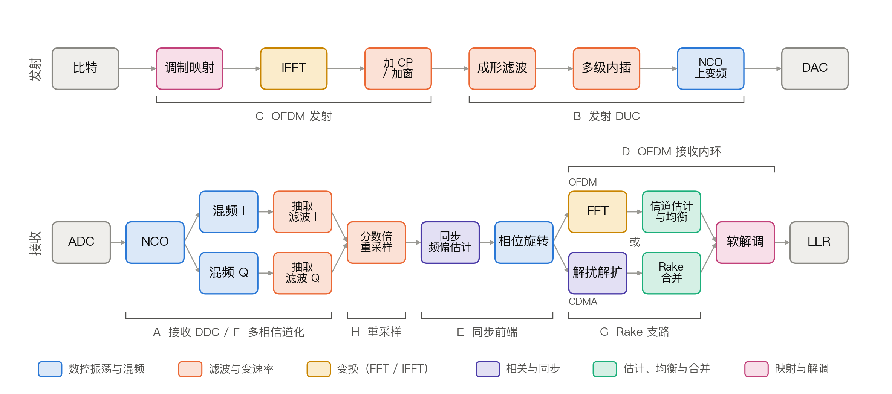
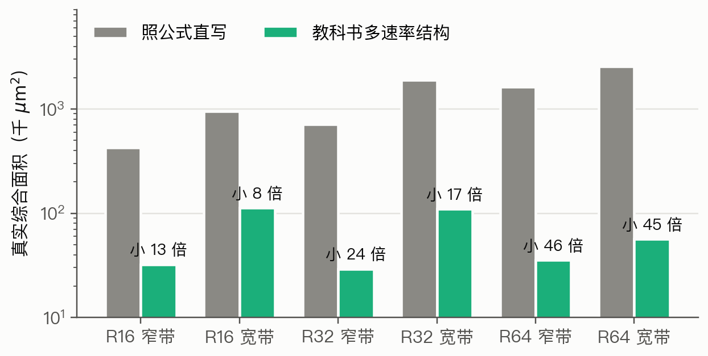
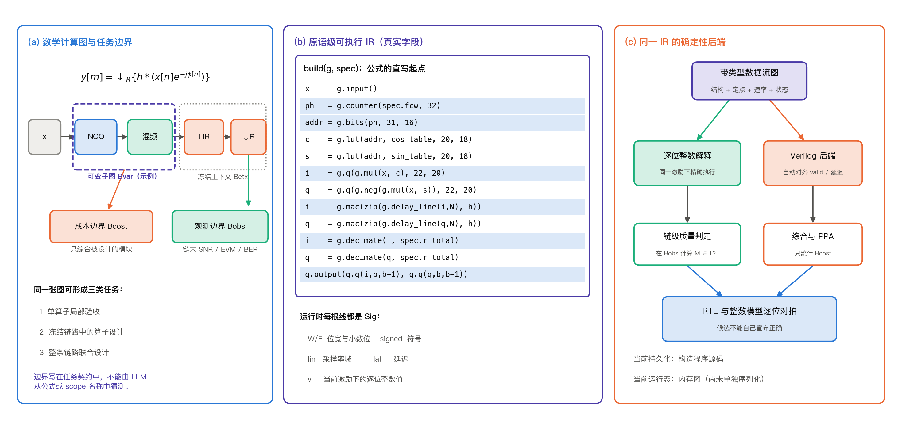
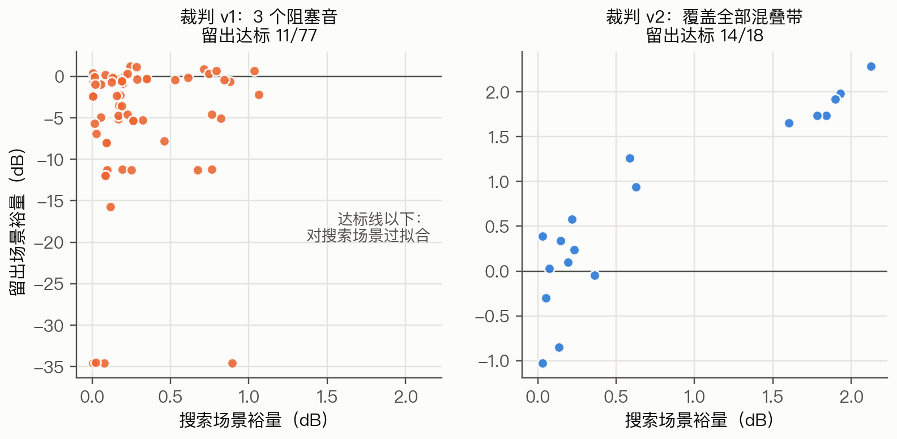
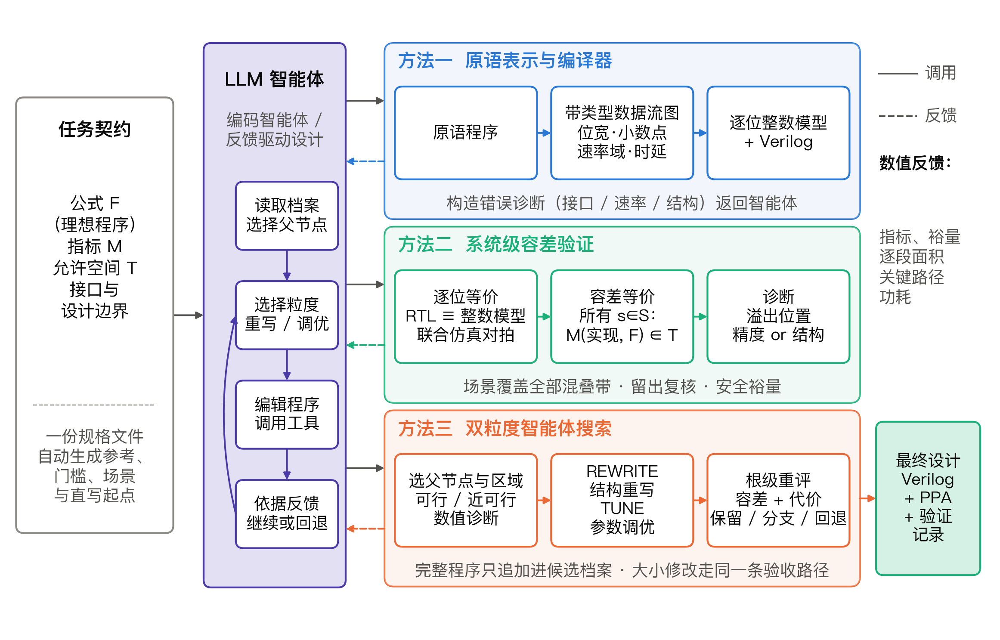
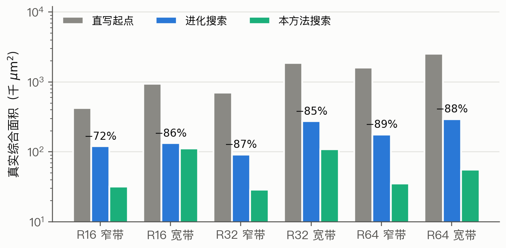
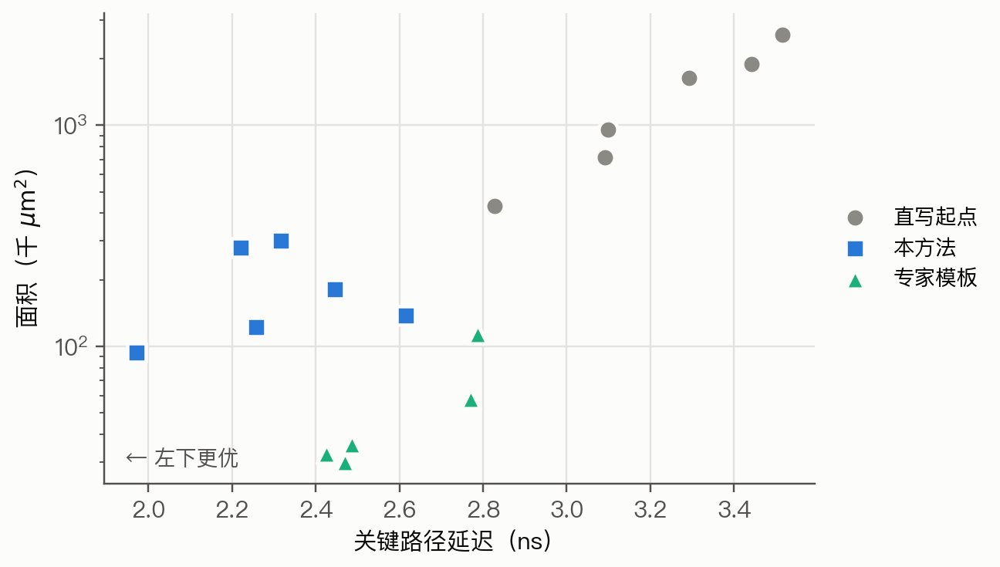
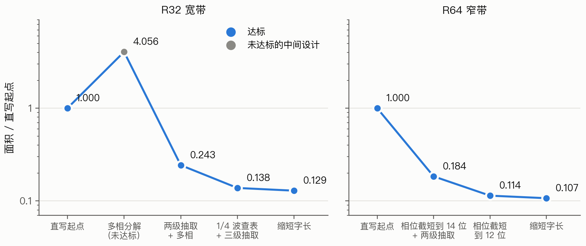
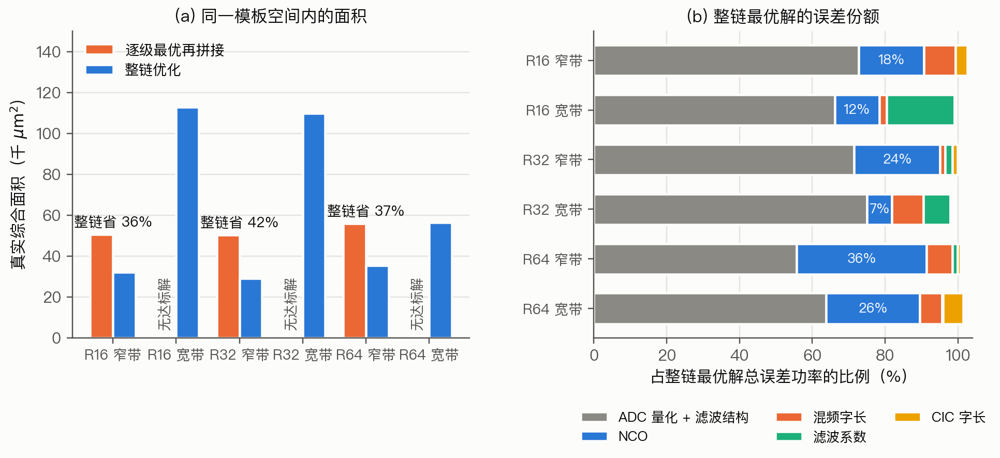
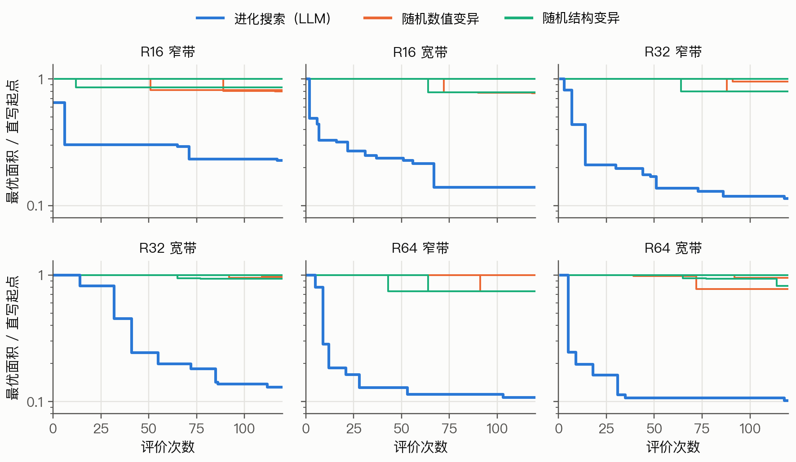

# 研究生学位论文中期报告（v2）

> 2026-10-13。持续更新版；所有新增论断均须由仓库内产物支持。
> 题目：**基于大语言模型的通信基带算法硬件设计自动化方法研究**
> 所有实验结果均在修订后的裁判（v2）下得到；面积为 Nangate45 真实综合面积（快速 ABC 脚本）。数字出处见附录。

---

# 一 研究背景、领域进展和研究动机

## 1.1 研究背景

从 3G 到 5G，再到 Wi-Fi 和软件无线电，基带硬件中占面积和功耗最多的是**数值运算**：上下变频、多速率滤波、FFT、信道估计与均衡、软解调（图 1）。这些模块的数学定义是确定的，但实现方式有很大的自由度。本课题所说的“通信基带算法”指基带及数字前端中以数值运算为主的模块，包括上下变频、滤波、FFT、调制解调和软判决译码；必须逐位正确的比特级处理不在范围内。

**图 1** 通信收发链路的数值运算部分，以及本课题数据集中各条链路覆盖的范围。实线括号为已完成或接入中的链路，虚线括号为计划中的链路。

以接收机的数字下变频（DDC，链 A）为例，它的数学定义只有一行：

$$y[m] = \Big(h * \big(x[n]\, e^{-j 2\pi f_{IF} n}\big)\Big)[mR] \tag{1}$$

即把中频信号搬到零频、低通滤波、抽取 $R$ 倍，其中低通 $h$ 只要求满足系统指标。实现上却有很多选择：正余弦用整表、四分之一波表还是 CORDIC；滤波用单级长 FIR、多级抽取，还是 CIC 加半带；每一级用多少位宽。

**图 2** 同一个公式的两种实现的真实面积。照公式逐字实现的直写设计，比教科书多速率结构大 8–46 倍。决定面积的是**结构变换**，而不是位宽微调。

## 1.2 国内外研究现状

- **DSP 硬件生成器与字长优化。** SPIRAL、FloPoCo 用专家规则或算子库生成特定算子；字长优化在给定结构下搜索位宽。结构的选择和组合依赖设计者。
- **等价饱和（e-graph）。** egg、Coward 等、ROVER 用 e-graph 表示等价程序空间并按代价提取；ASPEN 让 LLM 提议重写规则。这类方法只做等价变换，通常局限于单个表达式。
- **LLM 生成 RTL。** RTLCoder、AutoChip、VerilogCoder 等从自然语言生成 Verilog，VerilogEval、RTLLM 等基准以功能通过率为指标。已有基准中的 DSP 题很少且规模小（如 4 抽头 FIR、8 点 FFT）。
- **中间表示与分阶段生成。** 2026 年的 HINT 在规格和 RTL 之间加入可执行的硬件意图层，先确定微结构再降级为 RTL，综合面积小于手写设计；VeriRefine 先把自然语言规格细化成逐信号的结构化描述并做审计，再把仿真失败归为“理解错误”或“编码错误”，回送到对应阶段修复。因此“加中间表示”和“错误归因加定向修复”本身已经不是空白。两者面向的都是通用数字电路，正确性标准仍是与规格逐位一致，没有涉及定点近似和系统级数值指标。
- **LLM 驱动的进化搜索。** AlphaEvolve、OpenEvolve 让 LLM 在种群中以 diff 形式改写程序；REvolution、COEVO 等把这一思路用于 RTL，规格仍是自然语言或参考 RTL。

**表 1** 与相关工作的特性对比（✓ 支持，✗ 不支持，△ 部分支持）

| 工作 | 公式级输入 | 近似变换 | 整链优化 | 无需人工规则 | 系统级数值判据 | 综合 PPA |
|---|:-:|:-:|:-:|:-:|:-:|:-:|
| SPIRAL / FloPoCo | ✓ | △ | ✗ | ✗ | ✗ | ✓ |
| 字长优化（Sung'95, Lee'06） | ✗ | △ | △ | ✓ | ✓ | ✗ |
| HLS（Vitis HLS 等） | △ | ✗ | △ | ✓ | ✗ | ✓ |
| e-graph（Coward'22, ROVER） | ✗ | ✗ | ✗ | ✗ | ✗ | ✓ |
| LLM 写规则（ASPEN） | ✗ | ✗ | ✗ | △ | ✗ | ✓ |
| LLM 写 RTL（RTLCoder, AutoChip） | ✗ | ✗ | ✗ | ✓ | ✗ | ✗ |
| 意图 IR / 分阶段（HINT, VeriRefine） | ✗ | ✗ | ✗ | ✓ | ✗ | △ |
| LLM 进化（REvolution, COEVO） | ✗ | ✗ | ✗ | ✓ | ✗ | ✓ |
| **本课题** | ✓ | ✓ | ✓ | ✓ | ✓ | ✓ |

注：△ 的含义——FloPoCo 支持带误差界的算子近似，字长优化只在位宽维度上近似；HLS 的输入是 C 代码。本表各项正式写入论文前需逐条对照原文核实。

## 1.3 研究动机：三个问题与三个方法

**目标。** 用大语言模型把通信算法（数学公式 + 系统指标）自动设计成面积、时序、功耗更优的硬件。

通信算法硬件设计的核心难点在于两类变换：一是**结构变换**，例如多级抽取、CIC、查表压缩；二是**近似变换**，例如截短位宽、用简化滤波器替代理想滤波器，只要系统指标仍然满足就可以接受。这些变换一直靠专家经验完成。LLM 带有大量算法和硬件知识，有望替代这部分经验，但要让它真正可用，必须依次回答三个问题。

与通用 RTL 生成相比，最根本的区别在于“正确”的含义：通用电路要求与规格逐位一致，通信基带硬件则只要求系统指标（SNR、EVM、BER 等）落在容差之内。把“正确性”改为“可接受性”以后，近似变换和整链误差预算分配才进入设计空间，而这部分正是逐位等价的验证与修复流程覆盖不到的。

**表 2** 三个问题与对应的方法

| | 问题 | 方法 | 验证 |
|---|---|---|---|
| 1 | **LLM 应该在什么表示上设计硬件？** 直接写 Verilog 太低层：一个数学变换要改大量时序和控制代码，而且每次评价都要仿真加综合，太慢，无法支撑搜索 | **原语级可执行表示**：LLM 写由 16 个通用原语组成的构造程序。程序执行后形成带定点类型、采样率和状态的数据流图；同一份图产生快速逐位整数模型和逐位一致的 Verilog | 逐位对拍零失配；评价快上百倍；演化路径；与直接写 Verilog 对比 |
| 2 | **LLM 提出的近似设计怎样才算可接受？** 按单个算子的局部精度判定不对：逐级分配误差预算从原理上不是最优；测试不完整时，搜索会钻评价器的空子 | **系统级容差判定**：规格写成"公式 + 指标 + 容差"，只按整条链的端到端指标判定；干扰覆盖全频带，留出场景复核，加安全裕量 | 整链比逐级设计省 19%–42%；稀疏测试被钻空子与修复；误差份额分析 |
| 3 | **怎样让 LLM 高效地找到好设计？** 一次性生成几乎都失败；只做局部修改又难以跨越结构类地板 | **反馈驱动的双粒度智能体搜索**：智能体在区域级 `REWRITE` 与参数级 `TUNE` 之间切换；所有子候选都回到完整链路统一验收，父节点始终保留 | 平坦智能体、仅 `TUNE` 与 `REWRITE+TUNE` 对比；反馈消融；结构类之外的新实现 |

**三者如何串成一条线。** 方法一让 LLM 的每次修改都能被快速、准确地评价；方法二在此基础上定义什么样的设计算"好"，并把这个标准从单个算子提升到整条链；方法三在这个标准下组织 LLM 的搜索，把它的知识转化成更优的设计。前一个方法是后一个方法的前提：没有快速、可信的评价，就无法定义标准；没有可信的标准，搜索得到的"最优"就不可信。

在三个方法之上，我们把规格、参考、门槛、起点和提示词都做成由规格文件自动生成，使同一套系统可以直接用于新的通信算法：第二条链路（发射 DUC）只写了 20 行规格就完成了接入。

**本课题的贡献**

1. 提出一种供 LLM 设计硬件的原语级可执行表示，使通信算法到硬件的每一次 LLM 修改都能被秒级、逐位准确地评价。
2. 提出系统级容差判定方法，允许 LLM 在整条链路的指标约束下做近似变换，并在算子之间统一分配误差预算。
3. 提出反馈驱动的双粒度智能体搜索方法，在区域级结构重写与参数级局部调优之间切换，并以完整链路的容差和 PPA 反馈决定保留、继续修改或回到父节点。

---

# 二 已取得阶段性成果

## 2.1 问题定义与系统架构

**算子、子链与整链。** 数学上，整条链路本身也是一个复合算子。若链中有 $m$ 个阶段，则

$$F_G = f_m \circ f_{m-1} \circ \cdots \circ f_1.$$

因此“算子”和“链路”不是互斥类别，而是不同的抽象层。仅给出一个公式，系统无法知道本次任务是设计其中一个算子、一个子链，还是整条链。为消除这个歧义，本课题把规格从简单的 $(F,M,T)$ 三元组扩展为带显式边界的任务契约：

$$\mathcal{K}=\big(G,\ B_{\mathrm{var}},\ B_{\mathrm{ctx}},\ B_{\mathrm{obs}},\ B_{\mathrm{cost}},\ M,\ T,\ I\big),$$

- **数学计算图 $G$**：节点给出各级数学行为，边给出数据依赖和采样率变化；整图的理想行为为 $F_G$；
- **可变子图 $B_{\mathrm{var}}$**：本次允许搜索和生成的节点；
- **冻结上下文 $B_{\mathrm{ctx}}$**：可变子图之外的前后级，采用固定 RTL、逐位模型或理想模型；
- **质量观测边界 $B_{\mathrm{obs}}$**：在哪个输出计算 SNR、EVM、ACLR、SFDR、NMSE 或 BER；
- **成本统计边界 $B_{\mathrm{cost}}$**：哪些模块进入面积、时序和功耗统计；
- **指标 $M$、允许空间 $T$ 与接口 $I$**：分别定义合格判据、容差及外部位宽、速率和握手约束。

同一张数学计算图由边界不同可以形成三类任务。单算子局部任务在算子输出验收并只统计该算子；上下文感知的算子任务只修改一个算子，但把它接入冻结链路，在链末验收且仍只统计该算子的成本；整条子链任务则把多个节点同时放入可变子图，在链末验收并统计整条子链。第二类任务必须提供其他级的行为，但这些级只为质量传播服务时不必全部硬件化。

**优化问题。** 记 $p$ 为 $B_{\mathrm{var}}$ 内的原语构造程序，$H(p;G,B_{\mathrm{ctx}})$ 为把候选接回冻结上下文后得到的完整可执行系统，$x_s$ 为测试场景 $s$ 的输入，$\tilde{x}_s$ 为对应的无干扰输入。本课题求解：

$$\min_{p \in \mathcal{P}(B_{\mathrm{var}})} \; \mathbf{C}_{B_{\mathrm{cost}}}(p) = \big(\text{面积},\ \text{延迟},\ \text{功耗}\big) \quad \text{s.t.} \quad M_{B_{\mathrm{obs}}}\big(H(p;G,B_{\mathrm{ctx}})(x_s),\ F_G(\tilde{x}_s)\big) \in T,\ \forall s \in S_{\text{搜索}}. \tag{2}$$

最终设计还要在搜索不可见的留出场景 $S_{\text{留出}}$ 上复核。门槛由理想实现的成绩减去允许的实现损失 $\Delta$ 得到，例如：

$$\mathrm{SNR}_{\min} = \mathrm{SNR}\big(F_G(x_s),\ F_G(\tilde{x}_s)\big) - \Delta \tag{3}$$

质量是约束，代价是多目标；方法之间比较 PPA 的 Pareto 前沿。当前链 A 主实验把整个 DDC 子链设为 $B_{\mathrm{var}}$，把链末 I/Q 输出设为 $B_{\mathrm{obs}}$，把整条生成子链设为 $B_{\mathrm{cost}}$。程序中的 `scope` 只用于面积和诊断分组，不能代替任务契约中的搜索与成本边界，因为 `scope` 名称由候选程序自己给出。

## 2.2 方法一：原语级可执行表示

**当前 IR 的形态。** LLM 改的是用原语写的构造程序，既不是原始公式，也不是 Verilog。当前主线中的 IR 由两部分组成：持久化的是 Python 形式的 **build(g, spec)** 构造程序；程序执行后产生内存中的带类型数据流图。后者的每根信号都记录实际/名义位宽和小数位、符号、采样率域、延迟、保持语义，以及当前激励下的逐位整数值。编译器在建图时同步维护逐位整数语义并生成 Verilog，二者必须逐位对拍。

**从数学到 IR。** 这个过程不是把一行 LaTeX 机械翻译成唯一电路，因为同一公式对应大量结构。系统先把公式写成有名字的数学计算图，再由任务契约指定设计边界；直写前端或 LLM 选择每个数学节点的实现分解，最后用通用原语表达。例如式 (1) 依次展开为相位递推、正余弦近似、复数混频、卷积和抽取：

    def build(g, spec):
        x = g.input()
        ph = g.counter(spec.fcw, 32)
        addr = g.bits(ph, 31, 16)
        cos = g.lut(addr, cos_table, 20, 18)
        sin = g.lut(addr, sin_table, 20, 18)
        i = g.q(g.mul(x, cos), 22, 20)
        q = g.q(g.neg(g.mul(x, sin)), 22, 20)
        i = g.mac(zip(g.delay_line(i, ntaps), h), coef_bits=22)
        q = g.mac(zip(g.delay_line(q, ntaps), h), coef_bits=22)
        i = g.q(g.decimate(i, spec.r_total), spec.output_bits, spec.output_bits - 1)
        q = g.q(g.decimate(q, spec.r_total), spec.output_bits, spec.output_bits - 1)
        g.output(i, q)

这段程序执行后，关键节点的类型传播如下：

| 数学步骤 | IR 原语 | 主要类型信息 |
|---|---|---|
| $\phi[n+1]=(\phi[n]+\mathrm{FCW})\bmod 2^{32}$ | counter | 无符号 32 位，输入速率域 |
| $\cos\phi,\sin\phi$ | bits + lut | 查表地址位段；输出有符号 W=20、F=18 |
| $I=x\cos\phi,\ Q=-x\sin\phi$ | mul + neg + q | 量化后 W=22、F=20，显式舍入/溢出语义 |
| $v[n]=\sum_k h[k]u[n-k]$ | delay_line + mac | 状态、系数精度、累加与可选资源复用 |
| $y[m]=v[mR]$ | decimate | 数值格式保持，采样率域由 $1$ 变为 $1/R$ |
| 外部输出 | q + output | 检查输出位宽、小数位、符号和总速率 |

图 4 给出了完整关系：公式先成为分层计算图和带边界任务；实现选择落成原语程序；运行态 IR 再确定性地产生逐位整数模型和 Verilog。理想公式参考独立于候选实现，避免候选模型与 RTL 共享错误后相互“证明”。

**图 4** 数学公式到原语级可执行 IR 的过程。(a) 链路是分层复合算子，任务契约分别声明可变子图、冻结上下文、质量观测边界和成本边界；(b) 当前持久化 IR 是 **build(g,spec)** 构造程序，执行时形成带定点、速率、延迟和状态类型的数据流图；(c) 同一运行态图产生逐位整数模型和 Verilog，分别用于链级质量判定、逐位对拍和边界内 PPA 统计。

**实现状态与边界。** 仓库此前曾使用 DDC 专用 JSON **search_ir**，随后实现了逐节点定点格式和微结构字段的通用 **joint_design_ir**；当前报告对应的主线是更开放的 **dspgraph** 原语构造程序。它允许用原语组合出未预先登记的大结构，但运行态数据流图尚未单独序列化为规范 IR 文件。因此当前可复现实物是“构造程序源码 + 编译器版本 + 任务契约 + 生成 RTL”，后续需要补充稳定的图导出格式。当前系统也不是任意公式解析器：新增任务仍需人工把公式、接口、场景与指标编码成任务契约；LLM 负责在已声明计算图和边界内选择分解与实现，不能负责猜测研究对象。

**表 3** 原语集合（16 个，与具体算子无关）

| 类别 | 原语 | 负责什么 |
|---|---|---|
| 定点算术 | `add` `sub` `neg` | 加、减、取负 |
| | `mul` | 两个信号相乘（生成乘法器） |
| | `scale` `shift` | 乘常数（用移位加实现）、移位 |
| 位宽控制 | `q` | 量化到指定位宽；可选舍入或截断、饱和或回绕 |
| 查表与选择 | `lut` | 查找表 |
| | `bits` `mux` `const` | 取位段、多路选择、常数 |
| 时序与速率 | `reg` `delay_line` | 流水寄存器、样点延迟线 |
| | `integrate` | 累加器（CIC 的积分器） |
| | `decimate` | 抽取，改变采样率 |
| | `counter` | 计数器（如相位累加器） |
| 乘加 | `mac` | 常系数乘加；可选分时复用乘法器 |

原语里没有 FIR、CIC、NCO、CORDIC，这些都由 LLM 用原语拼出来。系统也不内置任何变换规则。LLM 写出的变换分为两类：

**等价变换**（输出不变，记作 $\rightleftharpoons$）：

$$
\begin{aligned}
H(z^{R})\ \text{后接}\ {\downarrow}R \ &\rightleftharpoons\ {\downarrow}R\ \text{后接}\ H(z) && \text{（多相恒等式：先抽取再滤波）}\\
\sum_{k=0}^{N-1} h_k\,x[n-k] \ &\rightleftharpoons\ \sum_{k=0}^{N/2-1} h_k\big(x[n-k]+x[n-N+1+k]\big) && \text{（系数对称：先加后乘）}\\
\cos\theta,\ \theta\in[0,2\pi) \ &\rightleftharpoons\ \pm\cos\theta',\ \theta'\in[0,\tfrac{\pi}{2}) && \text{（四分之一波查表）}
\end{aligned} \tag{4}
$$

**近似变换**（输出改变，引入误差 $\varepsilon$，记作 $\xrightarrow{\varepsilon}$）：

$$
\begin{aligned}
H(z) \ &\xrightarrow{\varepsilon}\ \prod_{i} H_i\big(z^{R_1\cdots R_{i-1}}\big) && \text{（单级滤波拆成多级抽取）}\\
H_1(z) \ &\xrightarrow{\varepsilon}\ \Big(\frac{1-z^{-R}}{1-z^{-1}}\Big)^{N} && \text{（CIC 代替第一级滤波）}\\
x \ &\xrightarrow{\varepsilon}\ Q_w(x),\quad \varepsilon \approx \frac{2^{-2w}}{12} && \text{（截短到 } w \text{ 位）}
\end{aligned} \tag{5}
$$

等价变换可以直接接受；近似变换是否可以接受，只由裁判按允许空间 $T$ 判定。这正是规则编译器做不到的部分。

**编译正确性。** 主实验的 18 个设计和逐级设计的 15 个设计，RTL 仿真与整数模型逐位对拍，失配均为 0。

## 2.3 方法二：系统级容差判定

**裁判**只看端到端行为：把测试信号送进被测设计，与理想参考对齐后计算指标，判断是否落在允许空间内。**诊断**在不达标时确定性地定位原因：把全部量化点加宽后重跑，如果达标说明是精度问题，再逐段定位；否则是结构问题。

**算子级误差模型与链级验收属于不同层次。** 对存在解析误差模型的算子，可以在可变子图内部确定性地计算量化误差，用于精度调优、误差归因和候选筛选；最终是否可接受，仍由候选接回冻结上下文后的链级指标决定。若前后级是线性时不变系统，可以进一步传播误差频谱或误差矩；遇到抽取折叠、饱和、状态递推或非线性判决时，则需要逐位链级模型或独立场景评价。当前链 A 的端到端 SNR 属于冻结场景上的逐位评价，不应表述为全输入空间的解析适应度。后续若要主张整链解析评价，必须先给出可验证的跨节点误差表示与组合规则。

**为什么不能逐级设计。** 设整链的允许误差为 $e_{\text{tot}}$，各级引入的误差近似可加（实测各项之和为总误差的 0.98–1.02 倍）：

$$e_{\text{tot}} \approx \sum_{i=1}^{m} e_i \tag{6}$$

逐级设计把预算平均分配，每级各自最小化面积；整链优化则联合求解：

$$\text{逐级：}\ A_{\text{逐级}} = \sum_i \min A_i\big(\tfrac{e_{\text{tot}}}{m}\big) \qquad\quad \text{整链：}\ A_{\text{整链}} = \min_{\sum_i e_i \le e_{\text{tot}}} \sum_i A_i(e_i) \tag{7}$$

整链最优解满足各级的边际代价相等，即 $-\partial A_i/\partial e_i = \lambda$。哪一级放宽精度最省面积，预算就应该多给哪一级。平均分配一般不满足这个条件，所以 $A_{\text{整链}} \le A_{\text{逐级}}$。2.6.3 节的实验定量验证了这一点。

**系统指标必须完整。** 以整链指标为准则有一个前提：指标的定义必须完整。第一版裁判每个场景只放 3 个阻塞音，结果参数搜索和 LLM 都学会了只在被检验的几个频点上做抑制。修订后的裁判让阻塞音覆盖全部混叠频带，并要求每个最终设计在留出场景上复核（图 5）。

**图 5** 搜索场景裕量与留出场景裕量。裁判 v1 下，77 个最优设计中只有 11 个在留出场景上达标，最差低于门槛 34 dB；裁判 v2 下，18 个设计中 14 个达标，未达标的只差 0.05–1.0 dB。

## 2.4 方法三：反馈驱动的双粒度智能体搜索

方法三维护一个只追加的**候选档案**。每个候选不是一段孤立代码，而是一份能够独立构造整条设计的完整原语程序，同时记录父节点、修改动作、变换声明、系统约束表、PPA、相对父节点的变化量和验证状态。初始化时，档案至少包含由任务契约自动生成的直写程序；智能体也可以只根据同一份契约建立其他完整起点。

智能体每轮先从档案中选择一个父节点，再根据失败场景、质量缺口、分区域代价和关键路径选择要修改的类型化区域。随后在两种语义粒度之间选择：

- **`REWRITE`：区域级结构重写。** 它改变算法分解、数据流拓扑、状态或速率结构，例如把长 FIR 改为 CIC 加补偿滤波，把 radix-2 FFT 改为 radix-4，或把两个区域融合后共享运算。智能体先复制父节点的完整程序，在独立工作副本中修改一个或多个相连区域；期间可以通过多次小代码编辑以及 `probe`、`freqz`、`check`、`eval` 等工具逐步完成。区域的输入输出类型重新匹配且程序能够构造后，整个工作副本才作为一个 `REWRITE` 子节点登记。因此“大变化”指语义和拓扑跨度大，并不要求模型一次生成一个巨大的文本补丁。
- **`TUNE`：参数级局部调优。** 它保持算法分解、区域连接和外部接口不变，只修改候选显式暴露的参数映射，例如位宽、小数位、截位位置、查表精度、抽头数、系数量化、流水和资源复用参数。当前工具通过 Python AST 精确改写参数字典，不让字符串替换误伤程序其他部分。一次 `TUNE` 形成一个子节点；连续子节点给出“面积减少多少、质量裕量损失多少”的局部灵敏度。

无论采用哪种动作，框架都不接受局部区域自行宣布成功。新候选必须回到链路根节点执行同一条评价路径：

1. 方法一构造带类型数据流图；不能构造或接口不一致的候选标为 `BROKEN`。
2. 同一数据流图生成逐位整数模型与 RTL；搜索阶段先用整数模型快速评价，编译器回归保证两条后端遵守同一套原语语义。
3. 方法二在完整冻结上下文中计算所有搜索场景的系统级约束。合法但仍有缺口的候选标为 `OPEN`，进入近可行档案；全部满足安全裕量的候选标为 `FEASIBLE`。
4. 对新的低代价可行候选自动运行留出场景；最终候选再执行整数模型与 RTL 对拍、门级检查和统一约束下的面积、时序与功耗评价，通过后标为 `VERIFIED`。

档案始终保留父节点。新分支失败时，智能体回到父节点或改从其他可行/近可行节点继续，不会用失败程序覆盖当前最好设计。约束缺口很小的 `OPEN` 节点优先用 `TUNE` 修复；可行节点用 `TUNE` 沿局部质量--PPA 斜率继续压缩；当连续四次 `TUNE` 没有改善最小可行代价，或者诊断显示瓶颈来自算法结构时，档案提示智能体执行 `REWRITE`。一个新结构通常还要经过若干次 `TUNE` 才与其他结构公平比较。

当前原型已经实现完整候选档案、父子关系、`REWRITE/TUNE` 动作记录、AST 参数修改、根级判定、可行与近可行前沿及留出/终验调度。现有 r32n 开发回放实际执行的是 7 个 `TUNE` 子节点；结构级 `REWRITE` 的决定性对照仍需按同模型、同反馈和同评价预算运行。因此当前结果只能证明闭环和小粒度路径可运行，尚不能把大结构发现写成已经验证的实验结论。

**图 3** 系统架构：智能体在 `REWRITE` 与 `TUNE` 两种粒度之间切换；完整候选经过编译、根级容差判定和 PPA 评价后进入档案，数值反馈决定下一轮修改或回到父节点。

## 2.5 数据集与通用框架

**算子筛选。** 本课题适用于同时满足三条的算子：数值质量可以换代价；有多种真正不同的结构；与前后级耦合。必须逐位正确的比特级处理（CRC、加扰、交织）不在范围内。

**表 4** 链路数据集（9 条；A–H 为前馈结构，I 为带状态反馈的结构）

| 编号 | 链路 | 组成 | 指标 | 来源系统 | 状态 |
|---|---|---|---|---|---|
| **A** | 接收 DDC | NCO → 混频 → 多级抽取滤波 | 带内 SNR、纹波 | 全部 | **已完成**（6 开发 + 6 留出规格） |
| **B** | 发射 DUC | 成形滤波 → 多级内插 → NCO 上变频 | EVM、ACLR | 3G、SDR | **已接入**（3 规格），实验运行中 |
| C | OFDM 发射 | 调制映射 → IFFT → 加窗 | EVM、带外泄漏 | 4G、5G、Wi-Fi | 计划 |
| D | OFDM 接收内环 | 频偏校正 → FFT → 信道估计 → 均衡 → LLR | EVM、BER 损失 | 4G、5G、Wi-Fi | 计划 |
| E | 突发同步前端 | 自相关 → 包检测 → 频偏估计 → 相位旋转 | 检测概率、频偏误差 | Wi-Fi、5G | 计划 |
| F | 多相信道化器 | 原型滤波器多相分解 → FFT | 子带泄漏、EVM | SDR | 计划 |
| G | WCDMA Rake 支路 | 匹配滤波 → 解扩 → 积分 → 合并 | 合并后 SNR | 3G | 计划 |
| H | 分数倍重采样 | 抗混叠滤波 → Farrow 插值 | EVM、镜像抑制 | SDR | 计划 |
| I | Viterbi 软判决译码 | 软比特量化 → 分支度量 → 加比选 → 路径度量归一化 → 回溯 | BER 损失 | 3G、Wi-Fi、卫星 | 计划 |

链 I 用来覆盖带状态反馈的算法：软比特位宽、路径度量位宽和回溯深度都可以拿 BER 换面积，加比选单元的并行度和复用方式也有多种结构，符合本课题“质量可换代价”的筛选条件。

另有 7 个算子族、106 个单算子实例（复乘、正余弦、NCO、FIR、atan2、LLR、匹配滤波）。

**通用框架。** 目标是新增一条链时只写一份规格文件，其余自动生成：参考与门槛由理想版程序算出，直写起点由理想版自动展开得到，测试信号和指标从库中选用。

目前的进展：裁判已拆分为信号库、参考生成和指标库，链 A 的 12 个规格改用新框架描述（一个 6 行的理想版函数，每个规格一条登记）。三项回归测试全部通过：

- 60 组（12 规格 × 5 场景）的输入、上限、门槛与原裁判逐位相同；
- 18 个已有设计重新打分，SNR、纹波、面积完全相同；
- 自动生成的直写起点与手写起点的指标一致，6 个规格全部达标。

**第二条链的接入成本。** 链 B（DUC）是第一条只靠规格文件接入的链：

| 项目 | 数值 |
|---|---|
| 规格文件 | 20 行有效代码（4 行理想版程序 + 3 个规格的参数） |
| 写规格文件 | 约 2 分钟 |
| 一次性补齐的通用能力（内插原语、复数输入输出、上变频、带通指标、基带信号库等，后续链路可复用） | 约 15 分钟 |
| 自动生成的直写起点 | 3 个规格全部达标（搜索裕量 +0.65 ~ +1.34 dB，留出裕量 +0.25 ~ +0.96 dB），RTL 逐位零失配 |

补齐通用能力后，链 A 的三项回归测试仍全部通过。

## 2.6 实验评估

### 2.6.1 实验设置

- **规格**：链 A 的 6 个开发规格（抽取倍率 16、32、64 × 宽带、窄带）；另有 6 个留出规格。
- **LLM**：DeepSeek（`deepseek-flash`）。
- **本方法**：进化搜索 + 数值反馈，120 次迭代，种子 0。
- **非 LLM 搜索**：从同一个直写起点出发，同为 120 次评价；随机数值变异和随机结构变异各 2 个种子。
- **专家模板（参考上限）**：教科书结构 NCO → CIC → 半带 → 补偿 FIR，经 4000 次评价的参数搜索。

### 2.6.2 总体结果

**图 6** 链 A 上的真实面积。百分比为本方法相对直写起点的降幅。

**表 5** 链 A 主结果

| 规格 | 直写起点 (μm²) | 本方法 (μm²) | 降幅 | 留出裕量 (dB) | 时钟频率 (MHz)：直写 → 本方法 | 专家模板 (μm²) |
|---|---|---|---|---|---|---|
| R16 窄带 | 425,644 | 121,112 | 71.5% | −0.05 | 354 → 443 | 32,210 |
| R16 宽带 | 946,859 | 134,285 | **85.8%** | −0.30 | 323 → 382 | 112,852 |
| R32 窄带 | 709,042 | 92,264 | **87.0%** | +0.24 | 324 → 507 | 29,155 |
| R32 宽带 | 1,889,223 | 276,398 | **85.4%** | +0.94 | 291 → 450 | 109,802 |
| R64 窄带 | 1,622,343 | 178,227 | **89.0%** | +0.34 | 304 → 409 | 35,428 |
| R64 宽带 | 2,559,706 | 296,043 | **88.4%** | +1.26 | 284 → 432 | 56,303 |

- **只给公式和指标，LLM 把真实面积降低了 71.5%–89.0%**，RTL 逐位零失配。
- **泛化与专家模板相当**：留出场景上本方法 4/6 达标，专家模板同样是 4/6。

**多种子结果。** 每个规格补到 3 个种子后（表 5b），18 个运行全部找到达标设计，降幅中位数为 68.1%–92.3%；在留出场景上 13/18 达标，不达标的 5 个集中在裕量要求最窄的 R16 两个规格。

**表 5b** 本方法 3 个种子的结果（真实面积）

| 规格 | 降幅中位数（范围） | 达到专家面积的比例：中位数（最好） | 留出达标 |
|---|---|---|---|
| R16 窄带 | 71.5%（70.6%–89.7%） | 27%（74%） | 0/3 |
| R16 宽带 | 68.1%（51.9%–85.8%） | 37%（84%） | 1/3 |
| R32 窄带 | 86.7%（79.1%–87.0%） | 31%（32%） | 3/3 |
| R32 宽带 | 85.5%（85.4%–85.8%） | 40%（41%） | 3/3 |
| R64 窄带 | 88.9%（83.9%–89.0%） | 20%（20%） | 3/3 |
| R64 宽带 | 92.3%（88.4%–93.9%） | 29%（36%） | 3/3 |

**在留出规格上复验。** 方法冻结后，在 6 个从未使用过的留出规格上运行本方法（种子 0）：6 个规格全部找到达标设计，真实面积相对直写起点降低 40.5%–92.5%（R16 中带 40.5%、R24 宽带 68.1%、R32 中带 75.5%、R48 窄带 87.6%、R64 中带 84.6%、R96 窄带 92.5%）。

**安全裕量解决留出问题（初步）。** 搜索时要求裕量不低于 0.3 dB：链 A 的 R16 两个规格、链 B 的 L8 和 L16 两个规格，原本都在留出场景上不达标，加裕量后 **4 个全部转为达标**。面积变化在 −25% 到 +14% 之间，没有一致的方向，即没有观察到明显的面积代价（每个规格 1 个种子）。
- **时序同步改善**：本方法的最高时钟频率为 382–507 MHz，直写起点为 284–354 MHz（图 7）。

**图 7** 面积与关键路径延迟。本方法在两个维度上都优于直写起点；与专家模板相比，本方法延迟更小但面积更大，两者互不支配。各设计的延迟差别不大（2–3.5 ns），这条链上的 PPA 比较主要由面积决定。

**与专家水平的距离。** 专家模板内置了 CIC、半带等结构。本方法只用 120 次迭代，在 R16 宽带上达到专家面积的 84%，其余规格为 19%–40%。

### 2.6.3 问题一：原语表示上的 LLM 变换

图 4(b) 给出了 R32 宽带上的真实演化路径，图 8 给出两个规格上每一步的面积。

**图 8** 演化路径。横轴是 LLM 依次引入的变换。

- **面积主要靠结构变换降下来**：大幅下降都发生在多级抽取、查表结构改写这几步，最后的位宽微调只再降 5%–7%。
- **每一步都是小幅的程序修改**，对应式 (4)(5) 中的某一种变换。
- **进化可以穿过未达标的中间设计**：R32 宽带的第 1 步本身不达标，它的后代修正后成为最优设计的祖先。

作为对照，让 LLM 每次从头写一个完整设计时，80 次调用只有 9 次达标（试点数据，裁判 v1）。

**与"LLM 直接写 Verilog"的对比（进行中）。** 同一模型、同样 120 次迭代、相同的数值反馈，让 LLM 直接修改与本方法起点逐位等价的 Verilog。目前完成了 R16 窄带一个规格：

| | 起点面积 (μm²) | 最优面积 (μm²) | 相对起点降幅 | 留出 | 每次评价耗时 |
|---|---|---|---|---|---|
| 直接写 Verilog | 661,986 | 148,167 | 77.6% | 达标 | 约 6 分钟 |
| 本方法（3 种子） | 425,644 | 43,805 – 125,195 | 70.6%–89.7% | 0/3 达标 | 1–3 秒 |

直接写 Verilog 也能做出查表压缩、对称预加等变换，但没有做多级抽取；它的最优面积比本方法的中位数大约 20%，比最好的种子大 3.4 倍。另一个明显差别是代价：Verilog 每次评价都要仿真和综合，同样的迭代次数墙钟时间是本方法的上百倍。目前只有一个规格，尚不能得出结论，其余 5 个规格正在运行。

### 2.6.4 问题二：系统级判定 vs 逐级设计

在专家模板空间中比较式 (7) 的两种做法。逐级设计的分配规则在实验前写定。

**图 9** (a) 逐级最优再拼接与整链优化的真实面积；(b) 整链最优解中各误差源占用的份额。

- **窄带规格：逐级设计能达标，但面积更大。** 整链优化节省 36%–42%。把两者的裕量都压到约 0.1 dB 后再比（只有 R16 窄带做到），整链优化仍节省 19%。
- **宽带规格：逐级设计找不到达标的解。** 局部指标在模板范围内无解；把局部指标放宽到有解时，整链已经不达标（差 0.6–2.5 dB）。这一条用到了预定规则之外的补充实验。
- **最优分配明显偏离平均分配。** 6 个规格中有 5 个是 NCO 占实现误差的大头（7%–36%），CIC 字长几乎不占。这与式 (7) 的边际代价条件一致。

需要说明的是，整链最优设计把裕量压到接近 0，其中 2 个在留出场景上不达标；整链优化需要配合安全裕量。

### 2.6.5 问题三：搜索效率

**图 10** 进化曲线。同样 120 次评价，本方法的最优面积持续下降，两种随机搜索基本停在起点附近。

**表 6** 同预算（120 次评价）下的面积比（面积 / 直写起点，越小越好）

| 方法 | R16 窄 | R16 宽 | R32 窄 | R32 宽 | R64 窄 | R64 宽 | 几何均值 |
|---|---|---|---|---|---|---|---|
| 随机数值变异（2 种子） | 0.80 / 0.82 | 0.77 / 1.00 | 0.80 / 0.96 | 0.97 / 0.95 | 0.74 / 1.00 | 0.77 / 0.95 | 0.871 |
| 随机结构变异（2 种子） | 0.86 / 1.00 | 0.78 / 1.00 | 0.80 / 1.00 | 0.93 / 1.00 | 0.75 / 0.75 | 0.82 / 1.00 | 0.884 |
| **本方法** | **0.226** | **0.139** | **0.114** | **0.129** | **0.107** | **0.102** | **0.131** |

- **LLM 的面积约为非 LLM 搜索的 1/7。** 随机搜索只能在现有结构上微调，LLM 能提出有意义的结构变换。

**表 7** 反馈档位消融（3 规格 × 4 种子，共 36 个运行）

| 反馈 | 面积比（几何均值） | 相对"只给分数" | Wilcoxon p |
|---|---|---|---|
| 只给分数 | 0.224 | — | — |
| **给全部指标数值** | **0.134** | **−40%，11/12 对更好** | **0.001** |
| 再加诊断归因 | 0.137 | −39%，11/12 对更好 | 0.002 |

- **数值反馈的作用显著。** 把各项指标的具体数值和逐段面积返回给 LLM，比只给一个分数面积小约 40%，12 对中 11 对更好（p = 0.001）。
- **额外的诊断归因没有进一步收益。** 在指标数值之上再给"加宽量化点重跑"的诊断，与只给指标数值无差异（p = 0.52）。在这条链上，诊断信息基本能从指标数值推出来。

**两项补充发现：**

- **决策的组织方式影响很大。** 在专家模板空间里，按"结构 → 精度 → 复用"分阶段搜索，显著优于三者同时搜索：面积比为 1 : 1.22，24/30 对更优，p = 0.0004；在 6 个从未使用过的留出规格上复现（1 : 1.26，p = 0.0006）。
- **与专家的差距是结构性的。** 我们尝试让 LLM 只用一半预算定结构，另一半预算交给确定性的位宽优化。结果不如让 LLM 用满全部预算（9 对中只有 3 对更好）。这说明 LLM 后半程带来的结构改进，比位宽调优的收益更大；要追上专家，需要的是更大步的结构变换，而不是更细的位宽调整。在最优设计上再追加一次位宽优化，面积还能降 1%–13%；但它会把裕量压到接近 0，9 个设计中只有 4 个在留出场景上达标。因此位宽优化只能在设定安全裕量的前提下作为收尾步骤。

**从专家模板出发的两层搜索。** 以满足 0.3 dB 裕量的专家设计为起点，运行两层搜索（120 次 LLM 迭代），结果如下：

- **与"只调位宽和复用"对比**：6 个规格中 5 个面积更小（几何均值 0.951）；留出场景达标 5/6，对照为 3/6。
- **与专家参数搜索的最优结果 R 对比**：平均面积大 11%，只有 R32 宽带一个规格面积更小（小 7.3%，且 R 在该规格上留出不达标）；留出达标 5/6，R 为 4/6。
- **LLM 做了什么**：最终程序与起点相比，4 个规格的代码结构完全没变，另外 2 个各改了 1 行。面积的下降几乎全部来自 LLM 调整模板中的结构参数（滤波器抽头数等）和位宽。

也就是说，**拿到专家模板之后，LLM 表现为一个带裕量约束的参数优化器，没有产生模板之外的新结构**，在面积上没有稳定超过专家参数搜索，但泛化更稳。LLM 的结构变换能力主要体现在从公式直接出发时（2.6.3 节）。

**与人类设计的开源实现对比（初步）。** 我们把开源 Ettus USRP 的数字下变频链（`ddc_chain.v`：CORDIC → 4 阶 CIC → 两级固定系数半带）接到同一个裁判上。它的抽取倍率可以映射到全部 12 个规格，每个规格都按主机软件的方式选取最优配置。结果是 12 个规格**全部不达标**，搜索裕量为 −8.9 到 −70 dB。去掉阻塞音后，倍率不小于 24 的规格 SNR 正常（37.5–51.8 dB），说明接线正确；不达标的原因是它的固定滤波器无法抑制覆盖全部混叠频带的强阻塞音。倍率为 16 的 3 个规格在去掉阻塞音后仍无有效输出，原因待查，不计入其性能。这说明在强阻塞的系统级指标下，通用的固定结构设计并不适用，需要按规格定制，而这正是本课题要自动完成的工作。由于它不达标，面积不可比，不纳入面积比较。

### 2.6.6 第二条链：发射 DUC

链 B 只写了一份 20 行的规格文件，直写起点自动生成。本方法（数值反馈，120 次迭代，种子 0）的结果如下：

**表 9** 链 B 结果（真实面积，μm²）

| 规格 | 直写起点 | 本方法 | 降幅 | 留出裕量 (dB) |
|---|---|---|---|---|
| L4 窄带 | 110,533 | 54,800 | **50.4%** | +0.13 |
| L8 宽带 | 354,577 | 195,781 | **44.8%** | −0.21 |
| L16 中带 | 429,584 | 228,200 | **46.9%** | −0.16 |

- **同一套系统、不做任何修改，在第二条链上把面积降低 45%–50%**，RTL 逐位零失配，最终种群中 31–33/40 个程序达标。
- 降幅比链 A 小，是因为 DUC 的直写起点没有链 A 那样的 65536 项大查找表，冗余本来就少。
- 链 B 的专家模板（补偿 FIR + 半带 + CIC 内插）经参数搜索后，真实面积为 32,207 / 65,120 / 45,593 μm²，本方法达到专家面积的 59% / 33% / 20%。在链 B 上，分阶段与联合搜索没有显著差异（8 对中联合 5 对更好），所以"分阶段更优"的结论限定在链 A。

### 2.6.7 小结

**表 8** 三个问题的证据

| 挑战 | 主要证据 | 进行中 |
|---|---|---|
| 1 表示 | 演化路径（图 8）；RTL 逐位零失配；评价速度快上百倍 | 与直接写 Verilog 的对比（1/6 规格完成） |
| 2 整链最优 | 整链比逐级节省 19%–42%，宽带规格上逐级无解（图 9）；裁判完整性（图 5） | 在链 B 上复验 |
| 通用性 | 链 B 只写 20 行规格即接入；本方法在链 B 上把真实面积降 45%–50%（表 9） | 链 B 专家参考 |
| 3 搜索效率 | 面积为随机搜索的 1/7（图 10）；数值反馈使面积降 40%，p = 0.001（表 7） | 补种子；留出规格 |

---

# 三 学位论文进展情况和存在的问题

## 3.1 进展情况

| 部分 | 状态 |
|---|---|
| 原语、编译器、裁判、诊断、综合、代价校准 | 完成 |
| 数据集设计（16 类算子、8 条链路） | 完成；链 A 已有结果 |
| 通用框架 | 裁判拆分与自动起点完成并通过回归；链 B 已只靠规格文件接入（20 行，约 2 分钟） |
| 链 A 主实验与三个挑战的实验 | 完成（主实验 3 种子，反馈消融 4 种子）；直接写 Verilog 基线与留出规格进行中 |
| 论文撰写 | 早期草稿需按当前主线重写 |

## 3.2 存在的问题

1. **与专家水平仍有距离，且尚未超过专家。** 从公式出发时，本方法达到专家面积的 14%–84%；从专家模板出发时，LLM 只调整参数、不改写结构，平均面积仍比专家参数搜索大 11%。LLM 很少主动采用 CIC、半带这类整体替换滤波结构的大步变换。目前只用了一个较小的模型（deepseek-flash）和每次 120 次迭代，更强的模型和更大的预算是否能改变这一点，尚待验证。
2. **统计强度。** 链 A 主实验已为 3 个种子，反馈消融为 4 个种子；链 B 和留出规格仍为单种子。
3. **裕量过紧。** 链 A 上本方法 3 个种子共 18 个设计中有 5 个在留出场景上不达标（集中在 R16 两个规格）；链 B 上有 2/3 差约 0.2 dB。0.3 dB 安全裕量已使这 4 个规格全部转为达标，需要在更多种子上确认，并作为默认设置。
4. **基线不完整。** 直接写 Verilog 的对比正在运行；HLS 基线受本机环境限制尚未完成。LLM 生成 RTL 领域的标准基线，即直接提示生成、先规划再生成、编译/仿真反馈修复（AutoChip 式），以及 pass@k 等指标，尚未补齐。
5. **链路类型单一。** 目前有结果的链 A、B 都是前馈多速率结构；FFT 类链路的直写起点规模很大，需要专门处理；带状态反馈的算法（链 I）尚未覆盖。
6. **PPA 不完整。** 时序口径较粗，功耗和吞吐尚未评估，搜索目标目前只有面积；式 (2) 的 Pareto 多目标形式还没有落到实验上。
7. **任务边界尚未成为独立 schema。** 当前主实验默认整条 DDC 子链都是可变和计价对象，`scope` 只用于诊断；还不能直接表达“只设计一个算子、在冻结链路末端验收、只统计该算子 PPA”的上下文感知任务。
8. **运行态图尚未规范化落盘。** 当前持久化对象是构造程序，带类型图只存在于编译过程；需要增加稳定的图导出、语义哈希和边界校验。链 A 的系统指标仍来自冻结场景逐位评价，整链解析误差组合尚未完成。
9. **接口语义缺失。** IR 目前没有 valid/ready 等流接口与握手语义，生成的模块还不能直接接入带反压的真实系统。

---

# 四 下一步工作计划和内容，预计答辩时间

| 时间 | 内容 |
|---|---|
| 2026.10–2026.11 | 冻结计算图与四类任务边界 schema，增加规范 IR 导出；链 A：直接写 Verilog 基线、补到 3 个种子、留出规格复验、安全裕量；通用框架完成并接入链 B |
| 2026.12–2027.01 | 接入其余链路（优先 OFDM 的 FFT 链与 Viterbi 链 I）；提升大步结构变换的发现率（跨结构变异、领域知识、跨链迁移）；面积—时序—功耗 Pareto 多目标搜索；任务契约加入 valid/ready 接口语义；补齐标准基线（直接提示、先规划再生成、编译/仿真反馈修复、HLS）与 pass@k |
| 2027.02–2027.03 | 全部链路的主实验与留出复验；整理论文实验 |
| 2027.03–2027.04 | 撰写学位论文，投稿 |
| 2027.05（预计） | 学位论文答辩 |

---

# 五 已取得研究成果列表

（待补）

---

## 附录：数字出处

数据目录：`da43/.../examples/comm_dsp_bench/experiments_dspgraph/`；绘图脚本：`thesis/midterm/figures/`。

| 内容 | 文件 |
|---|---|
| IR 构造程序、运行态类型与图 4 | `dspgraph/seeds/naive.py`、`dspgraph/sdf.py`、`thesis/midterm/figures/make_diagrams.py` |
| 主结果、留出裕量、表 6 | `main_table_v2_20261010.json` |
| 时序 | `timing_summary_v1_20261011.json`（sized 口径） |
| 演化路径 | `ancestry_M_r32w_r64n_v2_20261010.json` |
| 进化曲线 | `curves_M_B3_v2_20261010.csv` |
| 逐级 vs 整链、误差份额 | `e21_stagewise_v1_20261011/` 下的 `E21_summary.json`、`FROZEN_RULES.md`、`error_shares_E22_normalized.json` |
| 裕量散点 | `margin_pairs_v1_v2_20261010.json` |
| 反馈消融 | `groupA_v1_20261011/A3_feedback_4seeds_analysis.json` |
| 3 种子主结果、安全裕量 | `groupA_v1_20261011/E42_M_3seeds_and_A5_chainA.json` |
| 链 B 结果 | `chainB_duc_M_v1_20261012/final_eval.json` |
| 联合 vs 分阶段 | `analysis_p1_v2_judge2_20261010.json`、`analysis_p1_heldout_v2_20261010.json` |
| 结构与位宽分工实验 | `groupA_v1_20261011/A2_hybrid/tune_results.json` |
| 通用框架回归 | `dspgen_regression_chainA.json` |
| 从专家起点的两层搜索 | `e36_twolevel_v1_20261012/exp2_summary.json` 等 |
| 留出规格 | `groupA_v1_20261011/E43_heldout_specs_table.json` |
| 链 B 专家模板 | `chainB_duc_template_v1_20261012/final_eval_R.json` |
| 开源 USRP DDC 基线 | `h1_usrp_ddc_v2_20261012.json`（源码 EttusResearch/fpga@287ad57） |
| 链 B 规格与运行 | `dspgen/tasks/duc.py`；`chainB_duc_M_v1_20261012/` |
| 一次性生成试点 | `harness_ab_v1_flash_20261009/`（裁判 v1） |
