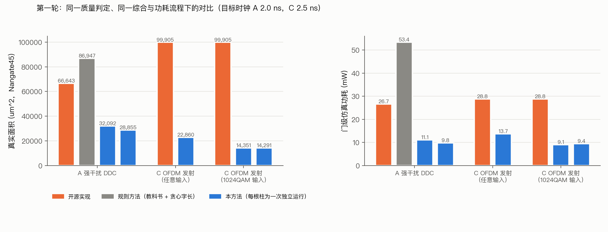
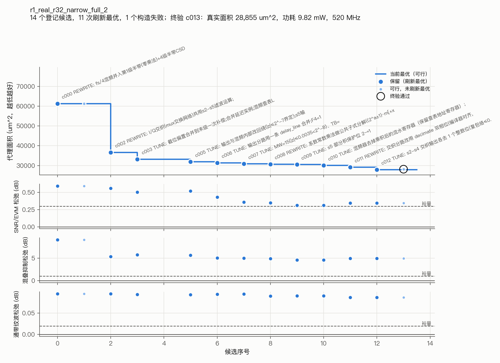

# 基于大语言模型的通信基带算法硬件设计自动化方法研究：中期报告

> 2026-10-16。文中实验数字均来自仓库内的结果文件，路径见附录 A。面积为 Nangate45 标准单元库上的实际综合面积，功耗为门级仿真翻转率下的 OpenSTA 功耗。

---

## 0. 问题与总体思路

通信基带与数字前端中的数值运算模块（上下变频、多速率滤波、FFT/IFFT、估计与均衡、软解调）有确定的数学定义，但硬件实现的自由度很大：同一个公式可以有结构、位宽、截位、复用方式都不同的多种实现，面积和功耗可以相差数倍。而且这类模块不要求与浮点公式逐位相等，只要求链路输出的系统指标（SNR、EVM、BER 等）在容差之内。

本课题研究的问题是：**给定数学公式、接口与系统质量规格，如何由 LLM 自动得到满足规格且面积、功耗尽可能小的可综合实现。**

需要回答三个子问题，各对应一个方法：

| 子问题 | 方法 |
|---|---|
| LLM 在什么表示上设计硬件 | 方法一：原语级可执行表示与编译器 |
| LLM 给出的近似设计怎样算“被允许” | 方法二：系统级容差验证 |
| 怎样组织 LLM 的生成与搜索 | 方法三：LLM 驱动的层次化设计搜索 |

三者构成一个闭环：方法一给出可执行、可组合、类型化的候选；方法二给出候选离系统要求还差多少的连续反馈；方法三让 LLM 根据反馈决定改哪一部分、改结构还是调参数。

---

## 1. 系统架构

```
              ┌──────────────────────── 任务契约（声明式数据）────────────────────────┐
              │ 理想公式 F（用同一套原语写成，按浮点语义解释）；接口 I（位宽、速率、实/复） │
              │ 输入类 X 与数值包络；数据集：搜索场景 / 留出场景 / 统计复核场景            │
              │ 质量规格：系统指标 + 实现预算 p；安全裕量；目标时钟；评价预算             │
              │ 设计边界：可变部分 / 冻结上下文 / 质量观测点 / 计价范围                   │
              └──────────────────────────────────┬────────────────────────────────────┘
                                                 │ 自动生成 agent 工作区（契约说明、原语文档、构造函数库、直写起点）
                                                 ▼
 ┌──────────── 方法三：LLM 驱动的搜索 ────────────┐   候选构造程序    ┌──────── 方法一：表示与编译 ────────┐
 │ LLM 智能体（Claude Code）                        │ ───────────────► │ 执行 build(g, spec)                │
 │  选父节点 → 选区域 → 选粒度（REWRITE / TUNE）    │                  │ → 类型化数据流图（可导出）          │
 │  → 写出修改 → 声明变换类别                      │                  │ → 逐位整数模型                      │
 │ 候选档案：父子关系、状态、松弛量、变化量          │                  │ → Verilog（与整数模型逐位一致）     │
 │ 可行前沿 / 近可行前沿 / 调度提示 / 预算           │                  │ → 代理面积（按分段）                │
 └──────────────────────▲──────────────────────────┘                  └─────────────────┬──────────────────┘
                        │   判定报告：约束表（值、门槛、松弛、裕量、来源）                    ▼
                        │   + 相对父节点的变化量 + 诊断 + 目标      ┌──────── 方法二：系统级容差验证 ────────┐
                        └──────────────────────────────────────────│ L0 构造与类型检查                        │
                                                                   │ L1 原语级判定：类别核实、搜索场景仿真、   │
                                                                   │    全频带扫频、原语信息推导的诊断         │
                                                                   │ L2 隐藏数据集复核（只返回通过与否）       │
                                                                   │ L3 实现级：RTL/门级对拍、综合、时序、功耗 │
                                                                   └──────────────────────────────────────────┘
```

**各部分职责**

- **任务契约**：一份声明式数据，描述“要什么”，不描述“怎么做”。新增一个设计任务只需登记一份契约，agent 工作区由它自动生成，保证不同运行之间条件一致。
- **方法一（编译器）**：把 agent 写的构造程序变成可执行、可综合的对象，并保证 Verilog 与构造程序的整数语义逐位一致。
- **方法二（验证器）**：回答“这个候选是否被允许、离要求还差多少”。它只有一个入口，按 L0–L3 四层给出判定报告；PPA 是其中实现级（L3）的测量，不是独立的模块。
- **方法三（搜索）**：LLM 负责提出修改；框架负责档案、前沿、调度提示、预算以及 L2、L3 的自动调度。不满足约束的候选不丢弃，作为后续修改的起点。

**一次迭代的数据流**：agent 选一个父节点并写出修改 → 编译器执行并编译 → 验证器给出 L0、L1 报告 → 档案登记节点并更新前沿；若它是新的最小可行点，自动做 L2 → agent 读报告决定下一步。agent 申请终验时做 L2 + L3，通过的节点标为 VERIFIED。

---

## 2. 方法一：原语级可执行表示与编译器

### 2.1 为什么需要介于公式与 RTL 之间的表示

- **直接写 Verilog，抽象层次太低**。LLM 要同时处理两类东西：
  - 设计决策：结构、位宽、截位、舍入方式、溢出方式、是否复用、流水几级；
  - 实现机制：时延对齐、有效信号传播、位宽增长与符号扩展、抽取的时钟使能、复位、跨速率控制。

  后者给定决策后只有一种正确写法，却最容易写错。早期试点中，LLM 从规格写出的 24 个结构程序里，能构造的 15 个全部错在约定上（相位计数器位数、增益、符号），没有一个错在滤波能力上。
- **直接改公式，抽象层次太高**。修改后的公式无法自动落到确定的硬件上，定点语义也无从表达。
- **把结构封进算子库，同样不行**。原语里直接提供 FIR、CIC、FFT，结构决策就被封进原语，LLM 只剩调参数。试点中给 LLM 一个参数化模板，它只改 0–2 行，退化成参数优化器。

因此需要一种表示，满足一条原则：**设计决策全部可见，实现机制全部隐藏。**

### 2.2 原语集合

原语是同时具备四项性质的基本运算：明确的逐位整数语义、可推导的类型与速率、确定的 RTL 生成、独立的代价计价。

| 类别 | 原语 | 说明 |
|---|---|---|
| RTL 字级运算（9） | `const` `add` `sub` `mul` `bits` `mux` `lut` `reg` `ram` | 与 Verilog 字级运算一一对应；`ram` 为单写单读、先读后写、复位清零的可寻址存储 |
| DSP 语义（10） | `q`（重量化：舍入/截断 × 饱和/回绕）、`shift`（只移小数点）、`delay`（样本域延迟）、`decimate`、`interpolate`、`gather`（帧重排）、`clock`（进入时钟域）、`state`/`close`（反馈寄存器）、`sample`（从时钟域取样） | Verilog 中没有这些概念，是原语相对 Verilog 的全部增值；编译器据此自动生成时延对齐、使能与有效信号 |
| 接口（2） | `input` `output` | 由契约中的接口决定位宽与实/复 |
| 便利原语（6） | `neg` `scale` `integrate` `counter` `delay_line` `mac` | 都可由上面的原语组合，文档中写明等价组合（例如 `integrate` = `state` + `add` + 回绕量化） |
| 工具（不产生硬件） | `probe` `scope` | 观测点与分段命名 |

`gather` 目前作为原语提供；有了 `ram` 以后它可以由 `ram` + 计数器写出，计划降为构造函数，使双缓冲这一存储组织方式变成可见决策。

在原语之上提供**构造函数库**（比较、绝对值、最值、复数加减乘、乘 ±j、基 2 蝶形），以 Python 源码给出。编译器不认识这些函数，它们展开后仍是原语，LLM 可以直接读也可以直接改。这和 IP 黑盒的本质区别是结构决策仍然可见。

**新增链路时的处理顺序**：写起来重复，就加构造函数；缺少形状、帧或接口信息，就扩展类型或契约；只有无法表达新的硬件语义时，才加原语。

### 2.3 原语携带的信息

每个信号携带类型 τ：

| 字段 | 含义 |
|---|---|
| W、F | 位宽与小数位（定点数值 = 整数码 × 2^−F） |
| signed | 有无符号 |
| 速率域 | 每个样点占用的时钟数；是否为不规则域（帧重排后）；是否为时钟域 |
| lat | 相对输入的时延（时钟数） |
| held | 样点在下一个样点到来前是否保持 |

每个节点额外记录运算、参数、量化方式（舍入/截断、饱和/回绕）、状态初值和所属分段（`scope`）。

类型系统拒绝非法组合，例如不同速率域的信号直接相加会报 `rate_mismatch`。这些信息也是方法二静态推导的依据（见 3.2）。

### 2.4 编译器

- **执行即编译**：每个原语调用同时产生三样东西：逐位整数值（在全部场景上）、Verilog 片段、代理代价。时延对齐所需的流水寄存器、有效信号的传播、速率域的控制计数器都由编译器插入。
- **记录层**：构造过程同时记录类型化数据流图（节点、信号、τ、分段），可导出，并带语义哈希。它用于复现、比对和方法二的静态分析。
- **正确性**：编译器本身不做形式证明。每个候选都把生成的 Verilog 与整数模型在完整场景上逐位对拍，这相当于逐候选的翻译验证；终验时还把综合后的门级网表与整数模型对拍。第一轮全部最终设计的 RTL 与门级对拍均为零失配。
- **含时钟域的设计**（`clock` / `state` / `close` / `sample`）：逐位语义取自生成 RTL 的仿真，构造时不产生真实数值。

### 2.5 为什么不用现成的数据流图或工具

原语程序本身就是一张同步数据流图（SDF，Lee & Messerschmitt 1987），并没有发明新的图概念。问题在于现有工具缺少其中某些能力：

| 工具 | 定点语义 | 多速率 | 逐位整数模型 | 确定性 RTL |
|---|---|---|---|---|
| MLIR/CIRCT | 否（只有整数） | 否 | 是 | 是 |
| Simulink + HDL Coder | 是 | 是 | 是 | 是（商业闭源，模型文件不便由 LLM 编辑） |
| Vitis HLS（ap_fixed） | 是 | 否，需手写 dataflow | 是 | 部分（调度由工具决定） |
| Chisel / SpinalHDL | 部分 / 是 | 否 | 是 | 是 |
| FloPoCo | 是（末位精确） | 否 | — | 是（算子级生成器，不是链路表示） |

开源工具中没有一个四项齐备。原语语言是设计选择，不是本课题的贡献；贡献在于在这样的表示上，以系统级反馈驱动 LLM 搜索结构与近似。


---

## 3. 方法二：系统级容差验证

### 3.1 统一入口与判定报告

方法二只有一个入口：`verdict(候选, 契约, 层级)`，返回一份判定报告，原样反馈给 agent。报告包括：

- **约束表**：每条约束的值、门槛、松弛量（指标 − 门槛，统一为越大越好）、安全裕量、最差场景、来源；
- **目标**：代理面积（L1）或真实面积、功耗、fmax（L3）；
- **诊断**：逐场景结果、分段代理面积、取值范围、局部量化噪声、输出对齐诊断等。

### 3.2 指标：两个来源、三种角色

**按来源分**：

| 来源 | 指标 | 保证强度 |
|---|---|---|
| 原语携带的信息（静态推导，不需要仿真） | 接口与吞吐、时延；数据通路取值范围（区间分析，判断能否排除饱和与回绕）；资源与分段代理面积；量化噪声源清单（每个丢精度的点、局部 SQNR） | 类型推导为构造保证；区间分析对契约输入类可靠（忽略相关性，偏保守） |
| 工具计算：编译器执行同一程序 | 数据集上的系统质量（SNR、EVM）；线性部分的全频带扫频（通带纹波、混叠抑制）；变换类别核实 | 扫频在网格上精确；系统质量为统计保证 |
| 工具计算：生成 Verilog 之后 | RTL 与整数模型对拍、门级网表与整数模型对拍；综合面积、静态时序、仿真功耗 | 对拍为翻译验证；PPA 为测量值 |

**按角色分**（只有约束参与“是否被允许”）：

- **约束**：每条链路只有 1–2 个系统质量指标，加上通用硬约束（实现正确、时序收敛）。逐算子的 SFDR、SQNR 等不作为约束。
- **目标**：面积、功耗。
- **诊断**：其余全部，只给 agent 参考。

时域、频域、任务级指标不是三套门槛，而是同一族判定在不同观测点上的形式。每条链路按“交给下游的是什么”只选一个观测点：数字下变频交出基带信号，用带内 SNR；发射链交出波形，用 EVM。

**为什么不按算子分别验收**：逐级分配误差预算会层层留裕量；误差可以在级间折算（早期实验中 NCO 占实现误差的 7%–36%，CIC 字长不到 2%，明显偏离平均分配）；级间耦合只在输出端可见（例如 NCO 相位截断的杂散把阻塞搬进带内）。早期实验中，整链判定比逐级判定省面积 19%–42%；在宽带规格上，逐级判定在同一结构空间内找不到可行解。

### 3.3 定点相对浮点的可接受判据

**一条规则覆盖所有链路**：实现引入的额外误差功率，不超过系统允许误差功率的 p 倍。

- 接收链（SNR）：SNR_impl ≥ SNR_ideal − 10·log10(1 + p)。SNR_ideal 是理想浮点公式在同一组带损伤输入上的 SNR。p = 0.1 时允许损失 Δ = 0.414 dB。
- 发射链（EVM）：EVM_impl(dB) ≤ EVM_std(dB) + 10·log10 p，即比标准门限低 10 dB。
- 混叠抑制（数字下变频）：rej ≥ 单个干扰相对期望信号的功率 + SNR_ideal + 10·log10(1/p)。
- 纹波、ACLR 等形状指标：由规格直接给出上限或下限。

所有门槛都由 p 和规格推出，不另设经验值。

### 3.4 变换类别与判定强度

不同性质的变换，“被允许”的条件不同。agent 登记候选时声明类别，框架负责核实：

| 类别 | 例子 | 被允许的条件 | 判定方式 |
|---|---|---|---|
| T0 非法 | 跨速率直接组合、位宽越界、接口不符 | — | 类型检查，构造时拒绝 |
| T1 逐位等价（equiv） | 插流水、重定时、分时复用、I/Q 交织 | 输出序列逐位相同 | 与父节点在搜索场景与随机场景上逐样点比对（允许整体延迟不同）；通过后**直接继承父节点的质量结论**，只看 PPA 变化 |
| T2 数学等价、定点不等价（math） | 多相分解、noble 恒等式、FFT 换基数 | 理想解释下与父节点等价，且定点误差满足质量约束 | 两者量化点同时加宽 20 位后比对（相对差低于 −70 dB）；精度部分按 T3 |
| T3 近似（approx，含调参） | CIC 替代 FIR、截位、查表近似、系数量化 | 系统质量约束满足，可证明性质不被破坏 | 区间分析、扫频与数据集统计判定 |

声明为 equiv 而比对不一致时，自动按 approx 判定并在报告中说明。例：在 r32 窄带设计上插一级输出流水并声明 equiv，核实通过；把混频位宽 15 改为 14 却声明 equiv，被识别为不等价（4674 个样点不同），改按近似判定为 OPEN（缺口 0.048 dB）。

### 3.5 数据集：验收集、加固集与隐藏

| 集合 | 来源 | 对 agent | 作用 |
|---|---|---|---|
| 搜索场景（2 个） | 契约 | 可见，L1 使用 | 搜索阶段判定 |
| 留出场景（3 个） | 契约 | 不可见 | 终验 |
| 统计复核场景（30 个，同一输入类的新随机实例） | 系统生成 | 不可见 | 终验；给出失败概率的 Clopper–Pearson 95% 上界 |
| 全频带扫频（数百个频点） | 系统生成 | 结果可见 | 线性性质的全频带覆盖 |

验收集来自标准或用户，是问题定义的一部分；加固集由系统生成，用来防止搜索只对少数场景过拟合。


### 3.6 裕量与判定规则

- **松弛量**：slack_j = 指标 − 门槛，单位就是该指标自己的单位。
- **FEASIBLE**（搜索阶段）：搜索场景上每个约束的 min slack_j ≥ 安全裕量 m_j。dB 类指标 m = 0.3 dB（发射链 0.5 dB），纹波类为上限的 20%，混叠抑制 1 dB。
- **VERIFIED**（终验）：留出场景和统计复核场景上 min slack_j ≥ 0；RTL 对拍、门级对拍零失配；目标时钟下 wns ≥ 0。
- **缺口**：v = Σ_j max(0, m_j − min slack_j) / u_j，u_j 为单位尺度（dB 类 1 dB，纹波类为上限）。OPEN 候选按 v 排序。

所有约束用同一规则。

### 3.7 反馈分层

| 层 | 触发 | 内容 | 耗时 |
|---|---|---|---|
| L0 构造 | 每次运行程序 | 类型错误及位置（行、原语、违反的约束） | 毫秒 |
| L1 原语级 | 每次评价或登记 | 类别核实；约束表；相对父节点的变化量（Δ松弛、Δ代理面积）；诊断 | 秒级 |
| L2 隐藏数据集 | 新的最小可行点自动触发，或终验 | 通过/未通过 | 十秒级 |
| L3 实现级 | 终验 | RTL 与门级对拍、真实面积、时序、仿真功耗；回写代理面积与真实面积之比 | 分钟级 |

大小两种修改需要的反馈不同：参数调优最需要变化量，即灵敏度；结构重写最需要逐约束、逐场景的缺口，以及量化噪声源和频响诊断。

### 3.8 PPA 流程

| 步骤 | 做法 |
|---|---|
| 综合 | Yosys + ABC 映射到 Nangate45（快速脚本） |
| 扇出缓冲 | 扇出超过 16 的网插入 BUF_X4 缓冲树，面积计入。快速综合不做这一步时，高扇出网会造成假延迟：某开源 IFFT 曾被测成 57 MHz，补缓冲后为 745 MHz |
| 时序 | OpenSTA：NLDM、输出负载 5 fF、计入 clk-to-q 与建立时间 |
| 功耗 | 门级网表用任务场景激励做 iverilog 仿真，OpenSTA 读入 VCD 翻转率。全局翻转率 0.1 的估算约低 2 倍，不再使用 |
| 一致性 | 门级仿真输出与整数模型逐位对拍 |

### 3.9 哪些性质可以证明

| 性质 | 保证 | 手段 |
|---|---|---|
| 接口、吞吐、时延 | 构造即正确 | 原语类型系统 |
| 数据通路不饱和、不回绕 | 对契约输入类可靠（偏保守） | 记录图上的区间分析；模运算积分器依赖 Hogenauer 条件，由仿真复核 |
| 逐位等价变换 | 多场景逐位一致（不是形式证明） | 与父节点比对 |
| 网表与 RTL | 当前为门级仿真对拍 | Yosys 内置 SAT 不支持存储器单元，带 `ram` 的设计需先展开为寄存器才能做形式等价 |
| 线性部分频响 | 扫频网格上精确 | 用编译器本身执行扫频；同时估计测量噪声底，接近噪声底时注明瓶颈是实现噪声而非滤波器漏过 |
| 系统质量（SNR、EVM） | 只能是统计保证 | 留出 + 统计复核 + 置信上界 |

SNR、EVM 是对输入分布定义的统计量，“对任意输入成立”的命题本身不成立。方法二给出的是：每条结论配一种保证，并写明强度。

**按分组归因误差不可行**。把某一组量化点加宽并不等于让它理想化：一个设计用常数补偿截断偏置，加宽后偏置变了而补偿常数不变，SNR 反而从 59.6 dB 降到 53.2 dB。存在有意的误差相消时，“某组的误差贡献”没有干净的定义。因此反馈不提供分组归因，只提供连续松弛、逐场景结果、分段面积和量化噪声源清单。

---

## 4. 方法三：LLM 驱动的层次化设计搜索


### 4.2 搜索状态

**节点**：一个完整的原语程序，附带判定报告、父节点、修改动作与声明的变换类别。根节点是直写起点（按公式逐运算直译、位宽足够宽，构造即正确，面积很大）。

**节点状态**：

| 状态 | 条件 | 处理 |
|---|---|---|
| BROKEN | 构造失败或判定出错 | 允许修复，否则不再展开 |
| OPEN | 合法但缺口 v > 0 | 进入近可行前沿，可继续展开 |
| FEASIBLE | 搜索场景上所有约束满足裕量 | 进入可行前沿 |
| VERIFIED | 终验通过 | 可作为结果 |

**两个前沿**：可行前沿按（代理面积，−SNR 松弛）取 Pareto；近可行前沿按（缺口 v，代理面积）取 Pareto。被支配的节点不再推荐，但不删除。

### 4.3 一轮展开

1. agent 选父节点和要修改的区域（由分段 `scope` 标出）；
2. 选粒度：
   - **REWRITE**：改结构、分解或融合，例如长 FIR 换成 CIC 加补偿、I/Q 交织共享一套运算、把混频并入半带；
   - **TUNE**：只改位宽、截位、系数、复用因子；
3. 写出修改，声明变换类别（equiv / math / approx）；
4. 框架执行 L0、L1，登记节点，返回约束表、变化量和诊断；
5. 若是新的最小可行点，框架自动做 L2，只返回通过与否。

**调度提示**由框架给出，选择由 agent 决定：

- 开发：可行前沿上面积最小的节点继续 TUNE；
- 修复：缺口最小的 OPEN 节点做微调；
- 探索：连续 4 次 TUNE 没有降低最小可行面积时，建议做一次 REWRITE。

**终验**：agent 选定节点后申请终验，框架做 L2 + L3，通过则标为 VERIFIED，并用真实面积校准代理面积。

### 4.4 分工

| 角色 | 负责 |
|---|---|
| LLM 智能体 | 读契约与公式做分析；提出结构与参数修改；解读反馈；选父节点与粒度；离线计算（滤波器设计、数值模型）由它在工作区自行完成 |
| 框架 | 编译与判定；档案、前沿、提示；L2、L3 调度；预算强制执行；隐藏数据的保管 |


### 4.5 预算与公平性

所有实验变体使用同一份预算，由工具层强制执行，超额调用直接拒绝：

| 类别 | 包含的调用 | 上限 |
|---|---|---|
| 评价 | eval、archive add（直写 Verilog 模式下为 veval、vsweep） | 150 |
| PPA | ppa、ppa --vcd（直写模式为 vppa） | 12 |
| 终验 | archive verify（平坦与直写模式为 final、vfinal） | 3 |

`observe`（导出观测点逐样点值）和 `rtl`（对拍）不计入。每次调用都记入工作区的调用日志，事后可以核对。

### 4.6 消融变体

同一工具链、同一契约，只改一项：

| 变体 | 去掉的部分 | 检验 |
|---|---|---|
| 完整方法 | — | — |
| 平坦 agent | 档案、前沿、提示（只有评价和终验命令） | 方法三 |
| 只给分数 | 约束表、变化量与诊断（只返回判定、一个标量分数和代理面积） | 方法二的反馈 |
| 直写 Verilog | 原语（agent 直接写 Verilog，用同一套判定与 PPA 流程） | 方法一 |

---

## 5. 实验

### 5.1 数据集

按计算形态选代表链路：

| 链路 | 形态 | 规格 | 状态 |
|---|---|---|---|
| A 接收数字下变频 | 连续流、多速率、前馈 | 6 个开发规格（抽取 16/32/64 × 宽/窄带）+ 6 个留出规格；现实性规格 `real_r32_narrow` | 主实验用现实性规格 |
| B 发射数字上变频 | 反向多速率 | 3 个规格，多音激励 | 已接入，需补调制信号与 EVM/ACLR |
| C OFDM 发射 | 块处理 | 802.11a/g 参数，64 点 IDFT + 16 点循环前缀；输入为 64/256/1024/4096QAM，或任意复数 | 主实验 |
| D OFDM 接收 | 块处理 | 去循环前缀 + 64 点 FFT | 已接入，信道估计、均衡与软解调待补 |

**链路 A 现实性规格 `real_r32_narrow`**：
- 实数 14 位输入，抽取 32，通带 ±0.00625（以输入采样率归一），输出 16 位复基带，每时钟 1 个输入样点，目标时钟 2 ns。
- 期望信号为通带内 24 个复音。干扰为一个窄带调制信号（8 个随机相位单音，宽约通带的 1/8），功率比期望信号高 45 dB（3GPP NR 基站 ACS 与带内阻塞为高 43–52 dB），中心落在会折入通带的混叠带上；不同场景的干扰位于不同混叠带。
- 门槛：p = 0.1 → Δ = 0.414 dB；纹波 ≤ 0.1 dB；混叠抑制要求约 101 dB。理想上限 SNR 为 44.8–46.2 dB。

**链路 C OFDM 发射**：
- 每符号输入 52 个子载波（k = −26..−1, 1..26），占 80 个样点槽中的前 52 个，每 4 个时钟一个槽。
- 输出为 b[m] = (1/32)·Σ X_k e^{+j2πkm/64}，按 b[48..63]‖b[0..63] 共 80 个复样点。输入输出均为 12 位，目标时钟 2.5 ns。
- 门槛为 802.11 对应调制的发射 EVM 门限减 10 dB（p = 0.1）：1024QAM 为 −45 dB。
- 两个版本：1024QAM 输入（输入一定是星座点）和任意复数输入（每分量在 ±√1.5 上均匀分布，与通用 IFFT 核同口径）。

### 5.2 对照

| 对照 | 类型 | 做法 |
|---|---|---|
| USRP DDC（EttusResearch/fpga@287ad57，LGPL） | 开源实现 | CORDIC + 4 阶 CIC + 两级半带；设置寄存器改为常数，在合法配置与缩放中按搜索场景选最好的；同一测试平台与 PPA 流程 |
| ZipCPU dblclockfft（LGPL） | 开源实现 | 64 点流水 IFFT 级模块；各级位宽与旋转因子按其生成器规则计算；外壳只缓存必要的输入，输出用倒位序地址写入缓冲，与循环前缀共用存储；取两种配置中较好的 |
| 教科书结构 + 贪心字长优化 | 规则方法（不用 LLM） | CORDIC 混频 + CIC（阶数由混叠要求解析推出）+ 半带（Kaiser 窗）+ CIC 补偿 FIR（firls 分段补偿）；先按规则定尺寸，再做 max−1 贪心字长下降，共 90 次评价；低速级用分时复用乘法器，各级加流水 |

### 5.3 主结果

全部设计都经过同一个终验：搜索 + 留出 + 30 个统计复核场景、RTL 与门级对拍、目标时钟下 STA、门级仿真功耗。

| 链路 | 方法 | 质量 | 真实面积 (μm²) | 功耗 (mW) | fmax (MHz) |
|---|---|---|---|---|---|
| A 强干扰下变频 | USRP（开源） | 不达标，SNR 差 5.5 dB | 66,643 | 26.7 | 654 |
| | 教科书结构 + 贪心字长 | 质量达标，时序差 0.17 ns | 86,947 | 53.4 | 461 |
| | 本方法，运行 1 | 终验通过 | 32,092 | 11.1 | 546 |
| | 本方法，运行 2 | 终验通过 | 28,855 | 9.8 | 520 |
| C OFDM 发射（任意输入） | ZipCPU IFFT（开源） | 终验通过 | 99,905 | 28.8 | 745 |
| | 本方法 | 终验通过 | 22,860 | 13.7 | 585 |
| C OFDM 发射（1024QAM 输入） | ZipCPU IFFT（开源） | 终验通过 | 99,905 | 28.8 | 745 |
| | 本方法，运行 1 | 终验通过 | 14,351 | 9.1 | 485 |
| | 本方法，运行 2 | 终验通过 | 14,291 | 9.4 | 417 |



**终验余量**（隐藏集上的最小 SNR 松弛，33 个场景全部通过）：

| 设计 | 搜索场景 | 留出场景 | 统计复核 |
|---|---|---|---|
| A 运行 1 | 0.373 | 0.334 | 0.044 |
| A 运行 2 | 0.347 | 0.290 | 0.084 |
| A 教科书基线 | 0.304 | 0.300 | 0.002 |
| C 任意输入 | 0.633 | 0.816 | 0.578 |
| C 1024QAM 运行 1 | 1.212 | 0.849 | 0.762 |
| C 1024QAM 运行 2 | 1.456 | 1.265 | 0.939 |

**解读**：

- 链路 C 任意输入版与 ZipCPU 严格同口径，面积为其 23%，功耗为其 48%。
- 链路 A 上 USRP 的固定结构在强干扰下质量不达标；本方法面积为其 43%–48%、功耗为其 37%–42%，同时满足质量。规则基线达标，但面积是本方法的 2.7–3.0 倍、功耗 4.8–5.4 倍，且未收敛到目标时钟。
- 同一链路两次独立运行结果接近（A：28.9k / 32.1k；C 1024QAM：14.3k / 14.4k）。
- 本方法的 fmax 低于开源实现，但都满足各自的目标时钟。
- 链路 C 的 1024QAM 版本先把输入解码为 5 位星座电平，相当于把映射器并入 IFFT。真实发射机里 IFFT 前就是映射器，这一跨算子融合成立；但它依赖输入一定是星座点（换成任意输入时 EVM 只有 −14 dB），因此与 ZipCPU 的主比较用任意输入版。

### 5.4 agent 找到的结构

| 设计 | 结构要点 |
|---|---|
| A 运行 2（28,855 μm²） | fs/4 混频并入首级半带 [−1, 0, 9, 16, 9, 0, −1]/32（无乘法）；之后四级 I/Q 交织半带各抽 2（系数 2/3/4/8 个），移位加实现并做公共子式分解，部分积截位偏置在末级统一补偿；输出速率精细混频，2 个粗旋转乘法器 + 1 个细角乘法器，27 位相位累加器 |
| A 运行 1（32,092 μm²） | fs/4 粗混频免乘法；首级半带直接拼出交织流；四级交织多相半带，一棵移位加树分时处理 I、Q；输出速率混频在交织流上分时，虚部由相位减 1/4 周得到，两拍共用一张八分圆正余弦表和 2 个 13×12 乘法器 |
| C 任意输入（22,860 μm²） | 基 2² 单路延迟反馈 FFT，后接位反转交换电路和循环前缀循环缓冲，全部在时钟域；实部、虚部在相邻两个时钟串行处理，每级蝶形只用 1 个加法器和 1 个减法器；两个旋转单元各用 1 个实乘法器分时完成复乘；输入按 (−j)^k 预旋转使输出天然从 b[48] 开始 |
| C 1024QAM（14,291 μm²） | 8×8 分解；输入解码为 5 位电平后累加进两条 32 级循环移位寄存器；每侧每时钟一次三乘法复乘；输出在空闲期每时钟出 1 个样点做单点 DFT8；按位取反与截断的偏置合并为每槽常数校正 |

这些结构都不在提供给 agent 的文档或模板中，原语文档里也不含任何结构提示。

### 5.5 搜索过程



图中上方分面为代理面积：深色点为刷新最优的候选及其修改说明，阶梯线为当前最优，圆圈为终验通过。下方三个分面为各约束的松弛量，实线为门槛，虚线为安全裕量。搜索过程中 agent 用质量余量换面积，SNR 松弛从 0.59 dB 逐步降到最低 0.31 dB（最终设计 0.35 dB），始终保持在 0.3 dB 裕量线以上。14 个登记候选中，11 次刷新最优，其中 REWRITE 4 次、TUNE 7 次。

其余运行的搜索过程见 `figures/v3/progress_r1_ofdm_tx64_gen_full_1.png` 与 `progress_r1_ofdm_tx64_q1024_full_2.png`。

### 5.6 消融：状态与已有结果

| 消融 | 状态 | 已有结果 |
|---|---|---|
| 方法一：直写 Verilog | 同预算的 Claude 对照已配置，运行因 API 额度耗尽中断，无结果 | 早期试点（DeepSeek、同迭代次数）：直写面积为原语路线的 1.2–5.1 倍，2 个规格综合超时 |
| 方法二：只给分数 | 同上，中断 | 早期试点（DeepSeek）：给出指标数值比只给分数面积降约 40%（11/12 对更好，p = 0.001）；在数值之外再给启发式诊断文字无额外收益（p = 0.52） |
| 方法三：平坦 agent | 第一轮有一次运行，但不能作为结论 | 平坦 agent 第三次终验通过，面积 37,628 μm²（完整方法 28,855–32,092）。当时两边都能从终验结果看到隐藏集信息，调用次数也未对齐（701 次对 107–252 次）；这两点已修复（3.5、4.5），需要重跑 |


---

## 6. 存在的问题与后续计划

### 6.1 存在的问题

1. **消融不完整**：三个方法各自的同预算消融尚未完成，第 1、3 条贡献的对照证据目前来自早期试点或不对等的第一轮。
2. **统计强度**：每条链路只有 1–2 次运行。
3. **链路覆盖**：完成主实验的是链路 A（连续流多速率）和链路 C（块处理）；B 缺调制信号激励，D 缺信道估计、均衡与软解调。
4. **统计复核余量偏薄**：链路 A 两个设计在统计复核上的最小松弛只有 0.04–0.08 dB。搜索场景只有 2 个，对实现噪声的波动（约 0.1 dB）不敏感，搜索阶段的裕量偏乐观。
5. **编译器与原语的缺口**（来自 6 个 agent 的工具反馈）：
   - 没有无复位寄存器（一个设计 58% 的面积是不需要复位的环形寄存器）；
   - 单独的 `delay` 比 `delay_line` 贵一倍；
   - 每次 `interpolate` 都新建速率域；
   - 时钟域的输出不能直接接输出；
   - `mac(share>1)` 不给乘法器插流水；
   - 缺位逻辑、带进位加减；
   - 综合结果没有按分段的真实面积，关键路径不映射到分段名。
6. **形式化保证有限**：等价核实基于场景比对；网表与 RTL 的形式等价受存储器单元限制。
7. **与工业现实的差距**：每时钟 1 个样本（GSPS 前端常见每拍 8 个样本）；固定功能（商用 DDC 运行时可配）；开源工艺与快速综合、无布局布线。

### 6.2 后续计划

---
