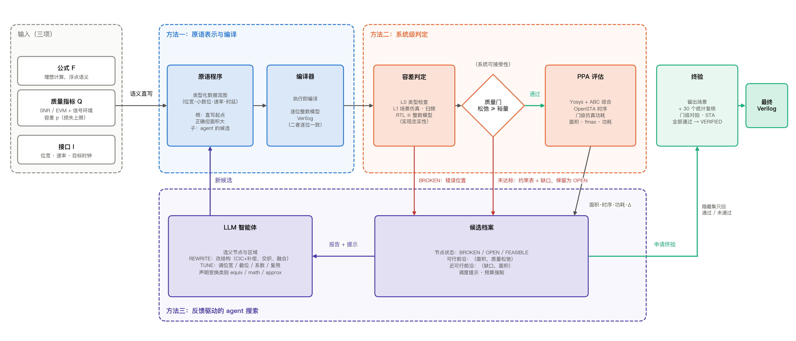
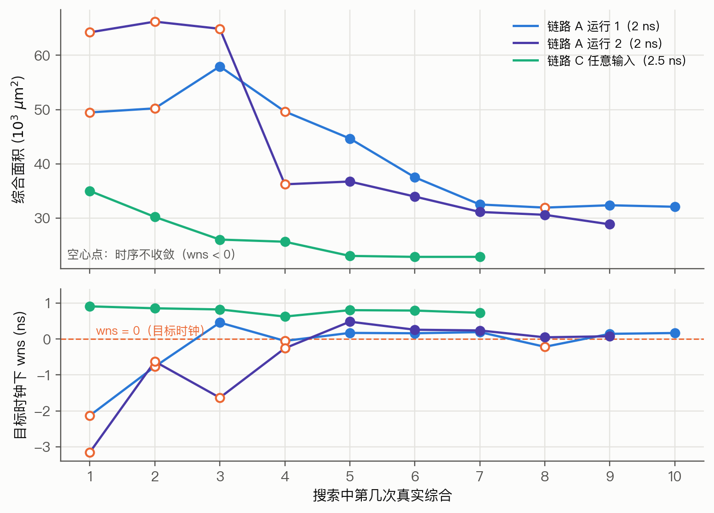

# 基于大语言模型的通信基带算法硬件设计自动化方法研究：中期报告

> 2026-10-16。文中实验数字均来自仓库内的结果文件，路径见附录 A。面积为 Nangate45 标准单元库上的实际综合面积，功耗为门级仿真翻转率下的 OpenSTA 功耗。

---

## 0. 问题与主张

通信基带与数字前端中的数值运算模块（上下变频、多速率滤波、FFT/IFFT、估计与均衡、软解调）有确定的数学定义，但硬件实现的自由度很大：同一个公式可以有结构、位宽、截位、复用方式都不同的多种实现，面积和功耗可以相差数倍。而且这类模块不要求与浮点公式逐位相等，只要求链路输出的系统指标（SNR、EVM 等）在容差之内。

**研究问题**：给定数学公式、系统质量指标与接口，如何由 LLM 自动得到满足指标、在目标时钟下时序收敛、且面积与功耗尽可能小的可综合 Verilog。

这里的 PPA 三项各有明确角色：

| PPA | 本课题中的角色 | 如何测 |
|---|---|---|
| 性能（Performance） | **硬约束**：吞吐由接口规定（如每时钟 1 个样点），必须在目标时钟下时序收敛（wns ≥ 0） | OpenSTA 静态时序，报告 wns 与 fmax |
| 功耗（Power） | **目标**：同等面积下越低越好；报告平均功率与每样点能耗 | 门级网表用任务激励仿真，按真实翻转率计算 |
| 面积（Area） | **主目标**：在质量与时序约束下最小化 | Nangate45 标准单元综合面积与单元数 |

**核心主张**：本课题不是让 LLM 生成与规格等价的 RTL，而是让它**在系统容差内改变计算本身**——改结构、改精度、改微结构——并保证得到的硬件实现忠实、系统质量可接受，再以真实综合的 PPA 驱动搜索。

### 0.1 与现有工作的区别

近两年“LLM 生成候选 → 正确性检查 → 综合 → PPA 反馈 → LLM 修改”的闭环已经很常见：EvolVE [1]、REvolution [2]、COEVO [3] 用进化搜索优化 RTL 的 PPA；RTLScout [4] 让 agent 在 Python 内嵌 HDL 上改写并用开源综合反馈；HINT [5]、VeriRefine [6] 在 RTL 之前引入可检查的中间表示。这些工作的正确性定义都是**功能等价**（测试通过或形式等价）。

通信 DSP 的正确性定义不同：允许偏离公式，只要系统指标在容差内。A2HCoder [7] 面向通信算法做 MATLAB 到 HLS 的转换并探索位宽，指出算法选择比 pragma 影响更大，但正确性仍以执行结果核对；传统字长优化 [8] 有 SQNR 约束，但不改结构、也不用 LLM。

因此本课题的流程骨架与上述工作同形，区别在三个环节的内容：

| 环节 | 现有工作 | 本课题 |
|---|---|---|
| 输入与正确性 | 自然语言规格 + 测试，要求等价 | 公式 + 系统指标与容差 + 接口，要求容差内 |
| 表示 | 等价保持的 IR / HDL | 带定点与速率语义的原语，近似是合法动作 |
| 判定 | 测试通过 / 测试通过率 | 实现忠实性（逐位）与系统可接受性（容差）分开判定 |

---

## 1. 总体流程

一句话：**输入三项 → 语义直写得到基础原语程序 → LLM 改写出大量候选 → 方法二判定（类型错误驳回，质量不足带缺口返回，达标的做综合）→ PPA 反馈 → agent 做 REWRITE / TUNE → 循环 → 终验 → 输出 Verilog。**

三个方法各占流程中的一段：

| 流程环节 | 方法 | 回答的问题 |
|---|---|---|
| 语义直写、候选的表示与编译 | 方法一：原语表示与编译 | LLM 在什么表示上改硬件，改完如何变成可执行、可综合的对象 |
| 质量门、PPA 评估、终验 | 方法二：系统级判定 | 近似的候选怎样算“被允许”，离要求还差多少 |
| 反馈 → 改写 → 新候选 | 方法三：反馈驱动的 agent 搜索 | LLM 根据反馈改哪里、改结构还是调参数 |

因果关系是：先能表示（方法一），才能判定（方法二），才能在容差空间里搜索（方法三）。

### 1.1 输入：只有三项

| 输入 | 内容 | 例（链路 A） |
|---|---|---|
| 公式 F | 理想计算，按浮点语义解释 | y[m] = ↓32 { h ∗ (x[n]·e^{−j2πf_if n}) } |
| 质量指标 Q | 系统指标、测量所处的信号环境、容差 p | 带内 SNR；期望信号 + 高 45 dB 的窄带阻塞；p = 0.1 |
| 接口 I | 输入输出位宽、实/复、速率、目标时钟 | 14 位实数入，16 位复数出，抽取 32，2 ns |

信号环境（阻塞多强、落在哪里）属于“指标在什么条件下测”，是 Q 的一部分，不是独立输入。

其余内容全部由系统从这三项派生，用户不写：

| 派生内容 | 怎样得到 |
|---|---|
| 门槛 | 由 p 和理想公式在同一输入上的成绩推出（3.2） |
| 搜索 / 留出 / 统计复核场景 | 按 Q 的信号环境随机生成并划分（3.6） |
| 安全裕量 | 按指标类型统一取值（3.3） |
| 直写起点 | 由 F 和 I 语义直写（2.4） |
| agent 工作区 | 契约说明、原语文档、构造函数库、直写起点自动生成 |

### 1.2 一个候选走一遍

以下步骤取自链路 A 上的真实判定记录：

1. **直写起点**：F 的每个运算按足够宽的位宽直译成原语，语义正确，但面积和功耗很大。
2. **agent 改写**：在某个父节点上把混频位宽从 15 改为 14，声明为“逐位等价”。
3. **编译**：编译器执行原语程序，得到逐位整数模型和 Verilog。
4. **判定**：与父节点比对发现 4674 个样点不同，不是等价变换，自动改按近似判定。SNR 松弛比安全裕量差 0.048 dB，结论为 **OPEN**。
5. **反馈**：OPEN 候选不丢弃，约束表和缺口返回 agent，登记进近可行前沿。
6. **下一轮**：agent 可以在该节点上补偿精度，也可以回到可行前沿换一处改。另一次修改“插一级输出流水”声明为等价，比对通过，直接继承父节点的质量结论，只看 PPA 变化。

PPA 反馈同样在回路中起作用。链路 A 运行 1 中，agent 为省面积去掉了某级半带加法树中的流水切点，真实综合报告 wns = −0.216 ns（2 ns 时钟下不收敛）；下一个候选把切点移到加法树第 3 层，wns 恢复为 +0.144 ns，代价是面积增加约 430 μm²（5.6 节）。

链路 A 运行 2 共登记 14 个候选，其中 11 次刷新最优（REWRITE 4 次、TUNE 7 次）。最终设计终验通过：面积 28,855 μm²，功耗 9.8 mW，2 ns 目标时钟下 wns = +0.077 ns（5.3 节）。

---

## 2. 方法一：原语表示与编译

### 2.1 为什么需要介于公式与 RTL 之间的表示

- **直接写 Verilog，抽象层次太低**。LLM 要同时处理两类东西：
  - 设计决策：结构、位宽、截位、舍入方式、溢出方式、是否复用、流水几级；
  - 实现机制：时延对齐、有效信号传播、位宽增长与符号扩展、抽取的时钟使能、复位、跨速率控制。

  后者给定决策后只有一种正确写法，却最容易写错。早期试点中，LLM 从规格写出的 24 个结构程序里，能构造的 15 个全部错在约定上（相位计数器位数、增益、符号），没有一个错在滤波能力上。
- **直接改公式，抽象层次太高**。修改后的公式无法自动落到确定的硬件上，定点语义也无从表达。
- **把结构封进算子库，同样不行**。原语里直接提供 FIR、CIC、FFT，结构决策就被封进原语，LLM 只剩调参数。试点中给 LLM 一个参数化模板，它只改 0–2 行，退化成参数优化器。

因此表示要满足一条原则：**设计决策全部可见，实现机制全部隐藏。**

### 2.2 原语集合

原语是同时具备四项性质的基本运算：明确的逐位整数语义、可推导的类型与速率、确定的 RTL 生成、独立的代价计价。

| 类别 | 原语 | 说明 |
|---|---|---|
| RTL 字级运算（9） | `const` `add` `sub` `mul` `bits` `mux` `lut` `reg` `ram` | 与 Verilog 字级运算一一对应；`ram` 为单写单读、先读后写、复位清零的可寻址存储 |
| DSP 语义（10） | `q`（重量化：舍入/截断 × 饱和/回绕）、`shift`（只移小数点）、`delay`（样本域延迟）、`decimate`、`interpolate`、`gather`（帧重排）、`clock`（进入时钟域）、`state`/`close`（反馈寄存器）、`sample`（从时钟域取样） | Verilog 中没有这些概念，是原语相对 Verilog 的全部增值；编译器据此自动生成时延对齐、使能与有效信号 |
| 接口（2） | `input` `output` | 由接口 I 决定位宽与实/复 |
| 便利原语（6） | `neg` `scale` `integrate` `counter` `delay_line` `mac` | 都可由上面的原语组合，文档中写明等价组合（例如 `integrate` = `state` + `add` + 回绕量化） |
| 工具（不产生硬件） | `probe` `scope` | 观测点与分段命名 |

原语之上提供**构造函数库**（比较、绝对值、最值、复数加减乘、乘 ±j、基 2 蝶形），以 Python 源码给出。编译器不认识这些函数，它们展开后仍是原语，LLM 可以直接读也可以直接改。这和 IP 黑盒的本质区别是结构决策仍然可见。

**新增链路时的扩展顺序**：写起来重复，就加构造函数；缺少形状、帧或接口信息，就扩展类型；只有无法表达新的硬件语义时，才加原语。

### 2.3 类型

每个信号携带类型 τ：

| 字段 | 含义 |
|---|---|
| W、F | 位宽与小数位（定点数值 = 整数码 × 2^−F） |
| signed | 有无符号 |
| 速率域 | 每个样点占用的时钟数；是否为不规则域（帧重排后）；是否为时钟域 |
| lat | 相对输入的时延（时钟数） |
| held | 样点在下一个样点到来前是否保持 |

每个节点额外记录运算、参数、量化方式、状态初值和所属分段（`scope`）。类型系统拒绝非法组合，例如不同速率域的信号直接相加会报 `rate_mismatch`。这些信息也是方法二静态推导的依据（3.4）。

### 2.4 语义直写：搜索的起点

系统把公式 F 的每个数学运算按“精度足够”的方式直译成原语，接口按 I 生成，得到第一份原语程序。它的接口、速率与运算语义构造即正确，但面积和功耗很大。公式中未指定的部分（例如滤波器 h）按通用规则取值，在宽松规格上直接达标（链路 C 的直写起点为 FEASIBLE），在严苛规格上未必达标（链路 A 现实性规格要求约 101 dB 混叠抑制，直写起点为 OPEN，缺口 1.74）。

搜索因此从一个**语义正确、PPA 很差**的点出发，而不是从一个不能工作的设计开始修 bug；agent 的任务是在容差内把质量补足、把 PPA 降下来。

### 2.5 编译器与实现忠实性

- **执行即编译**：每个原语调用同时产生逐位整数值（在全部场景上）和 Verilog 片段。时延对齐所需的流水寄存器、有效信号的传播、速率域的控制计数器都由编译器插入。
- **记录层**：构造过程同时记录类型化数据流图（节点、信号、τ、分段），可导出，并带语义哈希，用于复现、比对和静态分析。
- **实现忠实性**：编译器本身不做形式证明。每个候选都把生成的 Verilog 与整数模型在完整场景上逐位对拍，相当于逐候选的翻译验证；终验时还把综合后的门级网表与整数模型对拍。第一轮全部最终设计的 RTL 与门级对拍均为零失配。
- **含时钟域的设计**（`clock` / `state` / `close` / `sample`）：逐位语义取自生成 RTL 的仿真。

原语程序本身就是一张同步数据流图（SDF），并没有发明新的图概念。现有工具缺的是组合起来的能力（附录 B 对照表）：开源工具中没有一个同时具备定点语义、多速率、逐位整数模型和确定性 RTL。方法一的贡献不在语言形式本身，而在于**让定点与速率决策成为 LLM 可见、可改、可判定的搜索动作**。

---

## 3. 方法二：系统级判定

### 3.1 两个关系，分开判定

候选在流程中要过两道不同性质的检查：

| 关系 | 含义 | 要求 | 手段 |
|---|---|---|---|
| **实现忠实性** | RTL 是否忠实实现候选声明的定点语义 | 逐位相等 | RTL / 门级网表与整数模型对拍 |
| **系统可接受性** | 候选的计算是否满足部署容差 | 系统指标在容差内 | 场景仿真、扫频、统计复核 |

一句话：**候选可以有意偏离理想公式，但 RTL 不能偏离候选。** 这是本课题与“等价 RTL 优化”类工作的分界线。

方法二只有一个入口：`verdict(候选, 契约, 层级)`，返回一份判定报告原样反馈给 agent。报告包括约束表（每条约束的值、门槛、松弛量、安全裕量、最差场景）、PPA 结果和诊断。

### 3.2 一条规则推出所有门槛

**实现引入的额外误差功率，不超过系统允许误差功率的 p 倍。**

- 接收链（SNR）：SNR_impl ≥ SNR_ideal − 10·log10(1 + p)。SNR_ideal 是理想浮点公式在同一组带损伤输入上的 SNR。p = 0.1 时允许损失 0.414 dB。
- 发射链（EVM）：EVM_impl(dB) ≤ EVM_std(dB) + 10·log10 p，即比标准门限低 10 dB。
- 混叠抑制（数字下变频）：rej ≥ 单个干扰相对期望信号的功率 + SNR_ideal + 10·log10(1/p)。
- 纹波、ACLR 等形状指标：由规格直接给出上限或下限。

所有门槛都由 p 和规格推出，不另设经验值。

每条链路只选 1–2 个系统指标作约束，观测点按“交给下游的是什么”选：数字下变频交出基带信号，用带内 SNR；发射链交出波形，用 EVM。逐算子的 SFDR、SQNR 只作诊断。

**为什么不按算子分别验收**：逐级分配误差预算会层层留裕量；误差可以在级间折算（早期实验中 NCO 占实现误差的 7%–36%，CIC 字长不到 2%，明显偏离平均分配）；级间耦合只在输出端可见（例如 NCO 相位截断的杂散把阻塞搬进带内）。早期实验中，整链判定比逐级判定省面积 19%–42%；在宽带规格上，逐级判定在同一结构空间内找不到可行解。

### 3.3 门的三种结果

| 结果 | 条件 | 处理 |
|---|---|---|
| **BROKEN**（驳回） | 构造失败、类型错误、RTL 与整数模型失配 | 返回错误位置（行、原语、违反的约束）；允许修复，否则不再展开 |
| **OPEN**（未达标） | 合法，但某条约束的松弛量低于安全裕量 | **不丢弃**：带着约束表和缺口返回，进入近可行前沿，作为后续修改的起点 |
| **FEASIBLE**（通过） | 搜索场景上所有约束的松弛量 ≥ 安全裕量 | 进入 PPA 评估，登记进可行前沿 |

- **松弛量**：slack_j = 指标 − 门槛，单位就是该指标自己的单位，统一为越大越好。
- **安全裕量** m_j：dB 类指标 0.3 dB（发射链 0.5 dB），纹波类为上限的 20%，混叠抑制 1 dB。
- **缺口**：v = Σ_j max(0, m_j − min slack_j) / u_j，u_j 为单位尺度（dB 类 1 dB，纹波类为上限）。OPEN 候选按 v 排序。

质量差一点的候选往往结构上最有潜力（例如刚换成 CIC + 补偿、位宽还没调好），二值门会把它们直接丢掉；保留为 OPEN 让 agent 可以在它上面继续修补。

### 3.4 变换类别与判定强度

不同性质的变换，“被允许”的条件不同。agent 登记候选时声明类别，框架负责核实：

| 类别 | 例子 | 被允许的条件 | 判定方式 |
|---|---|---|---|
| T0 非法 | 跨速率直接组合、位宽越界、接口不符 | — | 类型检查，构造时拒绝 |
| T1 逐位等价（equiv） | 插流水、重定时、分时复用、I/Q 交织 | 输出序列逐位相同 | 与父节点逐样点比对（允许整体延迟不同）；通过后**直接继承父节点的质量结论**，只看 PPA 变化 |
| T2 数学等价、定点不等价（math） | 多相分解、noble 恒等式、FFT 换基数 | 理想解释下与父节点等价，且定点误差满足质量约束 | 两者量化点同时加宽 20 位后比对（相对差低于 −70 dB）；精度部分按 T3 |
| T3 近似（approx，含调参） | CIC 替代 FIR、截位、查表近似、系数量化 | 系统质量约束满足，可证明性质不被破坏 | 区间分析、扫频与数据集统计判定 |

声明为 equiv 而比对不一致时，自动按 approx 判定并在报告中说明（1.2 节的例子）。

除仿真外，原语携带的类型信息还支持静态推导：接口、吞吐与时延由类型系统保证；数据通路取值范围用区间分析判断能否排除饱和与回绕；量化噪声源清单列出每个丢精度的点及其局部 SQNR。各项性质的保证强度见附录 C。

### 3.5 PPA 评估

通过质量门的候选做真实综合，PPA 三项按 0 节的角色进入判定与反馈：

| 项 | 量 | 在判定中的作用 | 反馈给 agent 的内容 |
|---|---|---|---|
| 性能 | wns、fmax、关键路径 | 目标时钟下 wns ≥ 0 为硬约束；不收敛的候选不能终验 | wns 的符号与大小；关键路径的起止单元与到达时间 |
| 功耗 | 平均功率（内部、翻转、漏电三项）、每样点能耗 | 次目标（同等面积下越低越好） | 总功率与分项。每次综合给出全局翻转率下的估计；按任务激励做门级仿真的精确功耗（报告中的功耗数字均为此口径）在 agent 申请或终验时计算 |
| 面积 | 综合面积、单元数 | 主目标 | 总面积；按分段（`scope`）的面积分布；相对父节点的变化 |

**每样点能耗**：吞吐由接口固定，不同设计在同一目标时钟下处理同样多的样点，因此用 E = P × (每样点占用的时钟数) × 时钟周期 比较能效。链路 A 按每个输入样点计（1 个时钟），链路 C 按每个输出样点计（4 个时钟）。

这三项之间有 agent 可以利用的折中：

- **时序余量 ↔ 面积**：流水寄存器保证时序，但占面积和时钟功耗。wns 有余量时可以去掉流水，wns 为负时要插回或移动切点（5.6 节有两次运行的完整轨迹）。
- **分时复用 ↔ 面积、功耗**：低速级共用一套运算单元，乘法器和加法器数量下降，但需要额外的选择器和控制。
- **质量余量 ↔ 面积、功耗**：在容差内截位、换结构，数据通路变窄，面积和翻转功耗一起下降。

综合流程的具体设置：

| 步骤 | 做法 |
|---|---|
| 综合 | Yosys + ABC 映射到 Nangate45 |
| 扇出缓冲 | 扇出超过 16 的网插入 BUF_X4 缓冲树，面积计入。不做这一步时，高扇出网会造成假延迟：某开源 IFFT 曾被测成 57 MHz，补缓冲后为 745 MHz |
| 时序 | OpenSTA：NLDM、输出负载 5 fF、计入 clk-to-q 与建立时间 |
| 功耗 | 门级网表用任务场景激励做 iverilog 仿真，OpenSTA 读入 VCD 翻转率。全局翻转率 0.1 的估算约低 2 倍，不再使用 |
| 一致性 | 门级仿真输出与整数模型逐位对拍 |

### 3.6 终验与数据集分层

搜索阶段 agent 只看得到搜索场景。为防止对少数场景过拟合，出口前设一道终验门：

| 集合 | 来源 | 对 agent | 作用 |
|---|---|---|---|
| 搜索场景（2 个） | 按 Q 生成 | 可见 | 质量门 |
| 留出场景（3 个） | 按 Q 生成 | 不可见 | 终验 |
| 统计复核场景（30 个，同一输入类的新随机实例） | 系统生成 | 不可见 | 终验；给出失败概率的 Clopper–Pearson 95% 上界 |
| 全频带扫频（数百个频点） | 系统生成 | 结果可见 | 线性性质的全频带覆盖 |

**VERIFIED**：留出场景和统计复核场景上 min slack_j ≥ 0；RTL 与门级对拍零失配；目标时钟下 wns ≥ 0。终验只向 agent 返回通过与否，不泄露隐藏场景的数值。

SNR、EVM 是对输入分布定义的统计量，“对任意输入成立”的命题本身不成立。方法二给出的是：每条结论配一种保证，并写明强度。

---

## 4. 方法三：反馈驱动的 agent 搜索

### 4.1 定位

“生成 → 判定 → 反馈 → 修改”的搜索循环本身不是本课题的新意；已有研究表明，在代码进化中搜索空间比搜索算法更重要 [9]。方法三因此保持简单，它的作用是：**让 agent 能利用方法一的可见决策和方法二的连续反馈，在容差空间里做跨层修改**——不只是把位宽从 16 改成 14，而是把 FIR 换成 CIC + 补偿，再重新分配各级的误差预算。

### 4.2 搜索状态

**节点**：一个完整的原语程序，附带判定报告、父节点、修改动作与声明的变换类别。根节点是直写起点。节点状态即 3.3 的 BROKEN / OPEN / FEASIBLE，终验通过后标为 VERIFIED。

**两个前沿**：可行前沿按（面积，−质量松弛）取 Pareto；近可行前沿按（缺口 v，面积）取 Pareto。被支配的节点不再推荐，但不删除。

### 4.3 一轮展开

1. agent 选父节点和要修改的区域（由分段 `scope` 标出）；
2. 选粒度：
   - **REWRITE**：改结构、分解或融合，例如长 FIR 换成 CIC 加补偿、I/Q 交织共享一套运算、把混频并入半带；
   - **TUNE**：只改位宽、截位、系数、复用因子、流水切点；
3. 写出修改，声明变换类别（equiv / math / approx）；
4. 框架编译并判定，登记节点，返回约束表、PPA、变化量和诊断；
5. 若是新的最小可行点，框架自动做一次隐藏集复核，只返回通过与否。

两种粒度需要的反馈不同：参数调优最需要变化量，即灵敏度；结构重写最需要逐约束、逐场景的缺口，以及量化噪声源和频响诊断。

**调度提示**由框架给出，选择由 agent 决定：

- 开发：可行前沿上面积最小的节点继续 TUNE；
- 修复：缺口最小的 OPEN 节点做微调；
- 探索：连续 4 次 TUNE 没有降低最小可行面积时，建议做一次 REWRITE。

预算用完或 agent 认为已收敛时，选定节点申请终验（3.6）。

### 4.4 分工

| 角色 | 负责 |
|---|---|
| LLM 智能体 | 读公式与指标做分析；提出结构与参数修改；解读反馈；选父节点与粒度；离线计算（滤波器设计、数值模型）在工作区自行完成 |
| 框架 | 编译与判定；档案、前沿、提示；隐藏集复核与终验调度；预算强制执行；隐藏数据的保管 |

---

## 5. 实验

### 5.1 数据集

按计算形态选代表链路：

| 链路 | 形态 | 规格 | 状态 |
|---|---|---|---|
| A 接收数字下变频 | 连续流、多速率、前馈 | 6 个开发规格（抽取 16/32/64 × 宽/窄带）+ 6 个留出规格；现实性规格 `real_r32_narrow` | 主实验用现实性规格 |
| B 发射数字上变频 | 反向多速率 | 3 个规格，多音激励 | 已接入，需补调制信号与 EVM/ACLR |
| C OFDM 发射 | 块处理 | 802.11a/g 参数，64 点 IDFT + 16 点循环前缀；输入为 64/256/1024/4096QAM，或任意复数 | 主实验 |
| D OFDM 接收 | 块处理 | 去循环前缀 + 64 点 FFT | 已接入，信道估计、均衡与软解调待补 |

**链路 A 现实性规格 `real_r32_narrow`**（按 1.1 的三项输入）：
- F：实数中频输入下变频、低通、抽取 32。
- Q：带内 SNR，p = 0.1（允许损失 0.414 dB）；纹波 ≤ 0.1 dB；混叠抑制约 101 dB。信号环境为通带内 24 个复音，加一个窄带调制干扰（8 个随机相位单音，宽约通带的 1/8），功率比期望信号高 45 dB（3GPP NR 基站 ACS 与带内阻塞为高 43–52 dB），中心落在会折入通带的混叠带上；不同场景的干扰位于不同混叠带。理想上限 SNR 为 44.8–46.2 dB。
- I：14 位实数输入，通带 ±0.00625（以输入采样率归一），16 位复基带输出，每时钟 1 个输入样点，目标时钟 2 ns。

**链路 C OFDM 发射**：
- F：b[m] = (1/32)·Σ X_k e^{+j2πkm/64}，按 b[48..63]‖b[0..63] 输出 80 个复样点。
- Q：EVM，门槛为 802.11 对应调制的发射 EVM 门限减 10 dB（p = 0.1），1024QAM 为 −45 dB。
- I：每符号输入 52 个子载波（k = −26..−1, 1..26），占 80 个样点槽中的前 52 个，每 4 个时钟一个槽；输入输出均为 12 位，目标时钟 2.5 ns。
- 两个版本：1024QAM 输入（输入一定是星座点）和任意复数输入（每分量在 ±√1.5 上均匀分布，与通用 IFFT 核同口径）。

### 5.2 实验配置与对照

| 对照 | 类型 | 做法 |
|---|---|---|
| USRP DDC（EttusResearch/fpga@287ad57，LGPL） | 开源实现 | CORDIC + 4 阶 CIC + 两级半带；设置寄存器改为常数，在合法配置与缩放中按搜索场景选最好的；同一测试平台与 PPA 流程 |
| ZipCPU dblclockfft（LGPL） | 开源实现 | 64 点流水 IFFT 级模块；各级位宽与旋转因子按其生成器规则计算；外壳只缓存必要的输入，输出用倒位序地址写入缓冲，与循环前缀共用存储；取两种配置中较好的 |
| 教科书结构 + 贪心字长优化 | 规则方法（不用 LLM） | CORDIC 混频 + CIC（阶数由混叠要求解析推出）+ 半带（Kaiser 窗）+ CIC 补偿 FIR（firls 分段补偿）；先按规则定尺寸，再做 max−1 贪心字长下降，共 90 次评价；低速级用分时复用乘法器，各级加流水 |

### 5.3 主结果：PPA 对比

全部设计都经过同一个终验：搜索 + 留出 + 30 个统计复核场景、RTL 与门级对拍、目标时钟下 STA、门级仿真功耗。吞吐由接口固定，所有设计在同一目标时钟下处理同样多的样点，因此 PPA 可以直接对比。

| 链路 | 方法 | 质量 | 面积 (μm²) | 单元数 | 功耗 (mW) | 每样点能耗 (pJ) | 目标时钟 wns (ns) | fmax (MHz) |
|---|---|---|---|---|---|---|---|---|
| A 强干扰下变频（2 ns） | USRP（开源） | 不达标，SNR 差 5.5 dB | 66,643 | 43,360 | 26.7 | 53.4 | +0.471 | 654 |
| | 教科书结构 + 贪心字长 | 质量达标 | 86,947 | 60,360 | 53.4 | 106.8 | **−0.169**（不收敛） | 461 |
| | 本方法，运行 1 | 终验通过 | 32,092 | 21,495 | 11.1 | 22.2 | +0.167 | 546 |
| | 本方法，运行 2 | 终验通过 | **28,855** | **19,495** | **9.8** | **19.6** | +0.077 | 520 |
| C OFDM 发射，任意输入（2.5 ns） | ZipCPU IFFT（开源） | 终验通过 | 99,905 | 44,492 | 28.8 | 288 | +1.157 | 745 |
| | 本方法 | 终验通过 | **22,860** | **11,103** | **13.7** | **137** | +0.792 | 585 |
| C OFDM 发射，1024QAM 输入（2.5 ns） | ZipCPU IFFT（开源） | 终验通过 | 99,905 | 44,492 | 28.8 | 288 | +1.157 | 745 |
| | 本方法，运行 1 | 终验通过 | 14,351 | 8,298 | 9.1 | 91 | +0.440 | 485 |
| | 本方法，运行 2 | 终验通过 | **14,291** | **7,780** | 9.4 | 95 | +0.104 | 417 |

每样点能耗：链路 A 按每个输入样点（1 个 2 ns 时钟）计，链路 C 按每个输出样点（4 个 2.5 ns 时钟）计。

**终验余量**（隐藏集上的最小 SNR 松弛，33 个场景全部通过）：

| 设计 | 搜索场景 | 留出场景 | 统计复核 |
|---|---|---|---|
| A 运行 1 | 0.373 | 0.334 | 0.044 |
| A 运行 2 | 0.347 | 0.290 | 0.084 |
| A 教科书基线 | 0.304 | 0.300 | 0.002 |
| C 任意输入 | 0.633 | 0.816 | 0.578 |
| C 1024QAM 运行 1 | 1.212 | 0.849 | 0.762 |
| C 1024QAM 运行 2 | 1.456 | 1.265 | 0.939 |

**解读**：

- **面积**：链路 C 任意输入版与 ZipCPU 严格同口径，面积为其 23%，单元数为其 25%。链路 A 上本方法面积为 USRP 的 43%–48%；规则基线面积是本方法的 2.7–3.0 倍。
- **功耗与能效**：链路 C 功耗与每样点能耗为 ZipCPU 的 48%；链路 A 为 USRP 的 37%–42%，为规则基线的 18%–21%。功耗下降幅度在链路 A 上大于面积下降幅度，原因见下面的分项。
- **性能**：所有本方法设计都在目标时钟下收敛，吞吐与对照完全相同；规则基线在 2 ns 下不收敛（wns −0.169 ns）。本方法的 fmax 低于开源实现，这是用时序余量换面积的结果：agent 根据真实时序反馈去掉多余的流水寄存器，直到余量接近零（链路 A 运行 2 只剩 0.077 ns），把时序余量换成面积和功耗（5.6 节）。开源实现在目标时钟下留有 0.47–1.16 ns 的余量，这部分余量对固定吞吐的任务没有收益。
- **质量**：USRP 的固定结构在强干扰下质量不达标；本方法在质量达标的前提下取得上述 PPA。
- **稳定性**：同一链路两次独立运行结果接近（A：28.9k / 32.1k μm²，9.8 / 11.1 mW；C 1024QAM：14.3k / 14.4k μm²，9.4 / 9.1 mW）。
- 链路 C 的 1024QAM 版本先把输入解码为 5 位星座电平，相当于把映射器并入 IFFT。真实发射机里 IFFT 前就是映射器，这一跨算子融合成立；但它依赖输入一定是星座点（换成任意输入时 EVM 只有 −14 dB），因此与 ZipCPU 的主比较用任意输入版。

**功耗分项**（链路 A，门级仿真翻转率，2 ns 时钟）：

| 设计 | 内部功耗 (mW) | 翻转功耗 (mW) | 漏电 (mW) | 合计 (mW) |
|---|---|---|---|---|
| USRP（开源） | 17.20 | 8.13 | 1.34 | 26.7 |
| 本方法，运行 2 | 6.87 | 2.34 | 0.65 | 9.86 |
| 比值 | 40% | 29% | 49% | 37% |

漏电与面积大致成正比（49% 对面积 43%）。内部功耗（主要是寄存器时钟与单元内部翻转）降到 40%，对应寄存器和流水级的减少。翻转功耗降得最多（29%），对应数据通路变窄：在容差内截位、移位加代替乘法、fs/4 混频免乘法，使每个时钟翻转的线网更少更短。本方法运行 2 的分项来自搜索末期对最终程序的门级仿真功耗调用，合计 9.86 mW，与终验报告的 9.82 mW 为同一程序的两次测量。

### 5.4 agent 找到的结构

| 设计 | 结构要点 |
|---|---|
| A 运行 2（28,855 μm²） | fs/4 混频并入首级半带 [−1, 0, 9, 16, 9, 0, −1]/32（无乘法）；之后四级 I/Q 交织半带各抽 2（系数 2/3/4/8 个），移位加实现并做公共子式分解，部分积截位偏置在末级统一补偿；输出速率精细混频，2 个粗旋转乘法器 + 1 个细角乘法器，27 位相位累加器 |
| A 运行 1（32,092 μm²） | fs/4 粗混频免乘法；首级半带直接拼出交织流；四级交织多相半带，一棵移位加树分时处理 I、Q；输出速率混频在交织流上分时，虚部由相位减 1/4 周得到，两拍共用一张八分圆正余弦表和 2 个 13×12 乘法器 |
| C 任意输入（22,860 μm²） | 基 2² 单路延迟反馈 FFT，后接位反转交换电路和循环前缀循环缓冲，全部在时钟域；实部、虚部在相邻两个时钟串行处理，每级蝶形只用 1 个加法器和 1 个减法器；两个旋转单元各用 1 个实乘法器分时完成复乘；输入按 (−j)^k 预旋转使输出天然从 b[48] 开始 |
| C 1024QAM（14,291 μm²） | 8×8 分解；输入解码为 5 位电平后累加进两条 32 级循环移位寄存器；每侧每时钟一次三乘法复乘；输出在空闲期每时钟出 1 个样点做单点 DFT8；按位取反与截断的偏置合并为每槽常数校正 |

这些结构都不在提供给 agent 的文档或模板中，原语文档里也不含任何结构提示。它们正是“在容差内改变计算本身”的例子：混频并入半带、I/Q 交织共享运算、映射器并入 IFFT，都是跨算子的结构改写，而不只是调位宽。

### 5.5 搜索过程

上方分面为编译器对每个候选给出的面积估计（真实综合的面积与时序轨迹见 5.6 节）：深色点为刷新最优的候选及其修改说明，阶梯线为当前最优，圆圈为终验通过。下方三个分面为各约束的松弛量，实线为门槛，虚线为安全裕量。搜索过程中 agent 用质量余量换面积，SNR 松弛从 0.59 dB 逐步降到最低 0.31 dB（最终设计 0.35 dB），始终保持在 0.3 dB 裕量线以上。14 个登记候选中，11 次刷新最优，其中 REWRITE 4 次、TUNE 7 次。

其余运行的搜索过程见 `figures/v3/progress_r1_ofdm_tx64_gen_full_1.png` 与 `progress_r1_ofdm_tx64_q1024_full_2.png`。

### 5.6 搜索中的 PPA 反馈

图中每个点是搜索中的一次真实综合（Yosys + ABC + OpenSTA），上图为面积，下图为目标时钟下的 wns，空心点为时序不收敛。

| 运行 | 真实综合次数 | 其中时序不收敛 | 面积：首次 → 最终 | 最终 wns |
|---|---|---|---|---|
| 链路 A 运行 1 | 10 | 4 | 49,478 → 32,092 μm²（−35%） | +0.167 ns |
| 链路 A 运行 2 | 9 | 4 | 64,237 → 28,855 μm²（−55%） | +0.077 ns |
| 链路 C 任意输入 | 7 | 0 | 35,014 → 22,860 μm²（−35%） | +0.792 ns |

观察到三点：

1. **时序是真实的约束，不是摆设**。链路 A 两次运行的前几次综合都不收敛（最差 wns −2.1 ns 与 −3.2 ns），说明 2 ns 时钟对这条链路是紧的；如果只看面积，这些设计会被误当成更好的结果。链路 C 是块处理、时序宽松，全部收敛。
2. **agent 用时序余量换面积，并能从违例中恢复**。链路 A 运行 1 的第 8 次综合中，agent 为省面积去掉了半带 HB4 加法树里的流水切点，wns 变为 −0.216 ns；下一次把切点移到加法树第 3 层，wns 恢复为 +0.144 ns，面积只增加约 430 μm²；再下一次去掉乘法器数据输入与输出量化后的冗余流水寄存器，面积降到 32,092 μm²，wns 仍为 +0.167 ns。运行 2 同样在后期去掉混频乘积后的流水寄存器（30,611 μm²，wns +0.048 ns）和输出寄存器（28,855 μm²，wns +0.077 ns）。
3. **后期设计贴着目标时钟收敛**。两次链路 A 运行后期的 wns 都在 0.05–0.24 ns 之间，这正是 5.3 节中本方法 fmax 低于开源实现的原因：时序余量被转换成了面积和功耗。

这些修改的依据都来自真实综合的反馈（wns 符号、关键路径），而不是从文档中读到的规则；agent 的工作笔记记录了这些修改及其综合面积与 wns（附录 A）。

### 5.7 消融

同一工具链、同一输入、同一预算，每次只去掉一个方法：

| 变体 | 去掉的部分 | 检验 | 状态 | 已有结果 |
|---|---|---|---|---|
| 直写 Verilog | 原语（agent 直接写 Verilog，用同一套判定与 PPA） | 方法一 | Claude 对照已配置，运行因 API 额度耗尽中断 | 早期试点（DeepSeek、同迭代次数）：直写面积为原语路线的 1.2–5.1 倍，2 个规格综合超时 |
| 只给分数 | 约束表、变化量与诊断（只返回判定、一个标量分数和面积） | 方法二的反馈 | 同上，中断 | 早期试点（DeepSeek）：给出指标数值比只给分数面积降约 40%（11/12 对更好，p = 0.001）；在数值之外再给启发式诊断文字无额外收益（p = 0.52） |
| 平坦 agent | 档案、前沿、提示（只有评价和终验命令） | 方法三 | 第一轮有一次运行，不能作为结论 | 平坦 agent 第三次终验通过，面积 37,628 μm²（完整方法 28,855–32,092）。当时两边都能从终验结果看到隐藏集信息，调用次数也未对齐（701 次对 107–252 次）；这两点已修复（终验只回通过与否；工具层强制执行调用预算），需要重跑 |

---

## 6. 存在的问题与后续计划

### 6.1 存在的问题

3. **链路覆盖**：完成主实验的是链路 A（连续流多速率）和链路 C（块处理）；B 缺调制信号激励，D 缺信道估计、均衡与软解调。
4. **统计复核余量偏薄**：链路 A 两个设计在统计复核上的最小松弛只有 0.04–0.08 dB。搜索场景只有 2 个，对实现噪声的波动（约 0.1 dB）不敏感，搜索阶段的裕量偏乐观。
5. **编译器与原语的缺口**（来自 6 个 agent 的工具反馈）：
   - 没有无复位寄存器（一个设计 58% 的面积是不需要复位的环形寄存器）；
   - 单独的 `delay` 比 `delay_line` 贵一倍；
   - 每次 `interpolate` 都新建速率域；
   - 时钟域的输出不能直接接输出；
   - `mac(share>1)` 不给乘法器插流水；
   - 缺位逻辑、带进位加减；
   - 综合结果没有按分段的真实面积，关键路径不映射到分段名。
6. **形式化保证有限**：等价核实基于场景比对；网表与 RTL 的形式等价受存储器单元限制。
7. **功耗与性能尚未成为搜索中的一等目标**：搜索中每次综合的功耗是全局翻转率下的估计，按任务激励的门级仿真功耗只在少数调用和终验时计算；前沿只按面积与质量松弛排序；每条链路只有一档目标时钟，还没有给出面积—时钟折中曲线。
8. **与工业现实的差距**：每时钟 1 个样本（GSPS 前端常见每拍 8 个样本）；固定功能（商用 DDC 运行时可配）；开源工艺与快速综合、无布局布线。

### 6.2 后续计划

按对论文结论的重要性排序：

1. **补齐三项同预算消融**（对应问题 1、2）：链路 A、C 上每个变体至少 3 次独立运行，与完整方法同预算、同隐藏集规则，报告均值与离散度。这是三个方法各自成立的直接证据。
2. **加厚搜索阶段的质量判定**（对应问题 4）：搜索场景由 2 个增加到可覆盖实现噪声波动的数量，或在质量门中加入按场景数校正的裕量，使搜索余量与统计复核余量一致。
3. **PPA 多目标化**（对应问题 7）：每次综合都按任务激励做门级仿真功耗；前沿加入功耗维度；同一链路在多档目标时钟下搜索，给出面积—时钟与功耗—时钟折中曲线，检验 agent 在更紧时钟下能否重新插入流水、在更松时钟下能否进一步分时复用。
4. **补全链路 B、D**（对应问题 3）：B 接入调制信号与 EVM/ACLR；D 补信道估计、均衡与软解调，验证方法在估计类、非线性模块上的适用性。
5. **补编译器缺口**（对应问题 5）：无复位寄存器、`delay` 计价、按分段的真实面积与关键路径映射。
6. **代码收敛**：按本报告的流程把实现整理为“直写 → 编译 → 判定 → PPA → 档案与 agent 工具”每个环节一个入口，旧实验脚本归档。
7. **工业贴近**（对应问题 8，视进度）：每时钟多样本并行、商用工艺或布局布线后的 PPA。

---

## 参考文献

[1] Hsin et al. EvolVE: Evolutionary Search for LLM-based Verilog Generation and Optimization. arXiv:2601.18067, 2026.
[2] Min et al. REvolution: An Evolutionary Framework for RTL Generation driven by Large Language Models. arXiv:2510.21407, 2025.
[3] Ping et al. COEVO: Co-Evolutionary Framework for Joint Functional Correctness and PPA Optimization in LLM-Based RTL Generation. arXiv:2604.15001, 2026.
[4] Arnold et al. RTLScout: Joint Agentic Code and Synthesis Optimization for Efficient Digital Circuits. arXiv:2606.06530, 2026.
[5] HINT: Toward an Executable Hardware-Intent Representation Layer for LLM-Driven RTL Generation. arXiv:2608.07625, 2026.
[6] VeriRefine: A Progressive Approach to Synthesizable RTL Design Generation Using LLMs. arXiv:2607.18519, 2026.
[7] A2HCoder: An LLM-Driven Coding Agent for Hierarchical Algorithm-to-HDL Translation. arXiv:2508.10904, 2025.
[8] Constantinides, Cheung, Luk. Wordlength optimization for linear digital signal processing. IEEE TCAD, 2003；Caffarena et al. SQNR Estimation of Fixed-Point DSP Algorithms. EURASIP JASP, 2010.
[9] Gideoni et al. Simple Baselines are Competitive with Code Evolution. arXiv:2602.16805, 2026.

---

## 附录 A：文中数字出处

| 内容 | 文件 |
|---|---|
| 主结果表、对比图 | `examples/comm_dsp_bench/experiments_v3/r1_report.py`（汇总脚本），`r1_results.md` |
| 本方法终验 | `examples/comm_dsp_bench/experiments_v3/r1_final/{real_r32_narrow_full_1,2, ofdm_tx64_gen_full_1, ofdm_tx64_q1024_full_1,2}.json` |
| USRP 对照 | `examples/comm_dsp_bench/experiments_v3/usrp_real_r32_narrow.json` |
| ZipCPU 对照 | `examples/comm_dsp_bench/experiments_v3/zipcpu_ofdm_tx64_{gen,q1024}.json` |
| 教科书基线 | `examples/comm_dsp_bench/experiments_v3/textbook/real_r32_narrow_pipe_final.json` |
| 搜索过程图 | `examples/comm_dsp_bench/experiments_v3/plot_progress.py`；agent 工作区 `/Users/chengzhy/verievolve_agent_ws/r1_*` |
| 平坦 agent 第一轮 | `/Users/chengzhy/verievolve_agent_ws/r1_real_r32_narrow_flat_1` |
| 流程图 | `thesis/midterm/figures/make_flow_v4.py` |
| 搜索中的真实综合轨迹（5.6） | `examples/comm_dsp_bench/experiments_v3/plot_ppa_trace.py`，读取各工作区 `tool_log.jsonl` 中的 `ppa` 调用；修改说明见工作区 `notes/plan.md`、`notes/summary.md` |
| 功耗分项（5.3） | USRP：`usrp_real_r32_narrow.json`；本方法运行 2：工作区 `r1_real_r32_narrow_full_2/tmp/ppa_final_vcd.txt` |

## 附录 B：现有工具对照

| 工具 | 定点语义 | 多速率 | 逐位整数模型 | 确定性 RTL |
|---|---|---|---|---|
| MLIR/CIRCT | 否（只有整数） | 否 | 是 | 是 |
| Simulink + HDL Coder | 是 | 是 | 是 | 是（商业闭源，模型文件不便由 LLM 编辑） |
| Vitis HLS（ap_fixed） | 是 | 否，需手写 dataflow | 是 | 部分（调度由工具决定） |
| Chisel / SpinalHDL | 部分 / 是 | 否 | 是 | 是 |
| FloPoCo | 是（末位精确） | 否 | — | 是（算子级生成器，不是链路表示） |

## 附录 C：各项性质的保证强度

| 性质 | 保证 | 手段 |
|---|---|---|
| 接口、吞吐、时延 | 构造即正确 | 原语类型系统 |
| 数据通路不饱和、不回绕 | 对契约输入类可靠（偏保守） | 记录图上的区间分析；模运算积分器依赖 Hogenauer 条件，由仿真复核 |
| 逐位等价变换 | 多场景逐位一致（不是形式证明） | 与父节点比对 |
| 网表与 RTL | 当前为门级仿真对拍 | Yosys 内置 SAT 不支持存储器单元，带 `ram` 的设计需先展开为寄存器才能做形式等价 |
| 线性部分频响 | 扫频网格上精确 | 用编译器本身执行扫频；同时估计测量噪声底，接近噪声底时注明瓶颈是实现噪声而非滤波器漏过 |
| 系统质量（SNR、EVM） | 只能是统计保证 | 留出 + 统计复核 + 置信上界 |

**按分组归因误差不可行**。把某一组量化点加宽并不等于让它理想化：一个设计用常数补偿截断偏置，加宽后偏置变了而补偿常数不变，SNR 反而从 59.6 dB 降到 53.2 dB。存在有意的误差相消时，“某组的误差贡献”没有干净的定义。因此反馈不提供分组归因，只提供连续松弛、逐场景结果、分段面积和量化噪声源清单。
